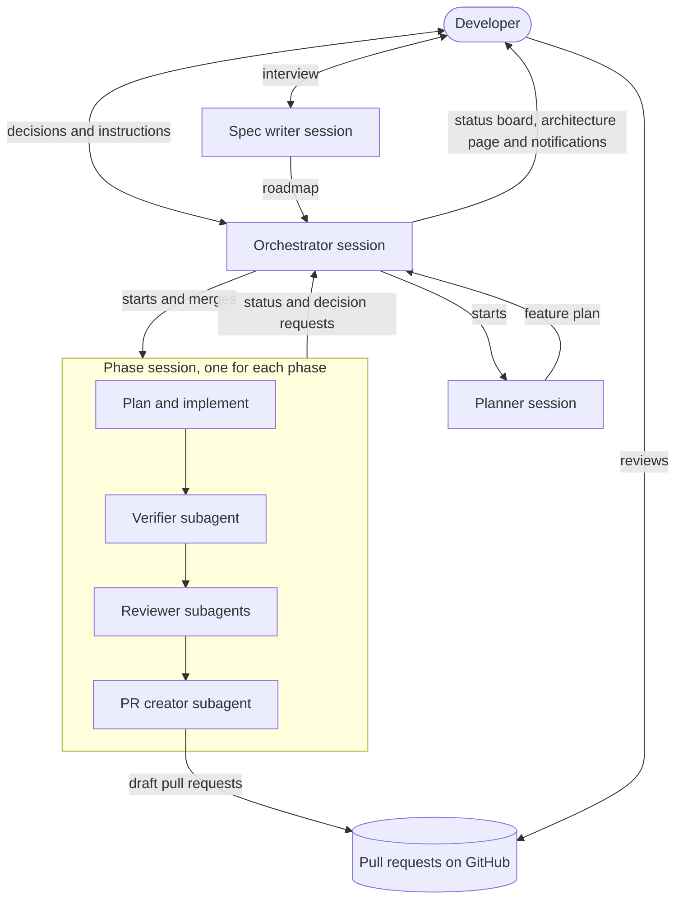

# s-stack: feature roadmap

s-stack is a Foundry package that runs one large feature as a group of cooperating Claude Code sessions. A spec writer session turns the developer's idea into a feature roadmap. An orchestrator session then starts a planner and one session for each phase of the work. Each session gets its own git worktree and its own pane in the current tmux window. Each phase opens draft pull requests as soon as agents have verified and reviewed it, so the developer reviews code while later phases are still being built.

s-stack is built on top of p-stack and replaces none of it. It defines the roles, the artefacts that the roles share, and the handoffs between them. How a session does its own work stays with p-stack's `poteto-mode`.

Read this file first. [Where to read next](#where-to-read-next) lists the files that hold the detail.

## The problems this solves

On 18 and 19 November 2026 the developer ran this workflow by hand for a large feature in a private repository. One orchestrator session coordinated about 26 other sessions. The developer wants the same pattern for every large feature. The transcripts of that run show what worked and what failed. [evidence.md](evidence.md) holds the quotes and their sources.

| Problem | What happened in the November run |
| --- | --- |
| The workflow exists only in transcripts | The orchestrator worked out the launch command, the brief template and the reporting protocol during the run. The next feature would work them out again. |
| The orchestrator forgot its upkeep | The developer asked four times for the status pages to be updated, and designed the loop prompt themselves partway through. |
| A restart broke addressing | The orchestrator's session name ended in `-b3` before the restart and in `-5b` after it. Reports sent to the old name were lost. |
| The developer could not review early | No phase session opened a pull request. One pull request carried the whole feature, so review waited for every phase. |
| Agent review was optional | The briefs did not require a review. Three phase sessions are known to have run one. |
| Phases shared files | A numbered decisions list, a status table and one verification script had many writers. The orchestrator allocated decision numbers by hand, and one phase sent 36 messages, most of them to agree edit order and turns on shared resources. |
| Permission prompts waited unseen | Phase sessions stopped on prompts in windows the developer was not watching. |
| The orchestrator filled its context | It reached 80% of a 1M-token window and was compacted. |

## What s-stack does

1. The developer starts a feature with `/sam-mode start <feature>`. A spec writer session opens, interviews the developer with the `deep-interview` skill and writes a feature roadmap.
2. The developer approves the roadmap. The spec writer starts the orchestrator.
3. The orchestrator starts a planner session. The planner writes the feature plan, which splits the work into phases and records what each phase depends on.
4. The orchestrator starts a phase session for each phase whose dependencies are met. The session works on a branch cut from the orchestrator branch.
5. The phase session plans its phase and implements it. Fresh subagents then verify the behaviour and review the diff. Neither gate can be skipped.
6. A PR creator subagent splits the phase into draft pull requests that target the repository's default branch.
7. The orchestrator merges the phase branch into the orchestrator branch. Phases that depend on it can now start.
8. The developer reviews the draft pull requests. Fixes go back through the phase session.

Throughout the run the orchestrator keeps two pages current. The status board says how the work is going and what needs the developer. The architecture page explains what is being built. The orchestrator also relays decisions between the developer and the sessions.

## What must be true when it works

The developer named the first four requirements in the interview. The last two follow from the problems above. Each has a check that the first real feature run can observe.

| Requirement | Check on the first real feature |
| --- | --- |
| No upkeep reminders | The developer never asks the orchestrator to update the status board, the architecture page or the roadmap. |
| Early first pull request | The first phase's draft pull requests are open while at least one other phase is still in Implement. |
| Two contact points | The developer types only into the spec writer and orchestrator panes. The exceptions are a permission prompt and a phase session that the developer chooses to visit. |
| Survives restarts | Kill the orchestrator pane and one phase pane mid-run, then start both again with the launcher. Each returns under the same session name. The status board shows the same phase states as the status files, and no report is lost. |
| No skipped gate | Every phase merged into the orchestrator branch has a verifier verdict and a reviewer verdict for the merged code head. |
| The developer reviews what agents verified | For every phase, the pull requests together contain exactly the verified phase diff. |

## Scope

s-stack includes these parts:

- A Foundry package named `s-stack`, installed by `default-stack`.
- One skill, `sam-mode`, with a handbook for each role.
- One launcher script that starts a session in its worktree and pane under a stable name.
- One status board template.
- An architecture page for each feature, which the orchestrator keeps current.

s-stack leaves these out:

- Small patches and minor bug fixes. One session with `poteto-mode` handles those.
- Hosts other than Claude Code. The workflow needs cross-session messaging, workmux and tmux.
- Claude Code agent teams.
- A command-line tool that enforces state transitions.
- A fixed limit on the number of live phase sessions.
- Merging pull requests into the default branch, and marking a draft ready for review. The developer does both.
- Any change to p-stack's own files.

## Decisions in brief

[decisions.md](decisions.md) gives the reason for each decision and the alternatives that lost.

| Id | Decision |
| --- | --- |
| D1 | Four kinds of main session: spec writer, orchestrator, planner and phase session. The verifier, the reviewer and the PR creator are fresh subagents of the phase session. |
| D2 | Sessions are independent Claude Code sessions that talk through cross-session messaging. Agent teams are not used. |
| D3 | Phase branches are cut from the orchestrator branch. Pull requests are split out after the gates and target the default branch. |
| D4 | Each pull request records the open pull requests it depends on. It joins a `gh stack` only when it has exactly one. |
| D5 | The plan has two levels. The planner writes the feature plan, and each phase session writes its own phase plan. |
| D6 | Files are the record and messages are wake-ups. Every file has one writer. |
| D7 | The launcher gives every session a fixed name, so a restart keeps the address. |
| D8 | s-stack ships prose, one launcher and one status board template. |
| D9 | The orchestrator merges a phase only when both verdicts cover its code head, then checks the merged branch. |
| D10 | The orchestrator notifies the developer of a waiting permission prompt. Nothing is approved in advance. |
| D11 | A 20-minute tick drives the orchestrator's upkeep. Its prompt never changes. |
| D12 | The status board is published once and updated through its database. |
| D13 | Git tracks `.foundry/` on the orchestrator branch and the branches cut from it. No pull request branch contains it. |
| D14 | Every session starts with `/sam-mode <role>`, and `sam-mode` reads `poteto-mode`. |
| D15 | The package is `s-stack`, the skill is `sam-mode`, and `default-stack` depends on the package. |
| D16 | Verification runs before review. |
| D17 | No fixed limit on live phase sessions. Dependencies and exclusive resources bound parallel work. |
| D18 | Review feedback reaches a phase through the orchestrator, from the developer or from the pull request. |
| D19 | The orchestrator keeps an architecture page current. |

## Where to read next

| To learn | Read |
| --- | --- |
| The shared artefacts, the states, the branches and the pull request rules | [workflow.md](workflow.md) |
| What each role receives, does and may write | [roles.md](roles.md) |
| The launcher, session names, messages, status files, the tick, the two pages, permissions and restarts | [coordination.md](coordination.md) |
| How s-stack ships in Foundry and what limits apply there | [package.md](package.md) |
| Why each decision was made | [decisions.md](decisions.md) |
| The quotes, documentation and experiments behind the decisions | [evidence.md](evidence.md) |

## What the developer settled on review

The developer read the first two versions of this roadmap on 20 November 2026 and settled these points. [decisions.md](decisions.md) records each one.

| Point | Outcome |
| --- | --- |
| The pull request model and its second copy of each change | Kept, with the safeguards (D3) |
| The names `s-stack` and `sam-mode` | Confirmed (D15) |
| Where `.foundry/` lives | Tracked on the orchestrator branch. The developer first asked for git to ignore it, then withdrew that (D13) |
| The status board template | Accepted (D8) |
| Fix rounds that start from pull request comments | Accepted (D18) |
| A default limit of five live phase sessions | Removed (D17) |
| The architecture page | Added (D19) |

## What is still open

1. **All the evidence comes from one feature run.** The first s-stack run is the second data point. Expect to revise the handbooks after it.
2. **Five questions need an experiment before the plan depends on them.** [package.md](package.md#experiments-for-the-planner) lists them.
3. **Foundry is a public repository.** The names of the private repository, its feature and its pages were removed from this roadmap before it was first pushed. Keep them out of later versions, and out of every plan and status file.
