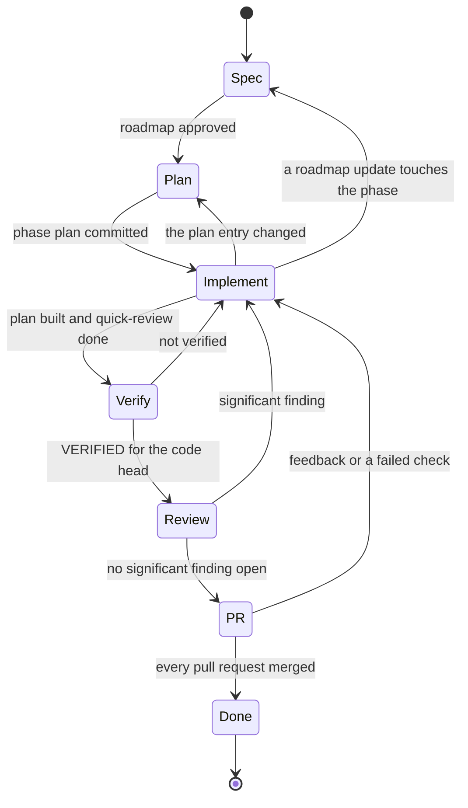
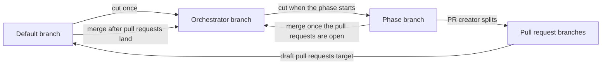

# Workflow

This file defines the artefacts that sessions share, the states that every phase passes through, the branches, and the rules for pull requests. [roles.md](roles.md) says who does each part. [coordination.md](coordination.md) says how sessions start and talk to each other.

Three placeholders recur. `<feature>` is the feature's short kebab-case name. `<id>` is the roadmap's directory name, `<date-time>-<feature>`. `<phase>` is a phase's identifier from the feature plan.

## Shared artefacts

| Artefact | Path | Writer | Readers |
| --- | --- | --- | --- |
| Feature roadmap | `.foundry/feature-roadmaps/<id>/` | Spec writer. The orchestrator writes one file in it, `run-decisions.md`. | Every main session, the verifier and the PR creator |
| Feature plan | `.foundry/plans/<id>/README.md` | Planner | Orchestrator, phase sessions, the verifier and the PR creator |
| Phase plan | `.foundry/plans/<id>/phases/<phase>.md` | That phase's session | That phase's session, its delegates, the verifier and the PR creator |
| Status file | `.foundry/plans/<id>/status/<phase>.md` | That phase's session | Orchestrator |
| Tracker | `.foundry/plans/<id>/status/orchestrator.md` | Orchestrator | Orchestrator |
| Status board | A published page. The tracker holds its address. | Orchestrator | Developer |
| Architecture page | A published page. The tracker holds its address. | Orchestrator | Developer, and anyone the developer shares it with |

**Where the files live.** Git tracks `.foundry/` on the orchestrator branch and on every branch cut from it. A pull request branch never contains it, so the roadmap and the plans never reach the default branch. A repository that uses s-stack must not ignore `.foundry/`.

**Feature roadmap.** It describes the problems, the intended behaviour, the significant architectural decisions and the key constraints. It leaves out implementation detail and the order of implementation. One roadmap covers tightly coupled features of one topic. Its `README.md` is the entry point and routes to the other files, so a reader loads only the part they need. The `<date-time>` in `<id>` comes from `date '+%Y-%m-%d_%H-%M-%S'`.

**Decisions made during the run.** The orchestrator records them in `run-decisions.md`, inside the roadmap directory. A reader takes the roadmap and that file together. A later roadmap update folds them into the main text.

**Roadmap updates.** A spec writer makes an update on its own branch, cut from the orchestrator branch. The roadmap on the orchestrator branch does not change until the developer approves the update and the orchestrator merges that branch.

**Feature plan.** It lists the phases. For each phase it records the scope, the phases it depends on, the paths it owns, the resources that only one phase can use at a time, and the evidence that proves the phase done. It also records the contracts between phases. One Claude Code session can implement one phase. The planner shapes the phases so that as many as possible can run at the same time.

**Phase plan.** It holds the implementation detail for one phase, including the intended split into pull requests. The phase session writes it when the phase starts, against the code as it stands then.

**Status file.** It is the record of one phase's state. [coordination.md](coordination.md#status-files) lists what it holds.

Four rules apply to all of them:

- Every file under `.foundry/` has one writer, so a merge never has two sides of one file to reconcile.
- A commit never mixes files under `.foundry/` with other files. The PR creator can then move whole commits.
- Both plans follow the plan handoff standard, which Foundry's `planning` package applies to every Markdown file under `.foundry/plans/`.
- The reviewers never see a plan or the roadmap. They get the diff only.

## States

A phase is the unit that moves through the states. Before the feature plan exists, the whole feature is in Spec and then in Plan.

| State | What happens | Who does it | The phase leaves when |
| --- | --- | --- | --- |
| Spec | The roadmap is written or changed. | Spec writer | The developer approves the roadmap. For an update, the orchestrator has also merged it. |
| Plan | The planner writes the phase's entry in the feature plan. The phase session then writes the phase plan. | Planner, then the phase session | The phase plan is committed. |
| Implement | The phase session builds the phase plan. | Phase session and its delegates | The plan is built and committed. Each planned pull request layer has had a `quick-review` pass, and its findings are fixed. |
| Verify | A fresh verifier runs the code and checks its behaviour against the roadmap and the plan. | Verifier subagent | The verdict is VERIFIED for the code head. |
| Review | Fresh reviewers examine the diff with `interrogate`. | Reviewer subagents | No significant finding is open for the code head. |
| PR | The PR creator opens draft pull requests. The orchestrator merges the phase branch. The developer reviews. | PR creator subagent, orchestrator and developer | Every pull request of the phase is merged into the default branch. |
| Done | The orchestrator removes the phase's worktree. | Orchestrator | |

The diagram shows the common moves back. These rules hold for every move:

1. A phase moves forward one state at a time. No state is skipped.
2. A phase can move back any number of states.
3. Phases move independently, so different phases are in different states at the same time.
4. Only the phase session changes its phase's state, by committing its status file. A phase without a session is in Plan and has no status file.
5. A verdict names the code head that it covers. The code head is the latest commit on the phase branch that changes a file outside `.foundry/`, so a commit that only records status cancels no verdict. A new code head needs new verdicts. After a fix, verification runs again in full, and the review covers the commits added since the last reviewed code head.
6. The orchestrator merges a phase only when the status file holds both verdicts for the code head.

| Cause | The phase moves back to |
| --- | --- |
| The verifier returns NOT VERIFIED or INCONCLUSIVE | Implement |
| The review finds a significant issue | Implement |
| The developer's review asks for a change, a check fails on a pull request, or the merged orchestrator branch fails its check | Implement |
| The planner changes the phase's entry in the feature plan | Plan |
| A roadmap update changes behaviour that the phase implements | Spec |

A phase session that moves back to Spec or Plan commits what it has and stops the work that the change could invalidate.

## Branches

| Branch | Name | Cut from | Holds |
| --- | --- | --- | --- |
| Default branch | Resolved from the repository | | The code that pull requests target |
| Orchestrator branch | `<feature>` | The default branch, when the feature starts | `.foundry/` and every phase that has reached PR |
| Phase branch | `<feature>-phase-<phase>` | The orchestrator branch, when the phase starts | The phase's work, on top of every phase merged so far |
| Pull request branch | The repository's naming convention | The default branch, or the branch of a pull request it depends on | One pull request's part of the phase, without `.foundry/` |

No session assumes that the default branch is `main`. Each session resolves it, for example with `gh repo view --json defaultBranchRef --jq .defaultBranchRef.name`.

One phase goes through these steps:

1. The orchestrator starts the phase. Every phase it depends on is already merged into the orchestrator branch, so the new phase branch contains their code.
2. The phase session works through Plan and Implement on the phase branch.
3. Before Verify, the phase session merges the current orchestrator branch into the phase branch. Verification then covers the phase together with every phase merged so far.
4. The phase passes Verify and Review.
5. The PR creator splits the phase diff into draft pull requests. The phase diff is `git diff <orchestrator branch>...<phase branch>`, without `.foundry/`.
6. The orchestrator merges the phase branch into the orchestrator branch. A fresh subagent then runs the feature's verification skill on the orchestrator branch.
7. Phases that depend on this phase can start.
8. The developer reviews the pull requests. When every one is merged into the default branch, the phase is Done, and the orchestrator merges the default branch into the orchestrator branch.

Four rules protect the orchestrator branch:

- The orchestrator makes only merges that apply cleanly. It never resolves a conflict in code. On a conflict it stops the merge and asks the phase session to merge the orchestrator branch into the phase branch, pass both gates again, and report.
- When the check in step 6 fails, the phases merged in that tick move back to Implement, and the phases that depend on them wait.
- A conflict between the default branch and the orchestrator branch goes to the phase session that owns the conflicting paths.
- The orchestrator branch is never the head of a pull request. In a private repository the orchestrator pushes it as a backup. A push shows everything under `.foundry/` to everyone who can read the repository, so in a public repository the orchestrator pushes it only when the developer says so.

## Pull requests

**Size and scope.** A pull request follows the repository's own rules for scope and size. Foundry's `coding-style` package states them in section 11 of its software engineering rules: one atomic change, and at most 2,500 changed lines.

**The split is planned first.** The phase plan names the intended pull requests before any code exists. The implementer commits along that split, so the PR creator moves whole commits. The PR creator still owns the final split and changes it when the diff demands.

**Dependencies are recorded for each pull request.** The PR creator works out exactly which open pull requests each new pull request needs. A phase's pull requests can depend on different parents. The status file records the list, and the status board shows it.

**The base follows from the dependencies.**

| The pull request's open dependencies | Base and form |
| --- | --- |
| None | It targets the default branch. |
| One, and no other pull request is stacked on that one | It joins that pull request's stack with `gh stack`. Its diff shows only its own change. |
| Two or more, or one that already has another pull request stacked on it | It targets the default branch. Its branch contains the commits of the pull requests it depends on. Its description lists each of them and says that the diff includes their changes until they merge. |

The last row exists because a `gh stack` is one linear chain. A pull request has one parent and at most one child, and it belongs to one stack.

**A pull request holds what agents verified.** Three checks apply before the PR creator reports:

- The pull requests of a phase together contain exactly the phase diff. The PR creator proves it by comparing the two.
- Each pull request passes the repository's checks on its own, in stack order.
- When a pull request fails because it needs code that it does not declare, the PR creator adds the dependency. It does not change code.

**Every pull request is a draft.** s-stack never marks a pull request ready for review and never merges one into the default branch.

**Descriptions.** The PR creator writes each description with the `summarise-pr` skill. It adds measured detail, such as timings or cost savings, where the phase produced it.

**One writer.** A pull request's branch and description have one writer, the phase session, through its PR creator. Before any update, the PR creator fetches the pull request's current head and description and keeps every change that it did not make. It follows the repository's own stacking skill where one exists. It never force-pushes a pull request branch unless the developer says so.

**Restacking is offered, not automatic.** A merge can leave a pull request with a single open dependency that it can stack on, or with none. The orchestrator shows the opportunity on the status board. When the developer asks for it, the orchestrator passes the request to the phase session, and a PR creator subagent makes the change.

**Fix rounds.** Feedback reaches the phase session through the orchestrator. The developer tells the orchestrator, or the orchestrator's tick finds new review comments or a failed check on the phase's pull requests. The phase session then does four things:

1. It moves back to Implement and makes the fix on the phase branch.
2. It passes Verify and Review again for the new code head.
3. Its PR creator carries the fix commits to the pull request branch that owns them and repeats the three checks.
4. It reports, and the orchestrator merges the phase branch again.

The orchestrator then tells every live phase session that builds on the changed code to merge the orchestrator branch, and marks their pull requests on the status board as needing an update.

## One-way and two-way doors

A two-way door is a decision that is easy to reverse. A one-way door is hard to reverse once committed to. One-way doors include a migration that loses data, a significant architectural choice, and anything that customers notice, such as an outage during an upgrade or a new user interface pattern.

- The developer decides every one-way door. A session that finds one sends a decision request to the orchestrator, and the orchestrator asks the developer.
- A session decides a two-way door itself, records the decision and continues. It raises the decision to the developer when the choice is architectural, nuanced or not obvious.
- A decision request states the question, the options, the session's recommendation, the door type and the work that waits on the answer.
- While a request is open, the session continues the work that the decision does not affect.
- The spec writer does not decide a two-way door itself when the specification is ambiguous. It asks the developer about every one-way door and about every ambiguity, so some of its questions are about two-way doors. It records each answer in the roadmap's `decisions.md` with its door type.
- The roadmap's two decision files hold the decisions that affect the whole feature. A phase's status file holds the decisions that affect only that phase. No list is shared between writers, so no one allocates decision numbers.
