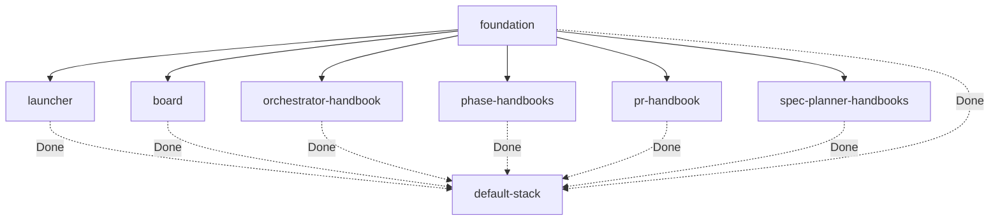

# s-stack feature plan

This plan splits the build of the s-stack package into eight phases. One Claude Code session implements one phase. After the first phase, six phases run at the same time. The last phase wires the package into `default-stack` once every other phase has landed on `main`.

The specification is the feature roadmap at `.foundry/feature-roadmaps/2026-11-20_21-37-12-s-stack/`. Read its `README.md` first, and take `run-decisions.md` on the orchestrator branch `s-stack-package` with it. This plan adds the phase split, the contracts between phases, the header of the status file, and the results of the five planner experiments. It does not restate the roadmap. Where the two disagree, the roadmap wins, and the session that finds the disagreement tells the orchestrator.

## Who reads what

| Reader | Reads |
| --- | --- |
| Orchestrator | [Phases at a glance](#phases-at-a-glance), [Starting and merging phases](#starting-and-merging-phases) and [Status file header](#c2-status-file-header) |
| A phase session | [Rules for every phase](#rules-for-every-phase), [Contracts between phases](#contracts-between-phases) and its own entry under [Phases](#phases) |
| Verifier | The phase's entry, its **Done when** list, and [Verification](#verification) |
| PR creator | The phase's **Pull requests** line, [Generated files and versions](#c7-generated-files-and-versions) and [Pull request rules for this run](#pull-request-rules-for-this-run) |
| Anyone asking why | [Experiments](#experiments), [Decisions taken by the planner](#decisions-taken-by-the-planner), [Rejected alternatives](#rejected-alternatives) and [Risks](#risks) |

## The problem and the outcome

The developer ran a large feature by hand in November as about 26 cooperating Claude Code sessions. The roadmap's problem table lists what went wrong. s-stack turns that workflow into a Foundry package, so the next large feature starts with `/sam-mode start <feature>` instead of a hand-built protocol.

When this plan is complete, these things are true:

- `packages/s-stack` exists. It ships one skill, `sam-mode`, with a router `SKILL.md`, seven role handbooks, one reference file, one launcher script and one status board template.
- A developer types `/sam-mode start <feature>` in a Claude Code session in a repository that installs s-stack. The launcher opens the feature window and starts the spec writer there under the name `<feature>-spec`.
- Every later session starts through the launcher under a fixed name, in a new pane of that window, with `/sam-mode <role>` as the first words of its first prompt.
- `default-stack` installs s-stack. The root development manifest reaches it.
- The Tier 1 suite, the primitive validator and the launcher's tests pass, and the launcher's tests run in CI in their own job.

The package's own acceptance needs one real feature run of at least three phases, and a revision of the handbooks from that run (roadmap `package.md`, "When the package is done"). That run comes after this plan and is not a phase of it.

## Rules for every phase

These rules come from the roadmap, `AGENTS.md`, the developer's run decisions, and this plan. They hold in every phase.

1. **Change only your owned paths.** Each phase entry lists them. Anything else is read-only. The generated files in [C7](#c7-generated-files-and-versions), and the `version:` line of `packages/s-stack/apm.yml` that `scripts/versioning.py bump` writes, are the exceptions. They are regenerated, never edited by hand.
2. **Never edit a file under `packages/p-stack`.** It is an upstream port (roadmap `package.md`, maintenance rule 1).
3. **Never push, tag, or mark a pull request ready.** Foundry is public, and the orchestrator branch carries `.foundry/`. Only the PR creator pushes pull request branches, and every pull request is a draft.
4. **Keep private names out.** No file, commit, status file or pull request names a private repository, its feature or its pages. Placeholder data only on any test page.
5. **Do not add an ignore entry for `.foundry`.**
6. **Write in British English.** Prose passes `markdownlint-cli2` with the repository's `.markdownlint.json` and `.markdownlint-cli2.jsonc`.
7. **Bound every `apm` call** and use the pinned CLI 0.32.0, as `AGENTS.md` requires. A fresh worktree has no `.venv-apm/`. Create it with `uv venv .venv-apm && uv pip install --python .venv-apm/bin/python apm-cli==0.32.0`. That also installs PyYAML, which `tests/structural/validate_primitives.py` needs and the system `python3` lacks. Run Tier 1 as `PATH="$PWD/.venv-apm/bin:$PATH" APM="$PWD/.venv-apm/bin/apm" bash tests/structural/run-tier1.sh`, outside the sandbox.
8. **Name other packages' skills in words.** A handbook writes "p-stack's `interrogate` skill", never a relative link into another package. A path inside `sam-mode` that may not exist yet goes in a code span, not a link, because the validator resolves every relative link.
9. **Point, do not restate.** A handbook states only what s-stack adds and points to the skill or playbook that owns a rule (roadmap `package.md`, maintenance rules 2 to 4). Each fact has one home, given in [C1](#c1-package-layout).
10. **Budgets.** `SKILL.md` at most 150 lines. Each handbook at most 200 lines.
11. **One-way doors go to the orchestrator.** Send a decision request as roadmap `workflow.md` defines it, and continue with work the decision does not affect.
12. **Every session of this run uses the same permission mode.** The developer's mode is `auto`. See [Experiment 3](#experiment-3-page-writes-and-permission-prompts).

## Phases at a glance

| Phase | Builds | Depends on | Exclusive resource | Planned pull requests |
| --- | --- | --- | --- | --- |
| `foundation` | Package scaffold, `SKILL.md`, the reference file, root wiring, the feature's verification skill | None | None | Two |
| `launcher` | `scripts/launch.sh`, its tests, the CI job | `foundation` | None | One |
| `board` | `assets/status-board.html` | `foundation` | None | One |
| `orchestrator-handbook` | `handbooks/orchestrator.md` | `foundation` | None | One |
| `phase-handbooks` | `handbooks/phase-session.md`, `verifier.md`, `reviewer.md` | `foundation` | None | One or two |
| `pr-handbook` | `handbooks/pr-creator.md` | `foundation` | None | One |
| `spec-planner-handbooks` | `handbooks/spec-writer.md`, `planner.md` | `foundation` | None | One |
| `default-stack` | `default-stack` depends on s-stack, with the docs that describe the graph | Every other phase in **Done** | None | One |

No phase needs an exclusive resource. The two shared resources are not exclusive.

- **The APM lifecycle lock**, `~/.apm/.apm-lifecycle.lock`, serialises `apm` calls across sessions. It was measured that a second `apm install` waits for the first and then succeeds. One install takes under 10 seconds, against a 120-second limit. Parallel phases slow each other's Tier 1 runs and do not fail them.
- **The developer's tmux server.** Launcher tests and live probes never touch it. They run on a private server under a temporary `TMUX_TMPDIR`, with stub `workmux` and `claude` commands unless the step says otherwise.



Solid arrows mean "merged into the orchestrator branch". Dotted arrows mean "every pull request of that phase merged into `main`".

## Starting and merging phases

1. Start `foundation` now.
2. When `foundation` is merged into `s-stack-package` and the merged branch passes the verification skill, start the six middle phases together.
3. Merge each middle phase under the roadmap's rules. A middle phase can conflict with another only in `packages/s-stack/apm.lock.yaml`, as [C7](#c7-generated-files-and-versions) explains. On that conflict, stop the merge and ask the phase session to merge `s-stack-package`, regenerate the lockfile, pass both gates again, and report.
4. Start `default-stack` only when every other phase is **Done**, meaning all of its pull requests are merged into `main`. This start condition is stricter than the roadmap's usual one, and the reason is in [Decisions taken by the planner](#decisions-taken-by-the-planner).
5. The run has no exclusive resources, so the dependencies alone bound parallel work.

Session names follow roadmap `coordination.md` with the feature `s-stack`. A phase session is `s-stack-phase-<phase>`, on a branch of the same name cut from `s-stack-package`. The orchestrator branch is `s-stack-package`, not `s-stack` as roadmap `workflow.md` would name it, because this run began before the launcher existed. The orchestrator owns recording that in `run-decisions.md`. Until the launcher exists, the orchestrator starts sessions by hand, as its run decision says.

## Contracts between phases

A phase builds against these contracts, so it never waits for a neighbour that is still running. A phase that needs to change a contract sends a decision request to the orchestrator. It does not change the contract locally.

### C1. Package layout

```text
packages/s-stack/
├── apm.yml
├── README.md
├── .gitignore                                 # byte-identical to the siblings' 33-byte file
├── apm.lock.yaml                              # generated, see C7
├── tests/                                     # launcher tests, not deployed
│   └── test_launch.py
└── .apm/skills/sam-mode/
    ├── SKILL.md
    ├── references/status-and-messages.md      # status header and messages
    ├── scripts/launch.sh                      # mode 100755
    ├── assets/status-board.html               # template, owns the board's data schema
    └── handbooks/
        ├── spec-writer.md
        ├── orchestrator.md
        ├── planner.md
        ├── phase-session.md
        ├── verifier.md
        ├── reviewer.md
        └── pr-creator.md
```

Each fact has one home.

| Fact | Home |
| --- | --- |
| When to use s-stack, the rules every session follows, the role-to-handbook map, `/sam-mode start` | `SKILL.md` |
| The status file header and the messages | `references/status-and-messages.md` |
| The workmux, tmux and `claude` command lines | `scripts/launch.sh` |
| The board's collections and fields | The comment at the top of `assets/status-board.html` |
| The tick checklist, the push notification, the two pages, merge rules | `handbooks/orchestrator.md` |
| The pull request split, `gh stack` commands, the equality proof | `handbooks/pr-creator.md` |
| What the verifier runs and returns | `handbooks/verifier.md` |
| The reviewers' brief | `handbooks/reviewer.md` |

`SKILL.md` routes each role to its handbook with this table. Main sessions take the role from their first prompt. Subagent roles have no launcher role, and the phase session points its subagents to their handbooks.

| First-prompt role | Handbook |
| --- | --- |
| `spec` | `handbooks/spec-writer.md` |
| `orchestrator` | `handbooks/orchestrator.md` |
| `planner` | `handbooks/planner.md` |
| `phase` | `handbooks/phase-session.md` |
| None, verifier subagent | `handbooks/verifier.md` |
| None, reviewer subagents | `handbooks/reviewer.md` |
| None, PR creator subagent | `handbooks/pr-creator.md` |

`SKILL.md` writes each path as text in a code span, in the way `poteto-mode` routes to `playbooks/<title>.md`. The validator therefore passes while handbooks are still being written. The verification skill checks the routes instead (see [C6](#c6-verification-skill-and-check-files)).

The `SKILL.md` frontmatter is `name: sam-mode` plus a `description` that says the skill runs a large feature as cooperating Claude Code sessions, needs Claude Code with cross-session messaging, tmux and workmux, and is not for small patches. The package's `apm.yml` follows `packages/pr/apm.yml`, with version `"0.1.0"` and these dependencies:

```yaml
dependencies:
  apm:
    - path: ../p-stack
    - path: ../deep-interview
    - path: ../review
    - path: ../pr
    - path: ../planning
    - path: ../coding-style
```

[Experiment 1](#experiment-1-manifests-and-tier-1) proved this shape.

### C2. Status file header

Every phase session of this run writes its status file at `.foundry/plans/2026-11-20_21-37-12-s-stack/status/<phase>.md`, in this form, from its first commit. The `foundation` phase copies this definition into `references/status-and-messages.md` unchanged, and from then on that file owns it.

The header is the YAML between the file's first two `---` lines. Notes go below it in Markdown. A program reads the header and ignores the notes. Every key is always present. An empty list is `[]`, and an absent value is `null`.

```yaml
---
phase: launcher                     # the phase id from the feature plan
state: Implement                    # Spec | Plan | Implement | Verify | Review | PR | Done
changed_at: 2026-11-21T14:05:00Z    # UTC, the time of the last state change
session: s-stack-phase-launcher     # the session name
branch: s-stack-phase-launcher      # the phase branch
code_head: 3f2c1e0a9b...            # full SHA, see below
waits_for: null                     # one line of text while the phase waits, else null
verdicts:
  - gate: verify                    # verify | review
    result: VERIFIED                # verify: VERIFIED | NOT VERIFIED | INCONCLUSIVE
                                    # review: CLEAR | SIGNIFICANT
    code_head: 3f2c1e0a9b...        # the code head the verdict covers
    at: 2026-11-21T15:40:00Z
    evidence: .foundry/plans/2026-11-20_21-37-12-s-stack/status/launcher-evidence.md
pull_requests:
  - number: 81
    branch: s-stack-launcher
    base: main                      # the branch the pull request targets
    depends_on: [79]                # open pull requests this one needs, as numbers
    stacked: true                   # true when it joined its parent's gh stack
requests:                           # open decision requests, removed once answered
  - id: launcher-r1
    question: One sentence.
    options: [A, B]
    recommendation: A
    door: two-way                   # one-way | two-way
    waiting_work: One sentence.
    since: 2026-11-21T14:10:00Z
decisions:                          # decisions taken for this phase only
  - id: launcher-d1
    decision: One sentence.
    door: two-way
    at: 2026-11-21T14:30:00Z
---
```

The rules:

- **Code head.** It is `git log -1 --format=%H <phase branch> -- . ':(exclude).foundry'`, the latest commit that changes a file outside `.foundry/`. A commit that only records status leaves it unchanged.
- **Verdicts.** The list keeps every verdict, newest last. The orchestrator merges only when the newest `verify` verdict is `VERIFIED` and the newest `review` verdict is `CLEAR`, and both name the current code head.
- **Ids.** A request or decision id is `<phase>-r<n>` or `<phase>-d<n>`, numbered by the phase itself. No list is shared between writers.
- **Evidence.** Evidence that is not a URL lives in a file the phase owns under `.foundry/plans/2026-11-20_21-37-12-s-stack/status/`, named `<phase>-evidence.md`.
- **Commits.** A status commit holds files under `.foundry/` and nothing else. Its subject is `chore(s-stack): <phase> <state>`.

The orchestrator's tracker at `status/orchestrator.md` keeps its own form. It is not a status file.

### C3. Messages

`foundation` writes the message tables from roadmap `coordination.md` into `references/status-and-messages.md`. Until it exists, phases use this form. The first line is self-contained, because the receiver sees only that line as a preview.

```text
<sender session name>: <kind>: <one sentence>
<detail lines, each a fact already committed to the sender's own file>
```

Messages to the orchestrator use these kinds, matching the rows of roadmap `coordination.md`'s first message table in order. They are `started`, `state`, `decision-request`, `blocked`, `prs-open`, `instruction`, `done-planning` and `roadmap-update`. A `state` message carries the new state and the code head. A `prs-open` message carries each number with its `depends_on` list.

Messages from the orchestrator use these kinds, matching the rows of its own table in order. They are `answer`, `instruction`, `merge-orchestrator-branch`, `fix-round`, `restack`, `move-back` and `stop`. An `answer` names the request id it answers. A `move-back` names the state to move back to and what changed.

### C4. Launcher command line

The handbooks and `SKILL.md` call the launcher only through this interface. The `launcher` phase implements it, and no other phase names a workmux, tmux or `claude` command.

```text
launch.sh --feature <feature> --role <role> [--phase <phase>] [--update <n>] [--window <window id>] [--fresh]
```

| Input | Meaning |
| --- | --- |
| `--feature` | The feature's kebab-case name. Required. |
| `--role` | `spec`, `orchestrator`, `planner` or `phase`. Required. |
| `--phase` | The phase id. Required with `--role phase`, refused otherwise. |
| `--update` | A roadmap update number. With `--role spec` it starts the update spec writer `<feature>-spec-<n>`. |
| `--window` | The tmux window id, for example `@47`. Required for every session except the first spec writer, whose window `workmux add` opens. |
| `--fresh` | Start a new conversation instead of resuming with `claude --continue`. |

Session names, worktrees and branches are those in roadmap `coordination.md`, "Session names". The feature worktree is cut from the default branch, which the launcher resolves and never assumes to be `main`. Every other worktree is cut from the orchestrator branch `<feature>`.

The first prompt is this single line, with `-` for an empty value. `update` carries the `--update` number, so an update spec writer knows it edits an existing roadmap.

```text
/sam-mode <role> feature=<feature> phase=<phase> update=<n> roadmap=<path> plan=<path> orchestrator=<feature>-orchestrator
```

`roadmap` is the path of the one directory matching `.foundry/feature-roadmaps/*-<feature>/` in the worktree, or `-` when none exists. `plan` is `.foundry/plans/<that directory's name>/README.md`, or `-`. The launcher fails when more than one directory matches.

| Outcome | Exit | Standard output |
| --- | --- | --- |
| Started a session | 0 | `started <name> pane=<pane id> worktree=<path>` |
| A session of that name is alive | 0 | `alive <name> pane=<pane id>`, and nothing changed |
| Bad arguments | 2 | Usage on standard error |
| `tmux`, `workmux` or `claude` is missing | 3 | The missing command, on standard error |
| tmux could not split a pane | 4 | tmux's own error, on standard error |
| Anything else | 1 | The failing command and its error, on standard error |

The guarantees in roadmap `coordination.md`, "The launcher", are the launcher's acceptance tests. One case needs care. After `workmux resurrect`, the orchestrator runs in a pane that the launcher did not create. A launch of the orchestrator must still report `alive` and must not start a second session.

### C5. Status board data

The `board` phase builds the template to this schema and writes it as a comment at the top of `assets/status-board.html`. The orchestrator handbook points to that comment and does not copy it. The board is a plain page with the `db` capability (decision D12), not the Data type (see [Experiment 4](#experiment-4-the-data-page-type)).

| Collection, document | Fields |
| --- | --- |
| `board`, `meta` | `feature`, `orchestrator_branch`, `default_branch`, `architecture_url`, `tick_at` (UTC), `stale_after_min` (40) |
| `board`, `recent` | `items`, a list of at most 20 `{at, phase, from, to}` entries, newest first |
| `phases`, one per phase id | `phase`, `state` (one of the seven names), `scheduling` (`queued`, `blocked`, `live` or `closed`), `waits_for`, `session_live`, `pane`, `changed_at` |
| `prs`, one per number | `number`, `url`, `title`, `phase`, `state` (`draft`, `open`, `merged` or `closed`), `checks` (`passing`, `failing`, `pending` or `none`), `base`, `depends_on` (numbers), `review_rank`, `needs_update` |
| `needs`, one per item | `kind` (`decision`, `prompt` or `restack`), `phase`, `summary`, `door` (`one-way`, `two-way` or `null`), `pane`, `since` |

The page shows the six sections of roadmap `coordination.md`, "The status board", in that order. **Ready for your review** lists draft pull requests by `review_rank`, the lowest first. A pull request whose `depends_on` holds an unmerged number comes after that number. **Heartbeat** shows `tick_at` and marks the page stale when `tick_at` is more than `stale_after_min` minutes old. The page renders every value with `textContent`, reads on a phone, and links to `architecture_url`. Only an editor writes, and every viewer reads.

The orchestrator writes changed documents with one `ArtifactData` batch per tick, at most 50 writes in a batch. `recent` is one document, because the page skill advises against one document per item of a growing log.

### C6. Verification skill and check files

The feature's verification skill is `tests/s-stack/verify-s-stack/SKILL.md`. It lives under `tests/` because Foundry ignores every `.claude/` and `.agents/` directory, so a project-local skill at the usual deploy path would not be tracked. A file under `tests/` is not deployed and changes no lockfile. Agents read it by path.

It runs these checks and reports each with its output:

1. `python3 tests/structural/validate_primitives.py` and `python3 tests/structural/check_root_manifest.py`, with the venv on `PATH`.
2. `markdownlint-cli2` on every Markdown file under `packages/s-stack/` and `tests/s-stack/`.
3. Line budgets. `SKILL.md` has at most 150 lines, and each file under `handbooks/` at most 200.
4. Routes. The check lists every `handbooks/<role>.md` that `SKILL.md` names and does not exist as pending, and does not fail. The strict form, in which a missing route fails, is a **Done when** item of the `default-stack` phase, which starts only after every handbook is on `main`.
5. No relative link from `sam-mode` into another package, and no file under `packages/p-stack` changed against `main`.
6. `python3 -m unittest discover -s packages/s-stack/tests`, once the `launcher` phase has merged.
7. The full Tier 1 suite, as in [Rules for every phase](#rules-for-every-phase) item 7.
8. The `## Rerun` section of every file `checks/<phase>.md` beside `SKILL.md`, in name order.

A phase's verifier adds that phase's behavioural checks in `tests/s-stack/verify-s-stack/checks/<phase>.md`. Only that phase writes that file. It has two sections. `## Rerun` holds checks that are cheap and repeatable and touch nothing outside the machine, such as cold reads, scratch repositories and unit tests. `## Evidence` records one-off checks with their results, such as a published test page or a real `claude` session, and is not rerun. After each merge, the orchestrator's fresh subagent runs the whole skill on `s-stack-package`, which runs only the `## Rerun` sections.

### C7. Generated files and versions

`packages/s-stack/apm.lock.yaml`, and from the last phase on `packages/default-stack/apm.lock.yaml`, are generated. No phase owns them. A phase that changes a file under `.apm/` regenerates them with `apm install --target cursor,claude,copilot` in each affected package, then `python3 scripts/relativise_lockfiles.py` on each lockfile. It commits the lockfile together with the change, because the pre-commit hook refuses a stale lockfile.

Parallel phases conflict in the lockfile. [Experiment 1](#experiment-1-manifests-and-tier-1) measured why. Every list in it is sorted by path, so two branches conflict whenever their new paths fall into the same gap between existing paths. All the handbooks, and the template, fall into one gap. The resolution is mechanical. Take either side, reinstall, relativise, commit the lockfile alone, and pass both gates again. The verifier's rerun is the full skill. The review covers only the lockfile commit, so it is cheap.

The `version:` line of `packages/s-stack/apm.yml` is also regenerated, by `python3 scripts/versioning.py bump`, and no phase owns it. s-stack is new, so it stays at version `"0.1.0"` on `s-stack-package` while `main` has no s-stack. Once one s-stack pull request has merged into `main`, every later pull request that changes s-stack needs a higher version than `main` has. `main`'s CI check fails a merge that repeats a version. Before the PR creator opens or updates a pull request, the phase session runs `python3 scripts/versioning.py bump` on the phase branch and commits the result, as `AGENTS.md` requires. The bump is then part of the phase diff, and the equality proof still holds. When two open pull requests carry the same version, the one merged second fails its check, and that failure starts an ordinary fix round.

## Phases

Each entry gives the scope, the dependencies, the owned paths, the exclusive resources, the planned pull requests and the evidence that proves the phase done. The phase session writes the detail in its phase plan, against the code as it stands when the phase starts.

### Phase `foundation`

**Scope.** Create the package and everything that every other phase builds on.

- The package files in [C1](#c1-package-layout) except the launcher, the template and the handbooks. That is `apm.yml`, `README.md`, `.gitignore`, `SKILL.md`, `references/status-and-messages.md`, and the generated `apm.lock.yaml`.
- `SKILL.md` in full. It says when to use s-stack and when one `poteto-mode` session is enough. It gives the rules for every main session from roadmap `roles.md`, and tells each session to read `poteto-mode`'s `SKILL.md` from the neighbouring skill directory, because a model cannot invoke that skill (roadmap D14). It maps each role to `handbooks/<role>.md`. It handles `/sam-mode start <feature>` by running `scripts/launch.sh --feature <feature> --role spec` and nothing else.
- `references/status-and-messages.md`, holding [C2](#c2-status-file-header) unchanged and the message tables of roadmap `coordination.md`, in the form of [C3](#c3-messages).
- `README.md` for the package, in the form of `packages/pr/README.md`. It says the skill needs Claude Code 2.1.224 or later, tmux and workmux.
- Root wiring. In the root `apm.yml`, add `./packages/s-stack` and remove `./packages/coding-style`, `./packages/planning` and `./packages/p-stack`, which s-stack now reaches.
- `tests/structural/run-tier1.sh`. Add `s-stack` to `PACK_BLOCKED`.
- Counts and lists. Run `git grep -n -i -E 'nineteen|eighteen|five packages' -- AGENTS.md README.md docs tests ':!tests/s-stack'`. Fix every hit that counts Foundry's packages or lists the pack-blocked packages. The package count goes from nineteen to twenty, the content-package count from eighteen to nineteen, the 33-byte `.gitignore` count from nineteen to twenty, and `s-stack` joins each pack-blocked list, which grows from five packages to six. On 21 November the hits were `AGENTS.md` lines 3, 4, 131 and 380, `docs/COMPATIBILITY.md` lines 77 and 98, `tests/acceptance.md` lines 21, 23, 39 and 51, and `tests/structural/run-tier1.sh` lines 4 and 40. `docs/DEPENDENCY-CONTRACTS.md` lists the pack-blocked packages by name near line 221 and needs `s-stack` too. Leave `run-tier1.sh` line 40's "nine" alone, because it counts `default-stack`'s packages, which change in the last phase.
- New rows. An `s-stack` row joins the package table in the root `README.md` and the per-package table in `docs/COMPATIBILITY.md`, and a `sam-mode` row joins the root `README.md` skills table.
- The verification skill in [C6](#c6-verification-skill-and-check-files), written with p-stack's `create-verification-skill`, with its output directed to `tests/s-stack/verify-s-stack/`. Prove it once by running it end to end on this phase's own head.

**Depends on.** None.

**Owns.** `packages/s-stack/apm.yml`, `README.md`, `.gitignore`, `.apm/skills/sam-mode/SKILL.md`, `.apm/skills/sam-mode/references/**`, the root `apm.yml`, `tests/structural/run-tier1.sh`, `AGENTS.md`, the root `README.md`, `docs/COMPATIBILITY.md`, `docs/DEPENDENCY-CONTRACTS.md`, `tests/acceptance.md`, `tests/s-stack/verify-s-stack/SKILL.md` and `tests/s-stack/verify-s-stack/checks/foundation.md`.

**Must not touch.** `packages/default-stack/**`, and every path that a later phase owns.

**Exclusive resources.** None.

**Pull requests.** Two, both targeting `main`.

1. The package and its wiring. It carries the 5,754-line generated lockfile. [Pull request rules for this run](#pull-request-rules-for-this-run) says how the size limit treats it.
2. The verification skill, depending on the first.

**Done when.**

- [ ] `validate_primitives.py` prints `primitives valid`, and `check_root_manifest.py` prints `12 listed, 19 reached` with exit 0. Today it prints `14 listed, 18 reached`.
- [ ] Tier 1 prints `all Tier 1 structural checks passed across 20 packages`.
- [ ] `apm audit --ci` in `packages/s-stack` passes on the committed, relativised lockfile without a reinstall first. The experiment measured this as passing.
- [ ] `wc -l` shows `SKILL.md` at 150 lines or fewer.
- [ ] The verification skill runs end to end on this phase's head and reports the handbooks as pending, not failed.
- [ ] `git grep` from the counts step finds no stale count or pack-blocked list.
- [ ] A fresh subagent given only `SKILL.md` and the reference file can say, for each role, which handbook path it would read and what the first prompt of a phase session looks like.

### Phase `launcher`

**Scope.** Write `scripts/launch.sh` to the interface in [C4](#c4-launcher-command-line) and the guarantees in roadmap `coordination.md`. Add its tests and a CI job.

- The script is Bash, `#!/usr/bin/env bash` with `set -euo pipefail`, executable in git (mode `100755`). [Experiment 1](#experiment-1-manifests-and-tier-1) showed that the mode survives deployment to `.claude/skills/` and `.agents/skills/`.
- It holds every workmux, tmux and `claude` command line in s-stack. It uses `workmux add` for the feature worktree, `workmux add --headless` for every other worktree, and `claude --name <session name>`, with `--continue` unless `--fresh` is passed.
- `packages/s-stack/tests/test_launch.py` uses `unittest`, like `packages/foundry-maintenance/tests`. Each test runs a real tmux server under a temporary `TMUX_TMPDIR`, puts stub `workmux` and `claude` commands first on `PATH`, works in a temporary git repository, and asserts on panes, windows, exit codes and standard output. Write one test for each guarantee and one for each outcome row in C4, plus the case after `workmux resurrect`. Use a pane the test creates outside the launcher, running a stub `claude --name <feature>-orchestrator`.
- `.github/workflows/ci.yml` gains a job `s-stack-launcher-tests` that installs tmux when it is missing, then runs `python3 -m unittest discover -s packages/s-stack/tests`. It is added to the `needs` list of the `tag` job, beside `foundry-maintenance-tests`. `AGENTS.md`'s CI section, which lists every job, is updated by the `default-stack` phase, because `foundation` and `default-stack` own `AGENTS.md`.
- One live check, recorded in `checks/launcher.md`, runs the real `claude` in a private tmux server, in a scratch clone with a `.foundry/feature-roadmaps/<date-time>-probe/` directory. It shows that the first prompt loads `sam-mode` for a role, and that a second launch reports `alive`. Kill the private server afterwards.

**Depends on.** `foundation`.

**Owns.** `packages/s-stack/.apm/skills/sam-mode/scripts/**`, `packages/s-stack/tests/**`, `.github/workflows/ci.yml` and `tests/s-stack/verify-s-stack/checks/launcher.md`.

**Exclusive resources.** None. The tests must never use the developer's tmux server or workmux state.

**Pull requests.** One, depending on each `foundation` pull request that is still open.

**Done when.**

- [ ] `python3 -m unittest discover -s packages/s-stack/tests` passes, with a test for every guarantee and every C4 outcome.
- [ ] A deliberately broken launcher fails the matching test. For example, a launcher that calls `select-layout` fails the layout test, and one that ignores a live session fails the `alive` test.
- [ ] The live check shows `/sam-mode phase` as the first words of a real session's first prompt, and `alive` on the second launch.
- [ ] `git ls-files -s` shows mode `100755` for `launch.sh`.

### Phase `board`

**Scope.** Write `assets/status-board.html`, the status board template, to [C5](#c5-status-board-data) and roadmap `coordination.md`, "The status board". Load the `artifact-capabilities` and `artifact-design` skills before writing it. The page declares the `db` capability with read for viewers and write for editors. The schema comment at the top of the file is the schema's one home.

**Depends on.** `foundation`.

**Owns.** `packages/s-stack/.apm/skills/sam-mode/assets/**` and `tests/s-stack/verify-s-stack/checks/board.md`.

**Exclusive resources.** None.

**Pull requests.** One, depending on each `foundation` pull request that is still open.

**Done when.**

- [ ] The template, published once as a private test page with placeholder rows written in one `ArtifactData` batch, shows all six sections in order, with a three-row pull request table in which one row depends on two others.
- [ ] A second batch that changes `tick_at` to 41 minutes ago makes the page mark itself stale, without a new publish.
- [ ] The page has no horizontal scroll at 400 pixels wide, in light and dark themes.
- [ ] `checks/board.md` records the publish, the two batches and how the page was read.

### Phase `orchestrator-handbook`

**Scope.** Write `handbooks/orchestrator.md` from roadmap `roles.md` (Orchestrator), `coordination.md` (the tracker, the tick, the board, the architecture page, permission prompts, restarts, parallel work) and `workflow.md` (branches and fix rounds). It points to p-stack's Orchestrate playbook for supervision and states only the differences. It owns the tick checklist, the push notification and both pages. It calls the launcher only through [C4](#c4-launcher-command-line), and points to the board schema in the template rather than copying it. From [Experiment 3](#experiment-3-page-writes-and-permission-prompts), it says to update the architecture page by editing its file and then publishing the same path, never by a publish that carries inline edits.

**Depends on.** `foundation`.

**Owns.** `packages/s-stack/.apm/skills/sam-mode/handbooks/orchestrator.md` and `tests/s-stack/verify-s-stack/checks/orchestrator-handbook.md`.

**Exclusive resources.** None.

**Pull requests.** One, depending on each `foundation` pull request that is still open.

**Done when.**

- [ ] The handbook is 200 lines or fewer, and names no workmux, tmux or `claude` command line.
- [ ] A fresh subagent, given the handbook, the reference file and a sample tracker with three sample status files (placeholder data), lists the actions of one tick correctly. That means which phase it starts, which it merges, which it does not merge because a verdict names an old code head, and which board documents it writes.
- [ ] `checks/orchestrator-handbook.md` holds that scenario and its expected answers, so a later verifier can rerun it.

### Phase `phase-handbooks`

**Scope.** Write the three handbooks for one phase's gate chain, from roadmap `roles.md` and `workflow.md`.

- `phase-session.md` covers the phase plan, implementing along the planned split, `quick-review` on each layer, the merge of the orchestrator branch before Verify, the gates in order, status commits, fix rounds, and moves back to Plan or Spec.
- `verifier.md` covers the fresh verifier's inputs, which skills it runs, the check file it owns, and its three verdicts. [Experiment 2](#experiment-2-nested-subagents) showed that a subagent can start subagents. So the verifier runs p-stack's verification skills itself, and the handbook says it must not return until every subagent it started has reported.
- `reviewer.md` holds the brief for p-stack's `interrogate` reviewers. They get the diff and the repository, never a plan or the roadmap, and they do not read `.foundry/`. It defines a significant finding.

**Depends on.** `foundation`.

**Owns.** `handbooks/phase-session.md`, `handbooks/verifier.md`, `handbooks/reviewer.md` under `packages/s-stack/.apm/skills/sam-mode/`, and `tests/s-stack/verify-s-stack/checks/phase-handbooks.md`.

**Exclusive resources.** None.

**Pull requests.** One, or two if the phase plan splits the session's handbook from the two gate handbooks. Each depends on every `foundation` pull request that is still open.

**Done when.**

- [ ] Each handbook is 200 lines or fewer.
- [ ] A fresh subagent, given `phase-session.md` and a sample status file at Verify with an old verdict, says that the verdict does not cover the new code head and that verification runs again in full.
- [ ] A fresh subagent, given `verifier.md` and a placeholder diff, names the check file it would write and the verdict it would return for a check that could not run, which is INCONCLUSIVE.

### Phase `pr-handbook`

**Scope.** Write `handbooks/pr-creator.md` from roadmap `workflow.md`, "Pull requests". It holds the `gh stack` commands and the base rule for each dependency case. It runs p-stack's `summarise-pr` itself ([Experiment 2](#experiment-2-nested-subagents)). It covers one writer for each pull request, never force-pushing, restacks only on request, and the equality proof from [Experiment 5](#experiment-5-proving-the-pull-requests-equal-the-phase-diff), written as commands in the handbook, not as a script (roadmap `package.md`, maintenance rule 6).

**Depends on.** `foundation`.

**Owns.** `packages/s-stack/.apm/skills/sam-mode/handbooks/pr-creator.md` and `tests/s-stack/verify-s-stack/checks/pr-handbook.md`.

**Exclusive resources.** None.

**Pull requests.** One, depending on each `foundation` pull request that is still open.

**Done when.**

- [ ] The handbook is 200 lines or fewer.
- [ ] The equality proof commands, copied from the handbook and run in a scratch repository like the one in Experiment 5, print `EQUAL` for a correct split. They fail for a split that drops a change, for one that adds a change, and for one that adds a file under `.foundry/`.
- [ ] `checks/pr-handbook.md` builds that scratch repository and runs the four cases.

### Phase `spec-planner-handbooks`

**Scope.** Write `handbooks/spec-writer.md` and `handbooks/planner.md` from roadmap `roles.md`.

- The spec writer interviews with the `deep-interview` skill, asks about every one-way door and every ambiguity, writes the roadmap, and starts the orchestrator with the launcher on approval. A roadmap update runs on its own branch.
- The planner writes the feature plan with the fields in roadmap `workflow.md`, settles open questions by experiment in throwaway worktrees, makes the verification skill the first phase when none covers the feature, and follows the plan handoff standard. This plan is the worked example the handbook may point to.

**Depends on.** `foundation`.

**Owns.** `handbooks/spec-writer.md` and `handbooks/planner.md` under `packages/s-stack/.apm/skills/sam-mode/`, and `tests/s-stack/verify-s-stack/checks/spec-planner-handbooks.md`.

**Exclusive resources.** None.

**Pull requests.** One, depending on each `foundation` pull request that is still open.

**Done when.**

- [ ] Each handbook is 200 lines or fewer.
- [ ] A fresh subagent, given `planner.md` and a two-paragraph placeholder roadmap, produces a phase table with every field that roadmap `workflow.md` names for the feature plan.

### Phase `default-stack`

**Scope.** Make `default-stack` install s-stack, once the package on `main` is complete.

- In `packages/default-stack/apm.yml`, add `../s-stack` and remove `../planning`. Keep the other entries. Run `python3 scripts/versioning.py bump`, which the experiment measured as `default-stack 0.1.9 -> 0.1.10` from the current base, and regenerate and relativise the lockfile.
- In `tests/structural/run-tier1.sh`, add `s-stack` to `DEFAULT_STACK_DEPLOYED`.
- In `docs/DEPENDENCY-CONTRACTS.md`, update the dependency graph and the capability table for s-stack. Record the latent audit failure from [Experiment 1](#experiment-1-manifests-and-tier-1) with its reproduction. In `AGENTS.md`, update the sentence that says which packages `default-stack` reaches twice, and add the `s-stack-launcher-tests` job to the CI section. In `docs/COMPATIBILITY.md`, update the `default-stack` row ("resolves 9 direct and 1 transitive package") and the package count in the sentence after the table. In `docs/DEPENDENCY-CONTRACTS.md`, update the sentence near line 108 that says the meta-package resolves ten packages. In `run-tier1.sh`, update the comment near line 40 that counts the packages `default-stack` deploys. Take each new count from the regenerated lockfile, as the number of distinct `repo_url` values.
- Check the consumer side. Install `default-stack` by path into an empty scratch directory and run `apm audit --ci` there.

**Depends on.** Every other phase in **Done**.

**Owns.** `packages/default-stack/apm.yml`, `packages/default-stack/apm.lock.yaml` (generated), `tests/structural/run-tier1.sh`, `docs/DEPENDENCY-CONTRACTS.md`, `docs/COMPATIBILITY.md`, `AGENTS.md` and `tests/s-stack/verify-s-stack/checks/default-stack.md`. `foundation` owns the four shared documents first, and the two phases never run at the same time.

**Exclusive resources.** None.

**Pull requests.** One, targeting `main`, with no open dependencies. [Pull request rules for this run](#pull-request-rules-for-this-run) says how the size limit treats its lockfile churn.

**Done when.**

- [ ] Tier 1 passes across 20 packages, with s-stack's files in the default-stack scratch consumer inventory.
- [ ] `python3 scripts/versioning.py check origin/main` prints no package without a version bump.
- [ ] The consumer audit in the scratch directory passes all its checks.
- [ ] The strict route check passes. Every `handbooks/<role>.md` that `SKILL.md` names exists.
- [ ] `docs/DEPENDENCY-CONTRACTS.md` reproduces the relativised-lockfile drift in commands that a reader can rerun, and states that CI is green because it reinstalls before auditing.

## Pull request rules for this run

These apply the roadmap's rules to Foundry.

- **Size.** The developer decided during the run that the 2,500-line limit counts hand-written lines only and excludes generated lockfiles. Every description states its hand-written line count, measured as `git diff --shortstat origin/main...HEAD -- . ':(exclude)**/apm.lock.yaml'`. The orchestrator records the decision in `run-decisions.md`.
- **Base.** `foundation`'s second pull request depends on its first, so it joins the first one's `gh stack`. A middle phase's pull request depends on each `foundation` pull request still open when its PR creator runs, because it needs the package and adds a file under `tests/s-stack/verify-s-stack/checks/`. With both still open, that is two dependencies, so under roadmap `workflow.md`'s base rule it targets `main`, its branch contains their commits, and its description lists them. With only the second still open, it can stack on that one when nothing else is stacked there yet. With neither open, it targets `main` with no dependency. The six middle phases never depend on each other.
- **Merge order on `main`.** `foundation`'s package pull request merges first. The developer merges the rest in any order, and `default-stack` merges last.
- **Versions.** See [C7](#c7-generated-files-and-versions).
- **Equality.** The PR creator runs the proof from Experiment 5 before it reports, and records the output as evidence in the status file.

## Verification

Each phase passes two gates for its code head, as roadmap `workflow.md` requires.

1. **Verify.** A fresh verifier reads `handbooks/verifier.md` once it exists. Until then it reads roadmap `roles.md`, "Verifier". It writes its checks into `checks/<phase>.md` and commits that file first. That commit is outside `.foundry/`, so it becomes the code head, and the verdict names the head that includes it. The verifier then runs the verification skill in [C6](#c6-verification-skill-and-check-files) on the phase branch, after the phase has merged `s-stack-package`, and then the phase's **Done when** list. If it has to change the check file again, it commits again and runs everything again. A behavioural check of prose is a cold read. A fresh subagent gets the file and a scenario, and its answer is compared with the expected answer recorded in the check file.
2. **Review.** Fresh reviewers run p-stack's `interrogate` skill on the phase diff, with the brief in roadmap `roles.md`, "Reviewer".

Before each gate, the phase session runs `quick-review` on each planned pull request layer and fixes its findings before it starts the next layer, as the plan handoff standard requires.

After each merge, a fresh subagent of the orchestrator runs the whole verification skill on `s-stack-package`. A failure there sends the phases merged in that tick back to Implement.

The prose phases are also proven by the first real feature run, which is outside this plan.

## Experiments

The roadmap's `package.md` lists five questions for the planner. Each was settled by experiment on 21 November 2026 with Claude Code 2.1.330, apm-cli 0.32.0, tmux 3.8 and workmux on macOS. Every experiment ran in a throwaway worktree, a scratch repository or a private tmux server. Nothing was pushed, and the test pages hold placeholder data only.

### Experiment 1. Manifests and Tier 1

**Question.** Do the manifests in roadmap `package.md` pass the Tier 1 suite?

**Answer.** Yes, with two changes the roadmap did not list. Measured on the throwaway branch `s-stack-exp-manifests`, at commit `11912bf`.

- `check_root_manifest.py` failed with `./packages/coding-style is listed but is already reached through s-stack`. Removing `coding-style` from the root manifest fixed it, giving `12 listed, 19 reached`.
- Tier 1 failed with `[x] s-stack pack --dry-run (exit 1)`, which is the documented local-path guardrail. Adding `s-stack` to `PACK_BLOCKED` in `run-tier1.sh` fixed it. Tier 1 then printed `all Tier 1 structural checks passed across 20 packages` in 202 seconds, against 158 seconds at the base.
- `versioning.py bump` raised `default-stack` from 0.1.9 to 0.1.10 and left the new s-stack at 0.1.0. The CI hook passed.
- `default-stack` does not need to list `p-stack`, `pr`, `review` or `coding-style` directly. Tier 1 passed both ways. The plan keeps them, because the smaller diff only removes `planning`.
- `launch.sh` stayed executable (`-rwxr-xr-x`) after a path install, under both `.claude/skills/sam-mode/scripts/` and `.agents/skills/sam-mode/scripts/`.
- Lockfile size. s-stack's lockfile is 5,754 lines, mostly p-stack's deployed tree, and default-stack's lockfile changed by +1,258/-1,115.
- Lockfile merges. Two branches adding `handbooks/phase-session.md` and `handbooks/planner.md` conflicted in both lockfiles. So did an edit to one handbook beside an addition of another. Two branches adding `assets/a.html` and `scripts/z.sh` merged cleanly, and a reinstall reproduced the merge byte for byte. Taking one side and reinstalling gave a correct lockfile each time.
- Concurrent installs. A second `apm install` printed `Another APM operation is running; waiting up to 120s.` and then succeeded.
- **Latent audit failure, reproduced by the planner.** With s-stack in place, `apm audit --ci` in `packages/default-stack` on the committed, relativised lockfile prints `Drift detected: 42 file(s)`, all p-stack skill files. At the base commit, the same command passes all 10 checks. After `apm install --frozen` rewrites absolute paths, the audit passes, and that is the order the hook and Tier 1 use, so CI stays green. The cause is inferred and not confirmed from APM's source. APM rewrites p-stack's cross-skill links into `apm_modules` with a hash in the path when p-stack is reached transitively, and that hash probably comes from `anchored_local_path`, which relativising changes. The `default-stack` phase records it.

### Experiment 2. Nested subagents

**Question.** Can a subagent start subagents on this host?

**Answer.** Yes, to at least three levels. A subagent of this session started a `poteto-agent` subagent, which started a `general-purpose` subagent. Each wrote a marker file, and all three files exist. Each nested launch ran in the background even when the brief asked for the foreground, and the first subagent reported before its own child had finished. So the verifier and the PR creator run their skills themselves, as roadmap `roles.md` intended. Their handbooks require them to wait for every subagent they started before they report.

### Experiment 3. Page writes and permission prompts

**Question.** Do the status board's database writes and the architecture page's updates run without a permission prompt?

**Answer.** Yes, in the developer's `auto` mode. Measured in interactive sessions in a private tmux server, by reading the pane.

| Action | `auto` mode | `default` mode |
| --- | --- | --- |
| `ArtifactData` get and update | No prompt | No prompt |
| First publish of a page file | No prompt | Not tested |
| Republish of an edited file to the same URL | No prompt | No prompt |
| Publish carrying inline `edits` | Refused, because "the automatic permission check that decides this publish cannot see the edits" | Permission dialog |
| `Edit` of the page file before the publish | "Allowed by auto mode" | Not tested |

The handbooks therefore update a page by editing its file and then publishing the same path. In `default` mode, an `Edit` of a file asks for approval as any file edit does (a guess, not tested here). That is one more reason every session of a feature uses the developer's `auto` mode. Headless `claude -p` sessions do not load the page tools, so they cannot run this probe.

### Experiment 4. The Data page type

**Question.** Can Claude's built-in Data page type show the Needs you list and the pull request dependencies?

**Answer.** It can hold them, but it does not remove the template, so the plan keeps the template. A Data page was created with placeholder rows in two saved-row datasets, `needs` and `prs`, the second with a `depends_on` column, plus a page file, all in one batch of 9 writes. The type stores the page as free HTML drawn by scripts from those datasets, so any list or dependency table is possible. The type's own render record never appeared, because no viewer had the page open long enough, so its rendering is unconfirmed. The deciding facts are these.

- The page is still HTML that s-stack would ship, stored as a document in the type's store instead of as `assets/status-board.html`. Roadmap D12 asked whether the type "replaces the template and removes that code". It does not.
- It adds the type's own contract, which includes one writer for each page part, value marks and a render check. That is more for the orchestrator handbook to state.

### Experiment 5. Proving the pull requests equal the phase diff

**Question.** How does the PR creator prove that the pull requests equal the phase diff?

**Answer.** Replay each pull request's own commits onto the phase's merge base in a temporary index, and compare the resulting tree with the phase head, excluding `.foundry/`. Then check separately that no pull request branch contains `.foundry/`. Measured in a scratch repository with a default branch, an orchestrator branch holding `.foundry/` and one merged phase, a phase branch with interleaved status commits, and two pull requests. One pull request had no dependency, and the other was stacked on another phase's open pull request.

```bash
# prove.sh <orchestrator branch> <phase branch> <default branch> <pr branch>:<dep branch,dep branch> ...
base=$(git merge-base "$orch" "$phase")
export GIT_INDEX_FILE=$(mktemp)
git read-tree "$base"
for spec in "$@"; do
  pr=${spec%%:*} deps=${spec#*:}; excl=(^"$default")
  [ -n "$deps" ] && for d in ${deps//,/ }; do excl+=(^"$d"); done
  for c in $(git rev-list --reverse --no-merges "$pr" "${excl[@]}"); do
    git diff-tree -p --binary "$c^" "$c" | git apply --cached
  done
done
replayed=$(git write-tree); rm -f "$GIT_INDEX_FILE"
git diff --stat --exit-code "$replayed" "$phase" -- . ':(exclude).foundry' && echo EQUAL
# and, for every pull request branch:
git diff --name-only "$default"..."$pr" -- .foundry   # must print nothing
```

| Case | Result |
| --- | --- |
| Correct split | `EQUAL`, exit 0 |
| One pull request left out | `a.txt` listed, exit 1 |
| A pull request with an extra file | `b2extra.txt` listed, exit 1 |
| A pull request that leaks `.foundry/leak.md` | The tree check passes, and the second check lists the file |

The tree comparison cannot see `.foundry/`, because it excludes that path, so both checks are needed. A pull request's own commits are those reachable from its branch and from none of the default branch and its declared dependencies' branches. The `pr-handbook` phase writes these commands into the handbook.

## Decisions taken by the planner

Each is a two-way door, decided here, with its reason. The orchestrator can overturn any of them.

| Decision | Reason |
| --- | --- |
| Generated lockfiles are owned by no phase. A conflict in one is resolved by regeneration and a new pass through both gates. | Every phase that adds a file changes the lockfile, so one owner per file would force the six middle phases to run one at a time. Regeneration is mechanical and was measured to give a correct result. |
| `default-stack` starts only when every other phase is **Done**. | Its lockfile records every s-stack file. If it started earlier, its pull request would depend on all six open s-stack pull requests, and under the base rule its diff would carry their code. Starting late also means `main` never installs a half-built s-stack by default. PR 51 set the precedent that a skill lands whole. |
| `SKILL.md` lands first and names handbooks in code spans. | The validator rejects a skill directory without `SKILL.md`, so it must be in the first pull request. Code spans keep the validator passing while handbooks are in flight, and the verification skill checks the routes. |
| The verification skill lives at `tests/s-stack/verify-s-stack/`. | Foundry ignores `.claude/` and `.agents/`, a file under `tests/` changes no lockfile, and no consumer should install a Foundry-only skill. |
| The board stays a plain page with a template. | The Data type does not remove the template's code (Experiment 4). |
| The launcher is Bash. | It only composes three command-line tools and parses its own flags. |
| `default-stack` keeps its direct `p-stack`, `pr`, `review` and `coding-style` entries. | Tier 1 passes either way, and removing only `planning` is the smaller change. |
| The seven handbooks are grouped into four phases by role chain. | Each group is one session's work within the 200-line budget per handbook, and each group shares context. The orchestrator handbook is alone because it is the largest and most cross-cutting. |

The developer decided one point during the run, relayed by the orchestrator. [Pull request rules for this run](#pull-request-rules-for-this-run) records it.

## Rejected alternatives

- **All handbooks in one phase.** It removes the lockfile conflicts, but seven handbooks of up to 200 lines each, plus cold-read checks, overfill one session and serialise most of the work.
- **Wiring `default-stack` in `foundation`.** Every later phase would then also change `default-stack`'s lockfile, doubling the conflicts, and `main` would install a router to handbooks that do not exist yet.
- **Placeholder handbooks created in `foundation`.** They would make the routes resolve early, but a pull request would ship text that a later pull request rewrites.
- **Dropping s-stack's dependency on p-stack.** It shrinks the lockfile, but it breaks roadmap `package.md`'s rule that s-stack declares every package whose skills it names. The developer declined it.
- **A script for the equality proof.** Roadmap `package.md` allows no code beyond the launcher and the template unless it removes a named failure. The proof is short enough to live as commands in the PR creator's handbook.
- **The Data page type for the board.** See Experiment 4.

## Risks

| Risk | Phase | What the owner watches |
| --- | --- | --- |
| Lockfile conflicts between middle phases cost extra gate passes | Every middle phase | The orchestrator merges middle phases one per tick, so each later phase merges the newest orchestrator branch before Verify. A phase that conflicts twice tells the orchestrator. |
| A p-stack change on `main` changes s-stack's lockfile while phases run. A session updating p-stack was busy during planning. | Every phase | After merging `main` into `s-stack-package`, regenerate the lockfile in the next phase that touches `.apm/`. |
| The relativised `default-stack` lockfile fails `apm audit --ci` without a reinstall | `default-stack` | Record it and do not work around it. If CI's order ever changes, CI turns red. |
| The launcher's liveness check misses a session that `workmux resurrect` restored | `launcher` | The resurrect case has its own test. |
| tmux missing on the CI runner | `launcher` | The job installs it when absent. Whether `ubuntu-latest` ships tmux is unverified. |
| Nested subagents report before their children finish | `phase-handbooks`, `pr-handbook` | The handbooks say to wait, and the cold reads check that rule. |
| Handbook prose is checked only by cold reads until a real run | Every handbook phase | The first real feature run, after this plan, revises the handbooks with `automate-me`. |
| A version repeated by two open pull requests | Every phase after the first merge to `main` | `main`'s check fails the second merge, and a fix round reruns `versioning.py bump`. |

## Appendix. Evidence locations

These are local and not pushed. They stay until the orchestrator cleans up.

- Manifest and lockfile experiment. The worktree is `exp-manifests` in the planner's scratchpad, on branches `s-stack-exp-manifests`, `s-stack-exp-b-lean-default`, `s-stack-exp-b-no-direct` and `exp-d-*`.
- Equality proof. The scratch repository and `prove.sh` are in `eq-probe` in the planner's scratchpad.
- Permission probe. `perm-probe/result.txt` is in the planner's scratchpad, and the pages are two private placeholder pages owned by the developer.
