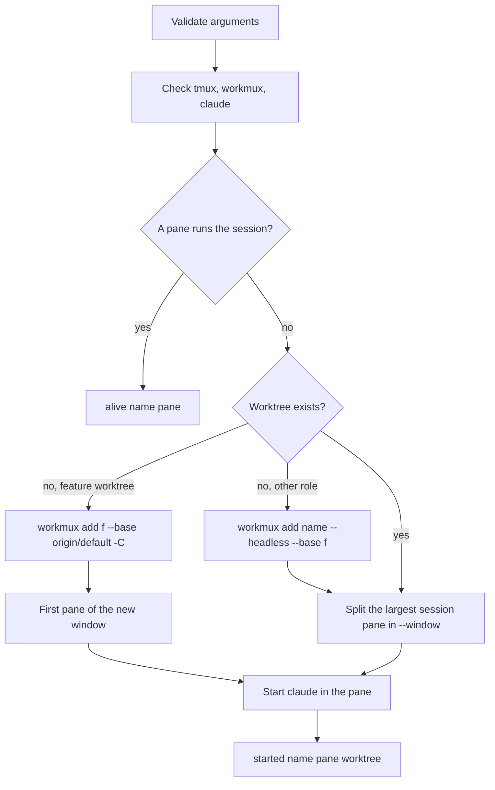

# Phase `launcher` plan

This plan builds `packages/s-stack/.apm/skills/sam-mode/scripts/launch.sh`, its tests and its CI job. The phase entry in the feature plan, contract C4, roadmap `coordination.md` ("Session names", "The launcher", "Restarts") and the run decisions on `s-stack-package` are the specification. This file adds the design and the facts measured on 21 November 2026 that the implementation depends on.

## The problem and the outcome

Every s-stack session after the first is started by hand today. The November run lost reports because a restarted session came back under a new name, and phase sessions were opened ad hoc. The launcher is the one place that knows the workmux, tmux and `claude` command lines. It gives every session a fixed name, starts it in a new pane of the feature window, resumes it after a restart, and never starts a second copy.

When this phase is done:

- `launch.sh` implements C4 plus the three modes added during the run (`--print-window`, `--close`, `--remove`).
- `packages/s-stack/tests/test_launch.py` proves every guarantee and every outcome against a real private tmux server with stub `workmux` and `claude`.
- CI runs those tests in a new job `s-stack-launcher-tests`, which gates the `tag` job.
- `AGENTS.md`'s CI section names the job.

## Non-goals and boundaries

- No handbook prose. The handbooks call the launcher only through the interface below.
- No change outside the owned paths: `packages/s-stack/.apm/skills/sam-mode/scripts/**`, `packages/s-stack/tests/**`, `.github/workflows/ci.yml`, `AGENTS.md`, `tests/s-stack/verify-s-stack/checks/launcher.md`. The lockfile is regenerated, never hand-edited (feature plan C7).
- No `versioning.py bump` on the phase branch (C7).
- Tests never touch the developer's tmux server or workmux state. **Measured:** when `$TMUX` is set, `tmux` ignores `TMUX_TMPDIR` and talks to the server named in `$TMUX`. A probe that set only `TMUX_TMPDIR` created a session on the developer's server, which was then killed. Every test and probe therefore removes `TMUX` and `TMUX_PANE` from the environment and uses a short temporary `TMUX_TMPDIR`. **Measured:** a socket path in the session scratchpad is too long for tmux (`File name too long`), so `TMUX_TMPDIR` comes from `tempfile.mkdtemp()`.

## Facts the design rests on

All measured on 21 November 2026 with Claude Code 2.1.330, tmux 3.8 and workmux 0.1.283 on macOS, in a private tmux server.

| Fact | Consequence |
| --- | --- |
| `claude --continue` in a directory resumes the newest conversation there and restores the name given earlier with `--name`. Its process arguments are then `claude --continue ...`, with no `--name`. | After `workmux resurrect`, which reopens with `--continue`, the orchestrator cannot be found from its arguments alone. Liveness has a second rule (below). |
| `claude --resume <name>` opens an interactive picker when two conversations share the name. | The launcher never resumes by name. |
| `claude --name <n> --session-id <uuid> <prompt>` starts a conversation with that id. Later, `claude --name <n> --resume <uuid> <prompt>` resumes exactly that conversation, keeps its id and name, delivers the prompt and opens no picker, even when a newer conversation exists in the same directory. | The launcher chooses each conversation's id itself and resumes by id, so two sessions that share the feature worktree each get their own conversation back. |
| `workmux add --headless` creates and provisions a worktree with no tmux target. `workmux add` without it opens a window and runs the layout's pane commands. `-C` (`--no-pane-cmds`) opens the layout's panes as plain shells. | The feature worktree is created with `workmux add <feature> --base origin/<default> -C`, and the launcher starts `claude` in that window's first pane itself, so it can pass `--name`. |
| `workmux path <name>` prints the worktree path and exits 0, or exits 1 with `Worktree '<name>' not found`. | It is the existence test and the path source. |
| `workmux remove <name> --keep-branch --force` removes the worktree without a prompt and keeps the branch. Without `--force` it asks for confirmation. | `--remove` runs its own guards first, then this. |

## Interface

```text
launch.sh --feature <f> --role <r> [--phase <p>] [--update <n>] [--window <window id>] [--fresh]
launch.sh --feature <f> --role <r> [--phase <p>] [--update <n>] --close
launch.sh --feature <f> --role <r> [--phase <p>] [--update <n>] --remove
launch.sh --print-window
```

Argument rules, each a usage error (exit 2) when broken:

- `--feature` and `--phase` match `^[a-z0-9]+(-[a-z0-9]+)*$`. `--update` matches `^[1-9][0-9]*$`.
- `--role` is one of `spec`, `orchestrator`, `planner`, `phase`.
- `--phase` is required with `--role phase` and refused otherwise. `--update` is allowed only with `--role spec`.
- `--close`, `--remove`, `--fresh` and `--window` are mutually exclusive in the combinations above. `--print-window` takes no other flag.
- `--window` is required to start any session except the first spec writer (`--role spec` without `--update`) when the feature worktree does not exist yet.
- `--remove` is refused for the feature worktree's roles (`spec` without `--update`, and `orchestrator`).

Names, worktrees and branches:

| Role | Session name | Worktree name and branch | Cut from |
| --- | --- | --- | --- |
| `spec` | `<f>-spec` | `<f>` (the feature worktree) | `origin/<default>` |
| `orchestrator` | `<f>-orchestrator` | `<f>` | must already exist |
| `planner` | `<f>-planner` | `<f>-planner` | `<f>` |
| `spec --update n` | `<f>-spec-<n>` | `<f>-spec-<n>` | `<f>` |
| `phase --phase p` | `<f>-phase-<p>` | `<f>-phase-<p>` | `<f>` |

The default branch is `git symbolic-ref --short refs/remotes/origin/HEAD` with `origin/` removed. When that ref is unset, it is `gh repo view --json defaultBranchRef --jq .defaultBranchRef.name`. When both fail, exit 1 naming both commands. Before cutting the feature worktree the launcher runs `git fetch origin <default>`, because a local default branch can be behind.

Outcomes. Rows marked new were added to C4 during the run (`launcher-r1`, `orchestrator-handbook-r2`).

| Outcome | Exit | Standard output |
| --- | --- | --- |
| Started a session | 0 | `started <name> pane=<pane id> worktree=<path>` |
| A session of that name is alive | 0 | `alive <name> pane=<pane id>`, nothing changed |
| New. `--print-window` | 0 | `window=<window id>` |
| New. `--close` closed the pane | 0 | `closed <name> pane=<pane id>` |
| New. `--close` found no pane running that session | 0 | `absent <name>`, nothing changed |
| New. `--remove` removed the worktree | 0 | `removed <name> worktree=<path>` |
| New. `--remove` refused: dirty worktree, branch not merged into `<f>`, a live session in it, or no such worktree | 5 | `refused <name>: <reason>` on standard error, nothing changed |
| Bad arguments | 2 | Usage on standard error |
| `tmux`, `workmux` or `claude` missing | 3 | The missing command on standard error. `--print-window` needs only `tmux`, `--remove` needs `workmux` and `tmux` (for the liveness guard), `--close` needs `tmux`. |
| `--print-window` outside tmux (`$TMUX_PANE` empty) | 1 | `not inside tmux` on standard error |
| tmux could not split a pane | 4 | tmux's own error on standard error |
| Anything else | 1 | The failing command and its error on standard error |

Exit 5 is new. It lets the orchestrator and the tests tell a guard refusal from a crash.

The first prompt is the single line in C4:

```text
/sam-mode <role> feature=<f> phase=<p or -> update=<n or -> roadmap=<path or -> plan=<path or -> orchestrator=<f>-orchestrator
```

`roadmap` is the one directory in the worktree matching `.foundry/feature-roadmaps/<date-time>-<f>/`, where `<date-time>` matches `[0-9]{4}-[0-9]{2}-[0-9]{2}_[0-9]{2}-[0-9]{2}-[0-9]{2}`. A plain `*-<f>` glob is wrong: feature `stack` would match `…-s-stack`. Paths are relative to the worktree. More than one match is exit 1.

## Design

### Data shape

The script has one record per run, built once from the arguments and then read:

```text
role, feature, phase, update      # validated inputs
name                              # session name, from the table above
worktree_name                     # workmux handle and branch
base                              # origin/<default> or <feature>
window                            # --window, or the window workmux add opened
```

and one list per tmux query, `pane_id pane_pid width height current_path window_id`, from `tmux list-panes -a -F`. Processes come from one `ps -A -o pid=,ppid=,args=` snapshot. Functions take these values. No function re-derives a name.

### Liveness, the one matcher

A pane runs session `<name>` when a descendant of its `pane_pid` is a `claude` process (the first word of its arguments has basename `claude`) and either:

1. **Strict.** Its arguments contain `--name <name>` or `--name=<name>`. Every session the launcher starts matches this.
2. **Resumed.** Its arguments contain no `--name`, and the pane's `current_path`, resolved with `pwd -P`, equals the session's worktree resolved the same way. This is the `workmux resurrect` case.

Start and `--remove` use both rules. `--close` uses the strict rule only, because the resumed rule cannot tell the spec writer and the orchestrator apart in the shared feature worktree, and `--close` must never touch a pane it cannot match to the session. The whole server is searched, not only `--window`. More than one matching pane is exit 1, naming the panes.

### Starting a session



- **New window.** Record `#{window_id}` of every window, run `workmux add`, then take the one new window whose panes have `current_path` equal to the worktree. Respawn its first pane (`list-panes` order) with `tmux respawn-pane -k -t <pane> -c <worktree> <command>`. The launcher created that window, so it may change its panes.
- **Split.** In `--window`, take the panes that run any `claude` process. Choose the largest by `width * height`, or, when none runs `claude`, the largest pane in the window. Split it with `tmux split-window -d -P -F '#{pane_id}' -t <pane> -c <worktree> <-h|-v> <command>`. Use `-h` when `width > 2 * height`, else `-v`, because a terminal cell is about twice as tall as it is wide. Never `select-layout`, never `resize-pane`. A split failure is exit 4 with tmux's error.
- **Command.** `claude --name <name> <--session-id <uuid> | --resume <uuid>> <first prompt>; exec "${SHELL:-/bin/sh}" -l`, every value quoted with `printf %q`. The trailing shell keeps the pane after `claude` exits, so its last output stays visible. Liveness checks the `claude` process, so a pane left at a shell is not alive.
- **Resume or fresh.** Each session's conversation id lives in the marker file `$(git -C <worktree> rev-parse --git-path s-stack-sessions)/<name>`, inside the worktree's own git directory, so nothing is tracked and no ignore entry is needed. The file holds one lowercase UUID. When the file exists and `--fresh` is absent, the command uses `--resume <uuid>`. Otherwise the launcher makes a new UUID (`uuidgen`, lowercased, or `/proc/sys/kernel/random/uuid` where `uuidgen` is missing), writes it to the file, and uses `--session-id <uuid>`. The launcher writes the file before it starts `claude`. If `claude` died before its first message, the id has no conversation, and the next resume fails in the pane with `No conversation found with session ID: <uuid>` and exit 1 (measured). The pane falls back to its shell, liveness reports no session, and `--fresh` starts a new conversation. The launcher does not inspect Claude Code's conversation store to prevent this, because that store is internal.
- **The first prompt on resume.** A resumed session also gets the first prompt. It reloads `sam-mode` and the role's handbook, which tells the session to read its files again, as roadmap `coordination.md`, "Restarts", requires.
- **Known limit, outside the launcher.** `workmux resurrect` reopens the feature window with `claude --continue`, which takes the newest conversation in the directory. That is the orchestrator's once the spec writer has ended, as the roadmap requires. A launcher restart never depends on it, because it resumes by id.

### `--print-window`

`tmux display-message -p -t "$TMUX_PANE" '#{window_id}'`, printed as `window=<id>`. Main sessions run it from their own Bash tool, where `$TMUX_PANE` is set.

### `--close`

Find the one pane that runs the session under the strict rule. `tmux kill-pane -t <pane>`. No match is `absent`.

### `--remove`

In order, each failure exit 5 with nothing changed: the worktree exists (`workmux path`); no pane runs the session under either rule; `git -C <worktree> status --porcelain` prints nothing (untracked files count, ignored files do not); `git merge-base --is-ancestor <worktree branch> <f>` succeeds. Then `workmux remove <worktree name> --keep-branch --force`. The branch is kept because it is merged and deleting it buys nothing.

## Tests

`packages/s-stack/tests/test_launch.py`, `unittest`, standard library only, in the style of `packages/foundry-maintenance/tests`. The suite is skipped with a stated reason when `tmux` is not on `PATH`, so a colleague without tmux sees a skip, not a failure. CI installs tmux, so CI never skips.

Fixture for every test:

- A temporary directory from `tempfile.mkdtemp()`, holding a bare `origin` repository with a `main` branch and `refs/remotes/origin/HEAD` set in the clone, a clone used as the repository root, and a `bin/` put first on `PATH`.
- An environment without `TMUX` and `TMUX_PANE`, with `TMUX_TMPDIR` set to a short temporary directory. A private server is started with `tmux -f /dev/null new-session -d -x 200 -y 50`, and killed in `tearDown`.
- A guard in `setUp` that fails the test, before any launcher call, unless `tmux display-message -p '#{socket_path}'` run in the test environment names a socket under the test's `TMUX_TMPDIR`. So a test that would reach the developer's server fails instead of touching it.
- Stub `workmux`, a Python script. `add <name> [--headless] [--base B] [-C]` runs `git worktree add -b <name> <root>__wt/<name> <B>`, and without `--headless` opens a window with two panes whose start directory is the worktree, as the default layout does. `path <name>` prints the path or exits 1 with workmux's message. `remove <name> --keep-branch --force` runs `git worktree remove`. Every call is appended to a log file.
- Stub `claude`, a Bash script that appends its arguments to a log file, then runs `exec -a claude perl -e 'sleep 86400' -- "$@"`, so `ps` shows `claude` as the first word followed by the real arguments.

One test per row. Each asserts on exit code, standard output and the server's panes and windows, never on which internal function ran.

| Behaviour | Test asserts |
| --- | --- |
| First spec writer | One new window, its first pane runs `claude --name f-spec`, `started` line, the stub log shows `add f --base origin/main -C` |
| Phase session | A new pane in `--window`, a headless `add` with `--base f`, prompt `/sam-mode phase feature=f phase=p update=- roadmap=<dir> plan=<dir>/README.md orchestrator=f-orchestrator` |
| Planner and update spec writer | Session and worktree names, `update=2` in the prompt |
| Alive by name | Second launch prints `alive`, pane count and window count unchanged, no new `claude` |
| Alive after `workmux resurrect` | A pane the test made outside the launcher in the feature worktree, running stub `claude --continue` with no `--name`. Launching `orchestrator` prints `alive` and starts nothing. Also the plan's case, a stub `claude --name f-orchestrator` in a test-made pane. |
| Resume | Kill the `claude` of a started phase session. The next launch starts `claude --name … --resume <the id of the first launch>` in a new pane. With `--fresh`, a new `--session-id` that differs from the first. |
| Two names in one worktree | Start `spec`, then `orchestrator`, in the feature worktree. Their ids differ. Kill both `claude` processes, relaunch `orchestrator`, then `spec`. Each `--resume`s its own id, in either order. |
| Untouched panes | Panes the test created, including a narrow sidebar pane, keep their size except the one split pane. No layout change: a pane added by the test at a recorded size keeps it. |
| Largest session pane is split | With two session panes of different sizes, the new pane comes from the larger. |
| Full window | A window too small to split gives exit 4 and tmux's message, no new `claude`. |
| Missing commands | `PATH` without each of `tmux`, `workmux`, `claude` gives exit 3 naming it. |
| Bad arguments | Each rule in Interface gives exit 2 and usage on standard error. |
| Roadmap matching | No directory gives `roadmap=-`. Two matching directories give exit 1. A `…-s-stack` directory is not matched for feature `stack`. |
| Default branch | `origin/HEAD` pointing at a branch other than `main` is used as the base. |
| `--print-window` | Exit 0 and `window=@<n>` with `TMUX_PANE` set to a pane of the private server. Exit 1 without `TMUX_PANE`. Exit 3 without `tmux`. |
| `--close` | Closes the session's own pane. `absent` when only another session's pane exists, and that pane survives. A resumed nameless `claude` in the worktree is not closed. |
| `--remove` | Removes a clean, merged worktree and keeps its branch. A dirty worktree, an unmerged branch, a live session, and a missing worktree each give exit 5 and change nothing. |

Mutation proof (Done when item 2). After the suite passes, the implementer temporarily applies each of these to `launch.sh`, runs the suite, records the failing test name in the PR evidence, and reverts: add `tmux select-layout tiled`; skip the liveness check; drop the resumed rule; drop the dirty-worktree guard.

## CI

In `.github/workflows/ci.yml`, a job beside `foundry-maintenance-tests`, in the same style:

```yaml
  s-stack-launcher-tests:
    name: s-stack launcher tests
    runs-on: ubuntu-latest
    steps:
      - uses: actions/checkout@v4

      # The Ubuntu runner images do not list tmux.
      - name: Install tmux
        run: command -v tmux || { sudo apt-get update && sudo apt-get install -y tmux; }

      - name: Run tests
        run: python3 -m unittest discover -s packages/s-stack/tests
```

Add `s-stack-launcher-tests` to the `tag` job's `needs`. The job has no path filter and no `needs`, exactly like `foundry-maintenance-tests` at `ci.yml` line 236. The `AGENTS.md` CI section gains one sentence naming the job, in the style of its `foundry-maintenance-tests` sentence.

## Execution order

1. Write `launch.sh` and `test_launch.py` together, test first for each row. Commit `launch.sh` with mode `100755` (`git update-index --chmod=+x` if needed). Run the suite and the mutation proof.
2. Regenerate `packages/s-stack/apm.lock.yaml` (C7), relativise it, and commit it alone.
3. Add the CI job and the `AGENTS.md` sentence in one commit.
4. `quick-review` on the whole diff, fix the findings, rerun the suite.
5. Merge `s-stack-package` into the phase branch with the C7 procedure, then run Verify and Review with fresh subagents.

All three code commits belong to one pull request.

## Pull request

One, as the feature plan says. Its dependencies are the `foundation` pull requests still open when the PR creator runs (81 and 82 on 21 November), so under the base rule it targets `main` and lists them. After it opens, its `s-stack-launcher-tests` check must pass on a real CI run before the PR creator reports. That run's URL is the evidence for the status file.

## Verification

- The verifier writes `tests/s-stack/verify-s-stack/checks/launcher.md`. `## Rerun` holds the unit suite and a `git ls-files -s` check for mode `100755`. `## Evidence` holds the live check from the feature plan: the real `claude` in a private tmux server (with `TMUX` removed), a scratch clone with `.foundry/feature-roadmaps/<date-time>-probe/`, a phase launch whose pane shows `/sam-mode phase` as the first words of the first prompt, and a second launch that prints `alive`. The trust dialog of the scratch folder is accepted in the private pane. The server is killed afterwards.
- Done when is the feature plan's list for this phase, plus the three added modes' tests.

## Decisions for this phase

| Id | Decision | Door |
| --- | --- | --- |
| `launcher-d1` | `--print-window` added to C4, answer to `launcher-r1` (option A). | Two-way, decided by the orchestrator |
| `launcher-d2` | `--close` and `--remove` added to C4, from `orchestrator-handbook-r2`. Refusals exit 5. `--close` matches strictly. `--remove` keeps the branch. | Two-way, modes from the orchestrator, details here |
| `launcher-d3` | The launcher picks each session's conversation id, stores it in the worktree's git directory, starts with `--session-id` and resumes with `--resume <id>`, never `--continue`. The orchestrator asked for this, so that two sessions sharing the feature worktree never swap conversations. | Two-way |
| `launcher-d4` | A nameless `claude` in a pane whose directory is the session's worktree counts as that session for start and `--remove`. | Two-way |
| `launcher-d5` | A resumed session receives the first prompt again. | Two-way |

## Rejected alternatives

- **Reading Claude Code's live-session files** under `~/.claude/sessions/` for liveness. They hold each session's name and pane, but they are an undocumented internal format that a release can change, and they carry other repositories' paths.
- **`claude --resume <name>`.** It opens a picker when names repeat (measured).
- **`claude --continue` with a marker that only records a start.** It resumes the newest conversation in the directory, so the spec writer and the orchestrator in the feature worktree could swap conversations.
- **A deterministic `--session-id` per name.** `--fresh` would need a new id, so the id must be stored anyway.
- **Tagging launcher panes with a tmux user option.** Panes restored by `workmux resurrect` carry no tag, so the process check is needed regardless, and one matcher is simpler than two.
