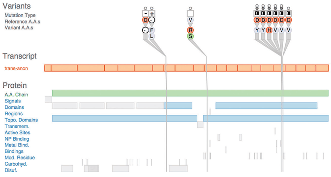

# 1.2 Why Have a Human in the Loop?

## Principle

<!-- verbatim p.27 -->
> Vis allows people to analyze data when they don't know exactly what questions they need to ask in advance.
<!-- /verbatim -->

## When vis is not needed

When people have well-defined questions about data, they can use purely computational techniques from fields such as statistics and machine learning. If a fully automatic solution has been deemed acceptable, there is no need for human judgement and so no need to design a vis tool [p.27].

The book's example is high-frequency stock trading, where deployed systems buy and sell when market conditions hold with no human check. A vis tool to speed up a human check would not help, because even an augmented human cannot reason about millions of stocks every second [p.27].

## When a human belongs in the loop

Many analysis problems are ill specified: there are many possible questions, from dozens to thousands or more, and people do not know in advance which are the right ones. Then the best path is an analysis process with a human in the loop that exploits the pattern detection of the human visual system [pp.27-28].

<!-- verbatim p.28 -->
> Vis systems are appropriate for use when your goal is to augment human capabilities, rather than completely replace the human in the loop.
<!-- /verbatim -->

## Kinds of use

Vis tools can be designed for transitional use, where the goal is to "work itself out of a job" by helping the designers of future purely computational solutions, or for long-term use with no intention of replacing the human soon [p.28].

| Use | Audience and purpose | Page |
| --- | --- | --- |
| Early transition | A stepping stone to understanding analysis requirements before formal models exist, used in a highly exploratory way; designing such tools often yields a much crisper understanding of the user's task as well as the tool | [p.28] |
| Middle transition | Aimed at the designers of a computational solution, to refine, debug or extend its algorithms or see how parameter changes affect them; a different audience from the system's end users, who may need a very different interface if any | [p.28] |
| Late transition | For end users alongside automatic decision making, to judge whether the system is doing the right thing, for example whether a machine learning result seems trustworthy before deployment; some tools are then abandoned, others stay to monitor the system | [p.28] |
| Long-term | A person stays in the loop indefinitely, commonly exploratory analysis for scientific discovery, to speed up and improve generating and checking hypotheses | [p.29] |
| Presentation | Supporting people who want to explain something they already know to others, rather than explore the unknown | [p.29] |

Figure 1.1, Variant View, is the long-term example: it helps biologists study the genetic basis of disease through DNA sequence variation, where computation is heavily used but cancer research cannot be fully automated any time soon [p.29]. The New York Times' interactive visualizations accompanying news stories are the presentation example [p.29].

## Figures

-  **Figure 1.1** [p.29]. The Variant View vis tool supports biologists in assessing the impact of genetic variants by speeding up the exploratory analysis process. From [Ferstay et al. 13, Figure 1].

## Related

- [1.3 Why Have a Computer in the Loop?](s01-03-why-have-computer-loop.md): the complementary question of why the drawing is generated by computer [p.29]
- [1.9 Why Focus on Tasks?](s01-09-why-focus-tasks.md): presentation and discovery reappear as abstract task goals [p.36]
- [3.4.1 Analyze](../ch03-why-task-abstraction/s03-04-actions/s03-04-01-analyze.md): where discovery and presentation are treated as abstract tasks [p.29]
