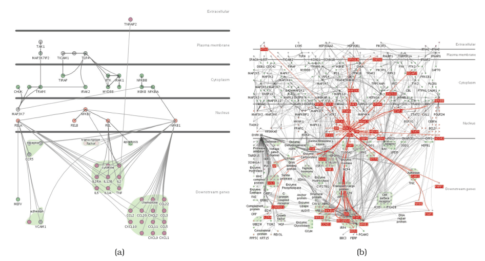

# 1.3 Why Have a Computer in the Loop?

## Principle

<!-- verbatim p.29 -->
> By enlisting computation, you can build tools that allow people to explore or present large datasets that would be completely infeasible to draw by hand, thus opening up the possibility of seeing how datasets change over time.
<!-- /verbatim -->

## Limits of drawing by hand

People can draw visual representations manually, with pencil and paper or with drawing tools where they arrange and colour each item individually. Attention span strongly limits what they will do, so they are unlikely to go beyond tiny static datasets; even hundreds of items might take hours or days [p.30].

Most real-world datasets are much larger, from thousands to millions or more, and many change dynamically over time. A computer-based tool that generates the representation automatically saves human effort compared with manual creation [p.30].

## Keeping the hand-drawn spirit

A designer can ask which aspects of hand-drawn diagrams matter, so that automatic drawings retain that spirit [p.30]. Cerebral (Figure 1.2) shows gene interactions in the style of biology textbook drawings, with vertical layers for the location in the cell where the interaction occurs. Figure 1.2(a), 57 nodes and 74 edges, could be done by hand; Figure 1.2(b), 760 nodes and 1269 edges, could not, and its automatic layout supports interactive exploration such as highlighting a gene's neighbours on mouseover [pp.30-31].

## Figures

-  **Figure 1.2** [p.30]. The Cerebral vis tool captures the style of hand-drawn diagrams in biology textbooks with vertical layers that correspond to places within a cell where interactions between genes occur. (a) A small network of 57 nodes and 74 edges might be possible to lay out by hand with enough patience. (b) Automatic layout handles this large network of 760 nodes and 1269 edges and provides a substrate for interactive exploration: the user has moved the mouse over the MSK1 gene, so all of its immmediate neighbors in the network are highlighted in red. From [Barsky et al. 07, Figures 1 and 2].

## Related

- [Cerebral](../idioms/cerebral.md): the system shown in Figure 1.2 [p.30]
- [1.2 Why Have a Human in the Loop?](s01-02-why-have-human-loop.md): why a person stays in the loop alongside the computer [p.29]
- [1.13 Why Are There Resource Limitations?](s01-13-why-there-resource-limitations.md): the computational limits that come with enlisting the computer for large datasets [p.30]
