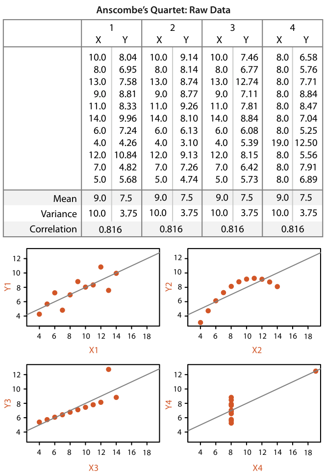

# 1.6 Why Show the Data in Detail?

## Principle

<!-- verbatim p.32 -->
> Vis tools help people in situations where seeing the dataset structure in detail is better than seeing only a brief summary of it.
<!-- /verbatim -->

Two such situations: exploring data to find patterns, both confirming expected ones and finding unexpected ones; and assessing the validity of a statistical model, to judge whether it actually fits the data [p.32].

## Anscombe's Quartet

Statistical characterization is very powerful but intrinsically loses information through summarization [p.32]. Anscombe's Quartet (Figure 1.3) is four small datasets, designed by a statistician, with identical mean, variance, correlation and linear regression lines, whose very different structures are immediately obvious when shown graphically [p.32]. The four scatterplots read as follows:

1. The first matches the intuition of anyone familiar with the statistics [p.34].
2. The second shows a clear nonlinear pattern, so a linear regression summary does not capture what is happening [p.34].
3. The third shows how a single outlier can lead to a misleading regression line whose slope does not quite match the line the eye picks out from the rest of the data [p.34].
4. The fourth is "a truly pernicious case": the regression line is almost perpendicular to the true pattern seen in the data [p.34].

<!-- verbatim p.34 -->
> The basic principle illustrated by Anscombe's Quartet, that a single summary is often an oversimplification that hides the true structure of the dataset, applies even more to large and complex datasets.
<!-- /verbatim -->

## Figures

-  **Figure 1.3** [p.33]. Anscombe’s Quartet is four datasets with identical simple statistical properties: mean, variance, correlation, and linear regression line. However, visual inspection immediately shows how their structures are quite different. After [Anscombe 73, Figures 1–4].

## Related

- [Scatterplots](../idioms/scatterplots.md): the idiom used to show each dataset in the quartet [p.34]
- [1.15 Further Reading](s01-15-further-reading.md): Anscombe's paper and Cleveland and McGill on showing as much of the data as possible [p.34]
- [1.7 Why Use Interactivity?](s01-07-why-use-interactivity.md): what to do when a dataset is too large to show in detail at once [p.34]
