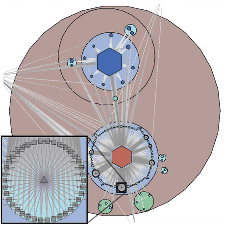

# 1.8 Why Is the Vis Idiom Design Space Huge?

## Definition

<!-- verbatim p.35 -->
> A vis idiom is a distinct approach to creating and manipulating visual representations.
<!-- /verbatim -->

There are many ways to encode data visually as a single picture, and the design space grows further when you consider manipulating one or more pictures with interaction [p.35].

## From simple to complex idioms

- **Simple static idioms** include chart types with deep historical roots, such as scatterplots, bar charts and line charts [p.35].
- **Linked simple charts.** A more complicated idiom links simple charts through interaction, for example selecting a bar in a bar chart highlights the associated items in a scatterplot showing a different view of the same data [p.35].
- **Complex idioms.** Grouse (Figure 1.4) supports incremental layout of a multilevel network through interactive navigation. The data, from the Internet Movie Database, is all movies connected to Sharon Stone: actors are grey square nodes and links mean appearance in the same movie. The user opens metanodes, shown as discs, to see structure at many levels of the hierarchy at once; metanode colour encodes the topological structure of the features it contains, hexagons are still-closed metanodes, and an inset shows a clique of actors with labels on [pp.35-36].

## The book's framework

The book offers a framework for thinking about the space systematically through design choices, including how to encode information with spatial position, how to facet data between multiple views, and how to reduce the amount of data shown by filtering and aggregation [p.36].

## Figures

-  **Figure 1.4** [p.35]. The Grouse vis tool features a complex idiom that combines visual encoding and interaction, supporting incremental layout of a network through interactive navigation. From [Archambault et al. 07a, Figure 5].

## Related

- [9.5 Containment: Hierarchy Marks](../ch09-arrange-networks-trees/s09-05-containment-hierarchy-marks.md): compound networks like Grouse's are discussed further there [p.36]
- [7 Arrange Tables](../ch07-arrange-tables/node.md): encoding information with spatial position [p.36]
- [12 Facet into Multiple Views](../ch12-facet-into-multiple-views/node.md): faceting data between multiple views, including linked charts [p.36]
- [13 Reduce Items and Attributes](../ch13-reduce-items-attributes/node.md): reducing the data shown by filtering and aggregation [p.36]
- [1.11 Why Are Most Designs Ineffective?](s01-11-why-most-designs-ineffective.md): how to search this huge space [p.36]
