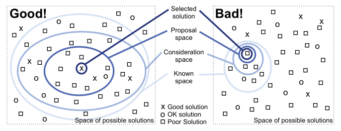

# 1.11 Why Are Most Designs Ineffective?

## Principle

<!-- verbatim p.37 -->
> The most fundamental reason that vis design is a difficult enterprise is that the vast majority of the possibilities in the design space will be ineffective for any specific usage context.
<!-- /verbatim -->

A design may be a poor match with human perceptual and cognitive systems, or comprehensible in another setting but a bad match with the intended task. Only a very small number of possibilities are reasonable, and an even smaller fraction excellent, so choosing at random is a bad idea [p.37].

## Satisfy, do not optimize

Optimizing, finding the very best choice, is not a very useful goal for design problems. A more appropriate goal is to satisfy: find one of the many good solutions rather than one of the even larger number of bad ones [p.37].

## The search space metaphor

Figure 1.5 shows five progressively smaller spaces [pp.37-38]:

1. **Space of possible solutions**, including ones nobody has thought of [p.37].
2. **Known space**, the possibilities known to you; small for a novice, and one of the book's goals is to enlarge it [p.37].
3. **Consideration space**, the solutions you actively consider; necessarily smaller than the known space [p.38].
4. **Proposal space**, the possibilities you investigate in detail [p.38].
5. **Selected solution**, the one finally chosen [p.38].

The left of Figure 1.5 is a good strategy with large known and consideration spaces; the right is a bad strategy with small ones, which raises the probability of considering only ok or poor solutions and missing a good one [p.38].

<!-- verbatim p.38 -->
> A fundamental principle of design is to consider multiple alternatives and then choose the best, rather than to immediately fixate on one solution without considering any alternatives.
<!-- /verbatim -->

One way to ensure more than one possibility is considered is to explicitly generate multiple ideas in parallel. The book aims to help designers entertain a broad consideration space and rule out parts of it by noting mismatches with human capabilities or the intended task [p.38].

## Trade-offs

Vis design cannot easily be handled as simple optimization because trade-offs abound: a design that does well by one measure rates poorly on another. Characterizing these trade-offs is a very open research problem, and the book offers guidelines and suggested processes but "few absolute truths" [p.38].

## Figures

-  **Figure 1.5** [p.38]. A search space metaphor for vis design.

## Related

- [4 Analysis: Four Levels for Validation](../ch04-analysis-four-levels-validation/node.md): a four-level model of the design process, intended to guide thinking through these trade-offs [p.38]
- [1.8 Why Is the Vis Idiom Design Space Huge?](s01-08-why-vis-idiom-design.md): the size of the space being searched [p.37]
- [1.12 Why Is Validation Difficult?](s01-12-why-validation-difficult.md): judging afterwards whether the selected design works [p.38]
- [6 Rules of Thumb](../ch06-rules-thumb/node.md): the book's guidelines for ruling out parts of the space [p.38]
