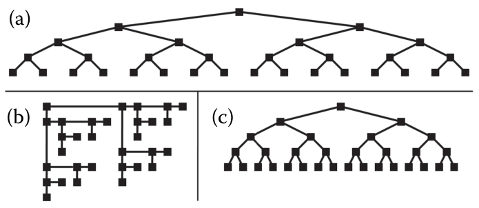

# 1.13 Why Are There Resource Limitations?

## Principle

<!-- verbatim p.39 -->
> When designing or analyzing a vis system, you must consider at least three different kinds of limitations: computational capacity, human perceptual and cognitive capacity, and display capacity.
<!-- /verbatim -->

## Scalability

Vis systems are inevitably used for larger datasets than they were designed for, so scalability, handling large data gracefully, is a central concern [pp.39-40]. Dataset size keeps growing through better data acquisition and sensors, more computer capacity generating data from simulation and logging, and computation's reach into every aspect of life [p.40].

## Computational limits

Computer time and memory are limited, with soft and hard constraints [p.40]:

- An interactive response means each frame must be drawn with algorithms that run in a fraction of a second, not minutes or hours [p.40].
- Users may be unwilling or unable to wait for long preprocessing before they can interact [p.40].
- **Soft constraint.** The system should be parsimonious with memory because the user runs other programs too [p.40].
- **Hard constraint.** Dataset size can outstrip finite memory even if the system uses nearly all of it; handling data that does not fit in core memory needs significantly more complex algorithms [p.40].

So the computational complexity of preprocessing, transformation, layout and rendering is a major concern, though by no means the only one [p.40].

## Human limits

Memory and attention are finite. Preattentive visual mechanisms process the current visual field in massively parallel ways, but memory for things not directly visible is notoriously limited, for long-term recall and for short-term working memory, visual and nonvisual [p.40].

<!-- verbatim p.40 -->
> We store surprisingly little information internally in visual working memory, leaving us vulnerable to change blindness: the phenomenon where even very large changes are not noticed if we are attending to something else in our view [Simons 00].
<!-- /verbatim -->

## Display limits and information density

Vis designers often run out of pixels: screen resolution is not enough to show all desired information at once [p.40].

<!-- verbatim p.40 -->
> The information density of a single image is a measure of the amount of information encoded versus the amount of unused space.
<!-- /verbatim -->

Synonyms for information density include graphic density and data–ink ratio [p.40].

Figure 1.6 encodes one small tree three ways with nodes of equal size [p.41]:

- **(a)** encodes depth from root to leaves with vertical position, but information density is low [p.41].
- **(b)** is drawn more compactly, so the ratio of node size to the area of the whole tree is larger, but depth cannot easily be read from position [p.41].
- **(c)** is "a very good alternative" combining both: high density from a compact view and position coding for depth [p.41].

<!-- verbatim p.41 -->
> There is a trade-off between the benefits of showing as much as possible at once, to minimize the need for navigation and exploration, and the costs of showing too much at once, where the user is overwhelmed by visual clutter. The goal of idiom design choices is to find an appropriate balance between these two ends of the information density continuum.
<!-- /verbatim -->

## Figures

-  **Figure 1.6** [p.41]. Low and high information density visual encodings of the same small tree dataset; nodes are the same size in each. (a) Low information density. (b) Higher information density, but depth in tree cannot be read from spatial position. (c) High information density, while maintaining property that depth is encoded with position. From [McGuffin and Robert 10, Figure 3].

## Related

- [6.5 Eyes Beat Memory](../ch06-rules-thumb/s06-05-eyes-beat-memory.md): more aspects of memory and attention [p.40]
- [5 Marks and Channels](../ch05-marks-channels/node.md): the power and limits of low-level preattentive visual mechanisms [p.40]
- [1.7 Why Use Interactivity?](s01-07-why-use-interactivity.md): interaction as the response when everything cannot be shown at once [p.41]
- [9.5 Containment: Hierarchy Marks](../ch09-arrange-networks-trees/s09-05-containment-hierarchy-marks.md): Figure 9.9 shows one tree in seven idioms, comparing connection and containment encodings [p.239]
