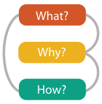
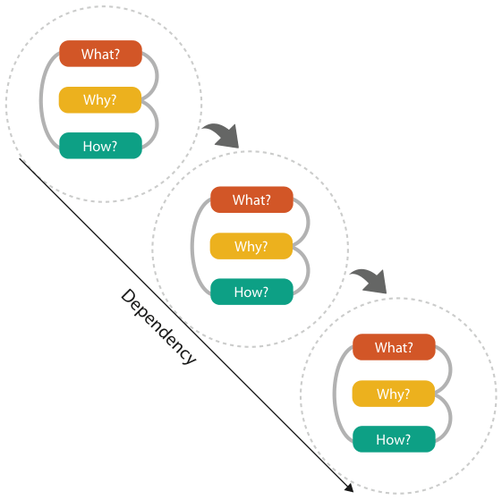

# 1.14 Why Analyze?

## Premise

<!-- verbatim p.41 -->
> This book is built around the premise that analyzing existing systems is a good stepping stone to designing new ones.
<!-- /verbatim -->

Many vis idioms and tools have been created over several decades. With so many combinations of data, tasks and idioms, reading papers about previous tools one by one is unlikely to give exactly what you need, and even a likely candidate may need deeper reading to find evidence it succeeded [pp.41-42].

## The what–why–how framework

The book's analysis framework imposes structure on the design space as a scaffold for thinking about design choices systematically; it is offered "as a guide to get you started, not as a straitjacket" [p.42].

Figure 1.7 analyses vis use by three questions [p.42]:

| Question | Answer | Book chapters | Page |
| --- | --- | --- | --- |
| What data the user sees | Data | Chapter 2 | [p.42] |
| Why the user intends to use a vis tool | Task | Chapter 3 | [p.42] |
| How the visual encoding and interaction idioms are constructed in terms of design choices | Idiom | Chapters 7 to 14 | [p.42] |

<!-- verbatim p.42 -->
> Each three-fold what–why–how question has a corresponding data–task–idiom answer trio. One of these analysis trios is called an instance.
<!-- /verbatim -->

## Chained instances

Simple tools can be described as one isolated instance, but complex tool usage often needs a sequence of chained instances, which express dependencies. Every instance has the input of what data is shown; some also produce output data. In Figure 1.8 the output of one instance is the input to the next [p.42].

Separating why from how, together with chaining, distinguishes means from ends. Sorting items can be an end, when the goal is a ranked list as the result of the session, or a means to another end, such as finding outliers that do not match the main trend, done along the way [pp.42-43].

## Figures

-  **Figure 1.7** [p.42]. Three-part analysis framework for a vis instance: why is the task being performed, what data is shown in the views, and how is the vis idiom constructed in terms of design choices.
-  **Figure 1.8** [p.43]. Analyzing vis usage as chained sequences of instances, where the output of one instance is the input to another.

## Related

- [2 What: Data Abstraction](../ch02-what-data-abstraction/node.md): data and the question of what [p.42]
- [3 Why: Task Abstraction](../ch03-why-task-abstraction/node.md): tasks and the question of why [p.42]
- [7 Arrange Tables](../ch07-arrange-tables/node.md): the start of Chapters 7 to 14, which answer how idioms are designed [p.42]
- [15 Analysis Case Studies](../ch15-analysis-case-studies/node.md): the framework applied to whole systems [p.41]
