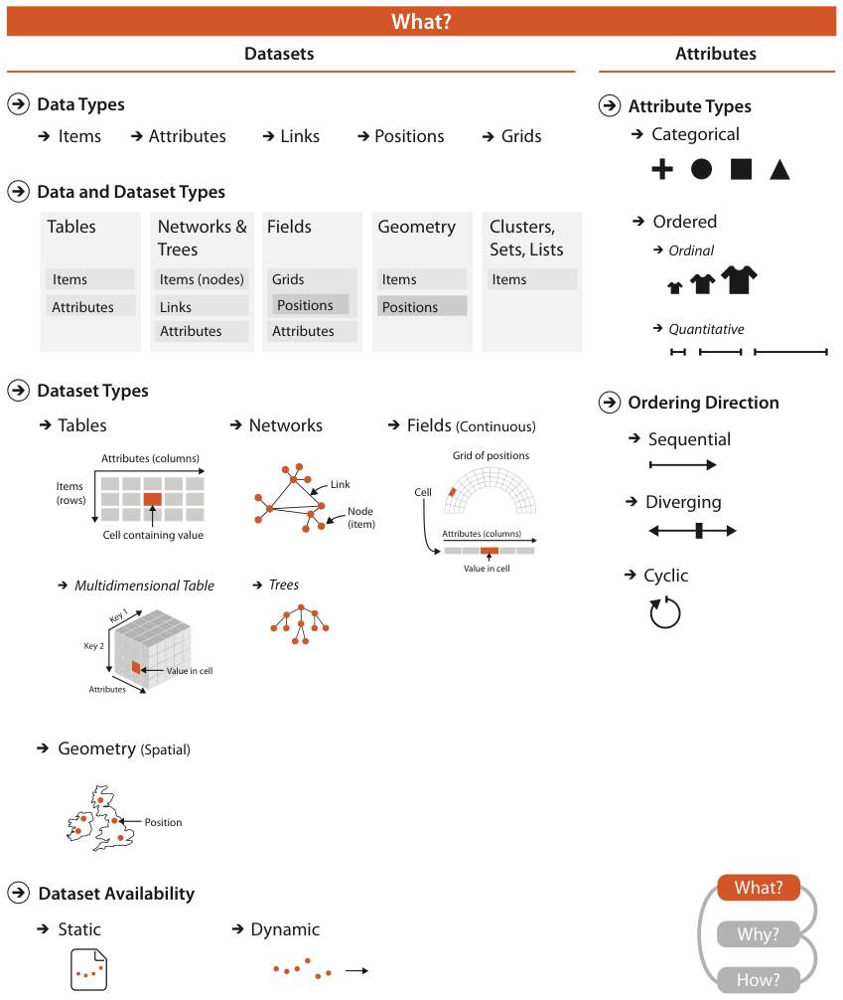

# 2.1 The Big Picture

## Scope

Figure 2.1 shows the abstract types of what can be visualised: data, datasets and attributes [pp.45-46].

<!-- verbatim p.46 -->
> The four basic dataset types are tables, networks, fields, and geometry; other possible collections of items include clusters, sets, and lists. These datasets are made up of different combinations of the five data types: items, attributes, links, positions, and grids. For any of these dataset types, the full dataset could be available immediately in the form of a static file, or it might be dynamic data processed gradually in the form of a stream. The type of an attribute can be categorical or ordered, with a further split into ordinal and quantitative. The ordering direction of attributes can be sequential, diverging, or cyclic.
<!-- /verbatim -->

## The taxonomy at a glance

Figure 2.1 has three panels under "What?", alongside "Why?" and "How?" [p.45]:

- **Data types**: items, attributes, links, positions, grids; Section 2.3 defines them [pp.45-46].
- **Dataset types**: tables (items as rows, attributes as columns, a value in each cell, plus the multidimensional table), networks and trees (nodes as items, links), fields (a grid of positions with a value in each cell), geometry (position only), and clusters, sets and lists (items only); Section 2.4 covers them [pp.45-46].
- **Dataset availability**: static or dynamic; Section 2.4.6 covers it [pp.45-46].
- **Attribute types**: categorical, or ordered split into ordinal and quantitative; Section 2.5 covers them [pp.45-46].
- **Ordering direction**: sequential, diverging, cyclic; Sections 2.5.2.1 and 2.5.2.2 cover it [pp.45-46].

## Figures

-  **Figure 2.1** [p.45]. What can be visualized: data, datasets, and attributes.

## Related

- [2.3 Data Types](s02-03-data-types.md): definitions of the five data types in the figure's first panel [p.46]
- [2.4 Dataset Types](s02-04-dataset-types/node.md): the four basic dataset types and the other collections of items [p.46]
- [2.4.6 Dataset Availability](s02-04-dataset-types/s02-04-06-dataset-availability.md): static files versus dynamic streams [p.46]
- [2.5 Attribute Types](s02-05-attribute-types.md): categorical, ordinal and quantitative, and the three ordering directions [p.46]
- [3 Why: Task Abstraction](../ch03-why-task-abstraction/node.md): the "Why?" part of the framework shown beside "What?" in Figure 2.1 [p.45]
