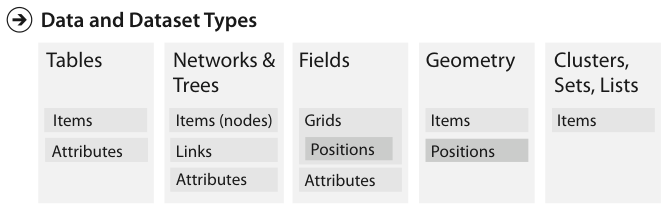
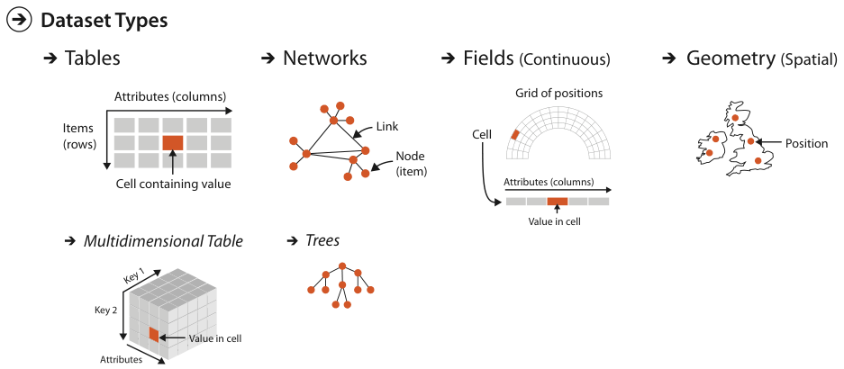
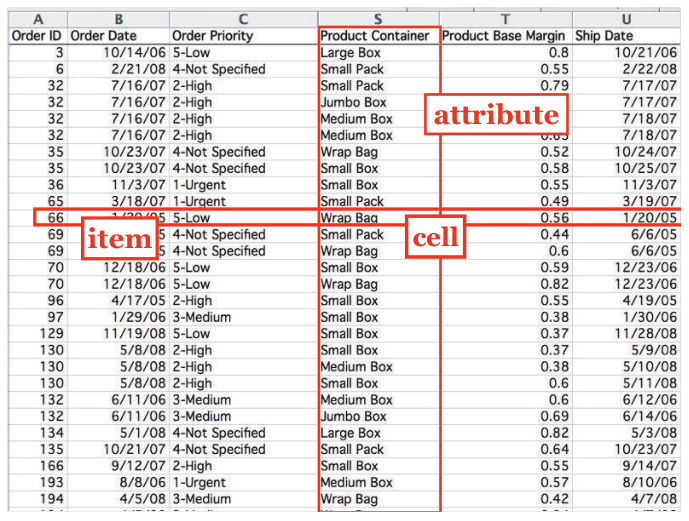

# 2.4.1 Tables

## Dataset types overview

Figure 2.3 shows how each basic dataset type is built from data types: tables from items and attributes; networks and trees from items (nodes), links and attributes; fields from grids, positions and attributes; geometry from items and positions; clusters, sets and lists from items [p.49]. Figure 2.4 shows the detailed internal structure of the four basic types [pp.49-50].

<!-- verbatim p.49 -->
> Tables have cells indexed by items and attributes, for either the simple flat case or the more complex multidimensional case.
<!-- /verbatim -->

## Tables as a dataset type

Tables are made of rows and columns, familiar from spreadsheets. The book treats a table as a dataset type independent of any visual representation; later chapters address which visual representations suit which dataset types [p.50].

<!-- verbatim p.50 -->
> For a simple flat table, the terms used in this book are that each row represents an item of data, and each column is an attribute of the dataset. Each cell in the table is fully specified by the combination of a row and a column—an item and an attribute—and contains a value for that pair.
<!-- /verbatim -->

Figure 2.5 shows the first few dozen items of a table of orders, with the attributes order ID, order date, order priority, product container, product base margin and ship date [pp.50-51].

<!-- verbatim p.50 -->
> A multidimensional table has a more complex structure for indexing into a cell, with multiple keys.
<!-- /verbatim -->

Keys and values are discussed further in Section 2.6.1 [p.50].

## Figures

-  **Figure 2.3** [p.49]. The four basic dataset types are tables, networks, fields, and geometry; other possible collections of items are clusters, sets, and lists. These datasets are made up of five core data types: items, attributes, links, positions, and grids.
-  **Figure 2.4** [p.50]. The detailed structure of the four basic dataset types.
-  **Figure 2.5** [p.51]. In a simple table of orders, a row represents an item, a column represents an attribute, and their intersection is the cell containing the value for that pairwise combination.

## Related

- [2.6.1 Key versus Value Semantics](../s02-06-semantics/s02-06-01-key-value-semantics.md): one key in a flat table, multiple keys in a multidimensional table, and the order table's attribute types [p.50]
- [7 Arrange Tables](../../ch07-arrange-tables/node.md): how to arrange tables spatially [p.50]
- [7.3 Arrange by Keys and Values](../../ch07-arrange-tables/s07-03-arrange-keys-values.md): the design choice that follows from separating a table's keys from its values [p.50]
