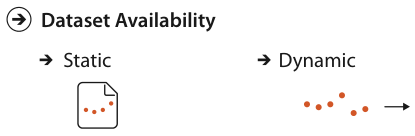

# 2.4.6 Dataset Availability

## Static versus dynamic

Figure 2.6 shows the two kinds of dataset availability: static or dynamic [p.56].

<!-- verbatim p.56 -->
> The default approach to vis assumes that the entire dataset is available all at once, as a static file. However, some datasets are instead dynamic streams, where the dataset information trickles in over the course of the vis session.
<!-- /verbatim -->

- **Kinds of dynamic change.** Adding new items or deleting previous ones, and changing the values of existing items [p.56].
- **Synonyms.** Dynamic is also called online, and static is also called offline [p.56].
- **Crosscutting.** Availability crosscuts the basic dataset types: any of them can be static or dynamic [p.56].
- **Cost.** Designing for streaming data adds complexity to many aspects of the vis process that are straightforward when the whole dataset is available up front [p.56].

## Figures

-  **Figure 2.6** [p.56]. Dataset availability can be either static or dynamic, for any dataset type.

## Related

- [2.6.2 Temporal Semantics](../s02-06-semantics/s02-06-02-temporal-semantics.md): the other meaning of "dynamic", time-varying semantics, which the book keeps distinct from streams [p.65]
- [2.4.1 Tables](s02-04-01-tables.md): one of the basic dataset types that availability crosscuts [p.56]
