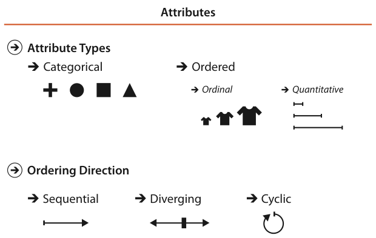

# 2.5 Attribute Types

## Overview

Figure 2.7 shows the attribute types [pp.56-57]. The major distinction is categorical versus ordered, and ordered splits further into ordinal versus quantitative. Ordered data may run sequentially from minimum to maximum, diverge in both directions from a zero point in the middle, or wrap around in a cycle; attributes may also have hierarchical structure [p.56].

| Type | Implicit ordering | Arithmetic | Examples | Cite |
| --- | --- | --- | --- | --- |
| Categorical (nominal) | No | No; only same or different | Favourite fruit, names, movie genres, file types, city names | [p.57] |
| Ordinal | Yes, well defined | No full-fledged arithmetic | Shirt size; rankings such as top-ten lists or tournament lineups | [pp.57-58] |
| Quantitative | Yes | Yes; magnitude supports arithmetic comparison | Height, weight, temperature, stock price, drinks sold per day | [p.58] |

## 2.5.1 Categorical

<!-- verbatim p.57 -->
> The type of categorical data, such as favorite fruit or names, does not have an implicit ordering, but it often has hierarchical structure.
<!-- /verbatim -->

<!-- verbatim p.57 -->
> Categories can only distinguish whether two things are the same (apples) or different (apples versus oranges).
<!-- /verbatim -->

- **External orderings.** Any arbitrary external ordering can be imposed, such as fruit alphabetically by name or by price if that auxiliary information is available, but such orderings are not implicit in the attribute itself [p.57].
- **Synonym.** Categorical is also called nominal [p.57].

## 2.5.2 Ordered: Ordinal and Quantitative

<!-- verbatim p.57 -->
> All ordered data does have an implicit ordering, as opposed to unordered categorical data.
<!-- /verbatim -->

<!-- verbatim p.57 -->
> With ordinal data, such as shirt size, we cannot do full-fledged arithmetic, but there is a well-defined ordering.
<!-- /verbatim -->

Large minus medium is not meaningful, but medium falls between small and large. Rankings are another kind of ordinal data [pp.57-58].

<!-- verbatim p.58 -->
> A subset of ordered data is quantitative data, namely, a measurement of magnitude that supports arithmetic comparison.
<!-- /verbatim -->

- **Example.** 68 inches minus 42 inches is meaningful, and the answer of 26 inches can be calculated. Both integers and real numbers are quantitative [p.58].
- **Interval and ratio.** Some domains split quantitative into interval versus ratio data [Stevens 46]; the book keeps them collapsed because the distinction is typically not useful when designing a visual encoding [p.58].
- **Usage in the book.** The ordered type is used often; ordinal is mentioned only when its distinction from quantitative matters [p.58].

### 2.5.2.1 Sequential versus Diverging

<!-- verbatim p.58 -->
> Ordered data can be either sequential, where there is a homogeneous range from a minimum to a maximum value, or diverging, which can be deconstructed into two sequences pointing in opposite directions that meet at a common zero point.
<!-- /verbatim -->

Mountain height from sea level to Everest is sequential, and so is bathymetry from sea level to the deepest ocean floor. A full elevation dataset is diverging, with sea level as the zero joining the two sequences [p.58].

### 2.5.2.2 Cyclic

<!-- verbatim p.58 -->
> Ordered data may be cyclic, where the values wrap around back to a starting point rather than continuing to increase indefinitely.
<!-- /verbatim -->

Many time measurements are cyclic: hour of the day, day of the week, month of the year [p.58].

## 2.5.3 Hierarchical Attributes

<!-- verbatim p.58 -->
> There may be hierarchical structure within an attribute or between multiple attributes.
<!-- /verbatim -->

- **Time.** In a decade of daily stock prices, a time-series dataset, time can be aggregated from days to weeks, months and years, with patterns at several scales, such as strong weekday-versus-weekend variation and subtler seasonal variation [pp.58-59].
- **Geography.** A postal code can be aggregated up to cities, states or countries [p.59].

## Figures

-  **Figure 2.7** [p.57]. Attribute types are categorical, ordinal, or quantitative. The direction of attribute ordering can be sequential, diverging, or cyclic.

## Related

- [13.4 Aggregate](../ch13-reduce-items-attributes/s13-04-aggregate/node.md): hierarchical aggregation in more detail [p.59]
- [7.5 Separate, Order, and Align: Categorical Regions](../ch07-arrange-tables/s07-05-separate-order-align-categorical/node.md): visual encoding of attribute hierarchies [p.59]
- [2.6 Semantics](s02-06-semantics/node.md): semantics, which crosscut attribute type, including whether an attribute is a key [p.59]
- [2.6.2 Temporal Semantics](s02-06-semantics/s02-06-02-temporal-semantics.md): time as key or value, and the type a temporal key usually has [p.58]
- [10.3 Colormaps](../ch10-map-color-other-channels/s10-03-colormaps/node.md): categorical and ordered colormaps that match these attribute types and ordering directions [p.58]
