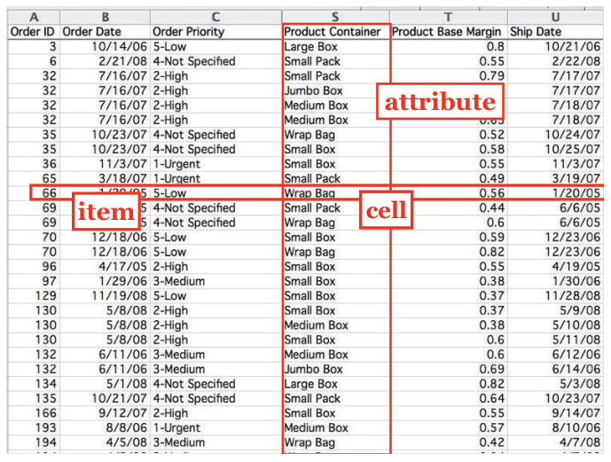
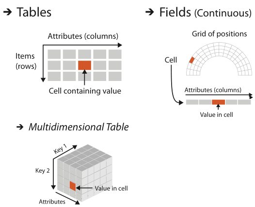
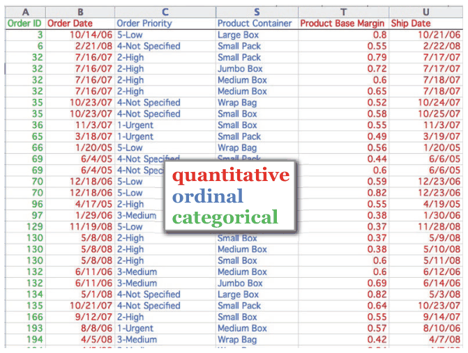

# 2.6.1 Key versus Value Semantics

## Keys and values

<!-- verbatim p.59 -->
> A key attribute acts as an index that is used to look up value attributes.
<!-- /verbatim -->

- **Where it matters.** The key/value distinction matters for tables and fields, as Figure 2.8 shows [p.59].
- **Synonyms.** Key is also called independent attribute and value dependent attribute, as in statistics; in data warehouses the terms are dimension and measure [p.59].

### 2.6.1.1 Flat Tables

<!-- verbatim p.59 -->
> A simple flat table has only one key, where each item corresponds to a row in the table, and any number of value attributes.
<!-- /verbatim -->

- **Implicit or explicit key.** The key may be implicit, simply the row index, or explicit, an attribute in the table, in which case it must contain no duplicate values [p.59].
- **Suitable key types.** Keys may be categorical or ordinal; quantitative attributes are typically unsuitable because nothing prevents several items from sharing a value [p.59].
- **Table 2.1.** Name looks like a key but two people share a name; Favorite Fruit repeats Pear; quantitative Age and ordinal Shirt Size both have duplicates. The ID column is an explicit unique identifier that acts as the key, ordinal if entry order carries temporal information, categorical if treated as a code [p.60].
- **Convention.** Keys are commonly stored in the first column, for human readability and easier data structures [p.60].
- **Order table.** Figure 2.9 colours the order table's attributes by type. It has no explicit key: even Order ID repeats, because an order holds several items with different container sizes, so the table uses the row number as an implicit key [pp.60-61].

### 2.6.1.2 Multidimensional Tables

<!-- verbatim p.61 -->
> The more complex case is a multidimensional table, where multiple keys are required to look up an item. The combination of all keys must be unique for each item, even though an individual key attribute may contain duplicates.
<!-- /verbatim -->

- **Example.** In biology, a gene as one key and time as another, with each cell holding a gene's activity level at a time [p.61].
- **Keys as an outcome.** Which attributes are keys may be unknown; often finding independent keys versus dependent values is the goal of the vis process, and success might mean recasting a flat table into a more meaningful multidimensional table [p.61].

### 2.6.1.3 Fields

- **Vocabulary.** Fields are continuous rather than discrete, but keys and values remain central; spatial field work tends to say independent and dependent variable instead [p.62].
- **Structure.** Fields are sampled systematically so that each grid cell spans a unique range of a continuous domain [p.62].

<!-- verbatim p.62 -->
> In spatial fields, spatial position acts as a quantitative key, in contrast to a nonspatial attribute in the case of a table that is categorical or ordinal. The crucial difference between fields and tables is that useful answers for attribute values are returned for locations throughout the sampled range, not just the exact points where data was recorded.
<!-- /verbatim -->

- **Multidimensional and multivariate.** Multidimensional structure depends on the number of keys, multivariate structure on the number of values. Standard cases are 2D and 3D static fields, and fields with three or four keys when time-varying; a spatial field may also have one key. A field with several keys and several values is both [p.62].
- **Classification.** A scalar field has one attribute per cell, a vector field two or more, a tensor field many [p.62].
- **Mathematical caveat.** These are vis usages; mathematically scalars and vectors are degenerate tensors (orders 0 and 1, with vis tensors of order 2 or more) [p.62].

### 2.6.1.4 Scalar Fields

<!-- verbatim p.62 -->
> A scalar field is univariate, with a single value attribute at each point in space.
<!-- /verbatim -->

Examples are the time-varying medical scan and the temperature at each point in a room. Several unrelated numbers at a point are simply several separate scalar fields [p.62].

### 2.6.1.5 Vector Fields

<!-- verbatim p.62 -->
> A vector field is multivariate, with a list of multiple attribute values at each point.
<!-- /verbatim -->

Each point has a direction and magnitude, like an arrow; the length might mean speed or force. Air velocity in a room at one time is a 3D example. The field's dimensionality sets the number of components, the length follows from the Euclidean distance formula, and the standard cases have two, three or four components [pp.62-63].

### 2.6.1.6 Tensor Fields

<!-- verbatim p.63 -->
> A tensor field has an array of attributes at each point, representing a more complex multivariate mathematical structure than the list of numbers in a vector.
<!-- /verbatim -->

Stress in a 3D field takes nine numbers for forces in three orthogonal directions. The full information at a point cannot be shown by an arrow and needs a more complex shape such as an ellipsoid [p.63].

### 2.6.1.7 Field Semantics

<!-- verbatim p.63 -->
> This categorization of spatial fields requires knowledge of the attribute semantics and cannot be determined from type information alone.
<!-- /verbatim -->

Nine values per point could be nine scalar fields, a mix of vector and scalar fields, or one tensor field; without more information there is no sure way to know [p.63].

## Figures

-  **Figure 2.5** [p.51]. In a simple table of orders, a row represents an item, a column represents an attribute, and their intersection is the cell containing the value for that pairwise combination.
-  **Figure 2.8** [p.60]. Key and value semantics for tables and fields.
-  **Figure 2.9** [p.61]. The order table with the attribute columns colored by their type; none of them is a key.

## Related

- [2.4.1 Tables](../s02-04-dataset-types/s02-04-01-tables.md): flat and multidimensional tables as dataset types, and the order table of Figure 2.5 [p.60]
- [2.4.3 Fields](../s02-04-dataset-types/s02-04-03-fields.md): fields as continuous data sampled on grids [p.62]
- [2.5 Attribute Types](../s02-05-attribute-types.md): the types behind the key rule, since keys may be categorical or ordinal while quantitative attributes are typically unsuitable [p.59]
- [7.3 Arrange by Keys and Values](../../ch07-arrange-tables/s07-03-arrange-keys-values.md): arranging tables by their keys and values [p.59]
- [8.4 Scalar Fields: One Value](../../ch08-arrange-spatial-data/s08-04-scalar-fields-one-value/node.md): idioms for scalar fields [p.62]
- [8.5 Vector Fields: Multiple Values](../../ch08-arrange-spatial-data/s08-05-vector-fields-multiple-values/node.md): idioms for vector fields [p.62]
- [8.6 Tensor Fields: Many Values](../../ch08-arrange-spatial-data/s08-06-tensor-fields-many-values.md): idioms for tensor fields [p.63]
