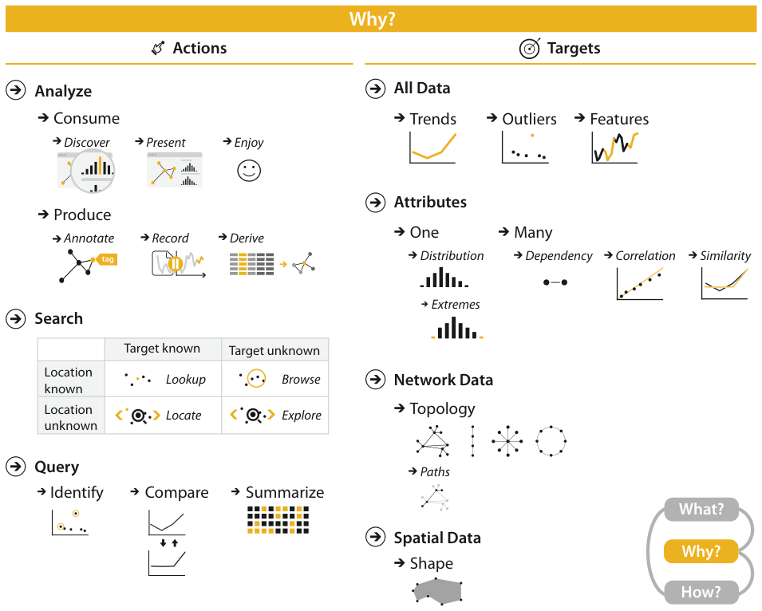

# 3.1 The Big Picture

## Actions

Figure 3.1 breaks the reasons a vis tool is used into actions and targets [pp.67-68].

<!-- verbatim p.68 -->
> The highest-level actions are to use vis to consume or produce information. The cases for consuming are to present, to discover, and to enjoy; discovery may involve generating or verifying a hypothesis.
<!-- /verbatim -->

<!-- verbatim p.68 -->
> At the middle level, search can be classified according to whether the identity and location of targets are known or not: both are known with lookup, the target is known but its location is not for locate, the location is known but the target is not for browse, and neither the target nor the location are known for explore.
<!-- /verbatim -->

<!-- verbatim p.68 -->
> At the low level, queries can have three scopes: identify one target, compare some targets, and summarize all targets.
<!-- /verbatim -->

Figure 3.1 lists the produce actions as annotate, record and derive [p.67].

## Targets

<!-- verbatim p.68 -->
> Targets for all kinds of data are finding trends and outliers. For one attribute, the target can be one value, the extremes of minimum and maximum values, or the distribution of all values across the entire attribute. For multiple attributes, the target can be dependencies, correlations, or similarities between them. The target with network data can be topology in general or paths in particular, and with spatial data the target can be shape.
<!-- /verbatim -->

Figure 3.1 also lists features as a target for all data, which the summary paragraph omits [pp.67-68].

## The vocabulary at a glance

| Level | Choices |
| --- | --- |
| Analyze: consume | present, discover, enjoy [p.68] |
| Analyze: produce | annotate, record, derive [p.67] |
| Search | lookup (target and location known), locate (target known, location not), browse (location known, target not), explore (neither known) [p.68] |
| Query | identify (one target), compare (some targets), summarize (all targets) [p.68] |
| Targets, all data | trends, outliers, features [p.67] |
| Targets, attributes | one attribute: value, extremes, distribution; many attributes: dependency, correlation, similarity [p.68] |
| Targets, network data | topology, paths [p.68] |
| Targets, spatial data | shape [p.68] |

## Figures

-  **Figure 3.1** [p.67]. Why people are using vis in terms of actions and targets.

## Related

- [3.4 Actions](s03-04-actions/node.md): definitions and examples of every action named here [p.68]
- [3.5 Targets](s03-05-targets.md): definitions of every target named here [p.68]
