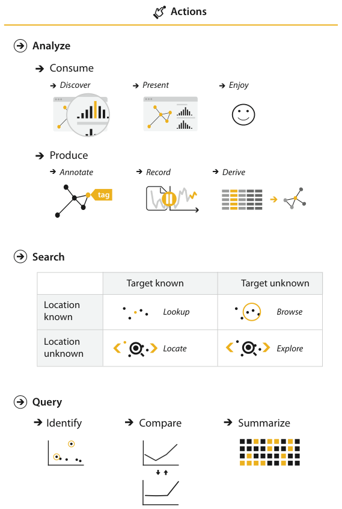
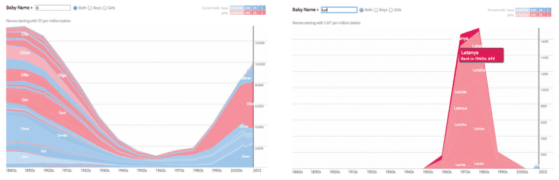

# 3.4.1 Analyze

## Consume or produce

At the highest level the framework distinguishes two goals of people analysing data with a vis tool: only to consume existing information, or also to actively produce new information [p.70]. Produce is covered in 3.4.2 [p.74].

The most common use case is consuming information already generated as data stored in a format amenable to computation [pp.70-71]. Within consume there are three goals: present something the user already understands to a third party; discover something new or analyse information not yet completely understood; or enjoy a vis to indulge casual interest in a topic [pp.71-72].

### Discover

<!-- verbatim p.72 -->
> The discover goal refers to using vis to find new knowledge that was not previously known.
<!-- /verbatim -->

Discovery may come from serendipitous observation of unexpected phenomena, or be motivated by existing theories, models, hypotheses or hunches [p.72]. It includes two outcomes [p.72]:

- **Generate** a new hypothesis, by finding completely new things [p.72].
- **Verify, or disconfirm,** an existing hypothesis, by working out whether a conjecture is true or false [p.72].

Discovery is not restricted to formal branches of science. It is often cited as the classic motivation for sophisticated interactive idioms, because the designer does not know in advance what the user will need to see [p.72].

<!-- verbatim p.72 -->
> The fundamental motivation of this analysis framework is to help you separate out the questions of why the vis is being used from how the vis idiom is designed to achieve those goals, so I will repeatedly emphasize that why doesn’t dictate how.
<!-- /verbatim -->

A margin note says the present-versus-discover distinction is very common in the vis literature, though other sources may call it explain versus explore [p.72].

### Present

<!-- verbatim p.72 -->
> The present goal refers to the use of vis for the succinct communication of information, for telling a story with data, or guiding an audience through a series of cognitive operations.
<!-- /verbatim -->

<!-- verbatim p.72 -->
> The crucial point about the present goal is that vis is being used by somebody to communicate something specific and already understood to an audience.
<!-- /verbatim -->

- **Contexts.** Decision making, planning, forecasting and instruction; collaborative or pedagogical settings. The means vary with audience size, whether the presentation is live or prerecorded, and whether the audience is co-located with the presenter [p.72].
- **Not only static.** Static information graphics, such as a newspaper diagram or a blog image, are a classic example, but present can also be pursued with dynamic idioms that include interaction and animation. Why is separable from how: presentation can be supported by a wide variety of idiom choices [pp.72-73].
- **Knowledge known in advance.** The presenter already knows what is communicated, either before using vis at all or from an earlier discover session. That second case is a chained sequence of tasks: the output of a discover session becomes the input to a present session [p.73].

### Enjoy

<!-- verbatim p.73 -->
> The enjoy goal refers to casual encounters with vis.
<!-- /verbatim -->

The user is driven not by a pressing need to verify or generate a hypothesis but by curiosity that the vis might both stimulate and satisfy. Encounters can be fleeting, such as an infographic in a blog post, or users can become engaged enough to use the tool intensively for an extended period [p.73].

**Designer and user goals can diverge.** A tool intended for discovery by one audience might be used for pure enjoyment by another. The book's analyses assume the goals are aligned, but a designer may need to consider how they diverge [p.73].

**Example: Name Voyager** (Figure 3.3). Built for expectant parents choosing a baby name: as the user types the start of a name, it shows the US popularity since 1900 of names beginning with those characters. Each name is a stripe whose height encodes popularity over time; currently popular names are brighter and gender is encoded by colour. Many people with no interest in having children used it to analyse historical trends and blogged about their findings, for their own enjoyment [pp.73-74].

## Figures

-  **Figure 3.2** [p.71]. Three levels of actions: analyze, search, and query.
-  **Figure 3.3** [p.74]. Name Voyager, a vis tool originally intended for parents focused deciding on what to name their expected baby, ended up being used by many nonparents to analyze historical trends for their own enjoyment. Left: Names starting with ‘O’ had a notable dip in popularity in the middle of the century. Right: Names starting with ‘LAT’ show a trend of the 1970s. After [Wattenberg 05, Figures 2 and 3], using <http://www.babynamewizard.com>.

## Related

- [3.4.2 Produce](s03-04-02-produce.md): the other branch of the analyze level [p.70]
- [3.3 Who: Designer or User](../s03-03-who-designer-user.md): designer and user goals, which may diverge [p.73]
- [2.4 Dataset Types](../../ch02-what-data-abstraction/s02-04-dataset-types/node.md): the dataset types the consumed data is stored as [p.70]
