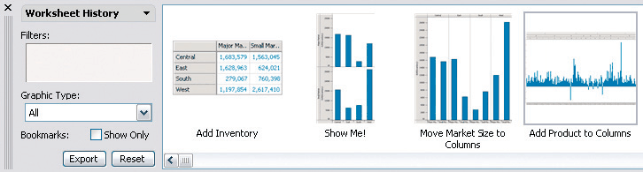
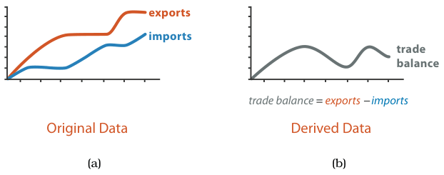

# 3.4.2 Produce

## Generating new material

<!-- verbatim p.74 -->
> In contrast to using vis only for consuming existing information, in the produce case the intent of the user is to generate new material.
<!-- /verbatim -->

The output is often used immediately as input to a next instance. It may also be meant for a later vis task such as discovery or presentation, or for a purpose that does not need vis, such as downstream analysis with nonvisual tools [p.74]. There are three kinds of produce goal: annotate, record and derive [p.74].

### Annotate

<!-- verbatim p.74 -->
> The annotate goal refers to the addition of graphical or textual annotations associated with one or more preexisting visualization elements, typically as a manual action by the user.
<!-- /verbatim -->

An annotation associated with data items can be thought of as a new attribute for them; for example, the user could label all the points in a cluster with text [p.74].

### Record

<!-- verbatim p.74 -->
> The record goal saves or captures visualization elements as persistent artifacts.
<!-- /verbatim -->

- **Artifacts** include screen shots, lists of bookmarked elements or locations, parameter settings, interaction logs and annotations [pp.74-75].
- **Record versus annotate.** Record saves a persistent artifact; annotate attaches information temporarily to existing elements. A user's annotation can later be recorded [p.75].
- **Graphical history** (Figure 3.4, from Tableau). Each task's output includes a static snapshot of the current view, and the snapshots accumulate in a branching meta-visualisation of the whole session [p.75].
- **Why record.** Recording and retaining such artifacts is often desirable for maintaining a sense of analytical provenance, allowing users to revisit earlier states or parameter settings [p.75].

### Derive

<!-- verbatim p.75 -->
> The derive goal is to produce new data elements based on existing data elements.
<!-- /verbatim -->

New attributes can be derived from information in existing ones, or data can be transformed from one type into another. Deriving is a critical part of the design process; it is usually the designer's choice but can be driven by a user [p.75]. A margin note gives transform as a synonym for derive [p.76].

<!-- verbatim p.75 -->
> When you are faced with a dataset, you should always consider whether to simply use it as is, or to transform it to another form: you could create newly derived attributes from the original ones, or even transform the dataset from the original type to another one.
<!-- /verbatim -->

There is a strong relationship between the form of the data, its attribute and dataset types, and which idioms display it effectively; the designer's hands are not tied, because the data can be transformed into a form more useful for the task [pp.75-76].

<!-- verbatim p.76 -->
> Don’t just draw what you’re given; decide what the right thing to show is, create it with a series of transformations from the original dataset, and draw that!
<!-- /verbatim -->

- **The data abstraction is a choice.** Because new data can be derived, the data abstraction is an active choice by the designer, not dictated by what the user provides. Deriving attributes and types greatly expands the space of possible idioms. The final abstraction may be the original dataset, but complex real-world tools often need derived attributes and types [p.76].
- **For critique.** When analysing an existing vis system, how its designer transformed the given dataset should be a cornerstone of the analysis [p.76].

#### Derived attributes: change of type

The derived attribute can encode the same data with a change of type. A quantitative temperature may be used raw to find anomalies in local weather; turned into an ordered attribute (hot, warm, cold) to decide whether shower water is suitable, aggregating most detail away; or turned, even more lossily, into a binary categorical attribute (burned or not burned) for toast [p.76].

#### Derived attributes: extra information

Some derivations need additional information: a categorical city name can become two quantitative attributes, latitude and longitude, through a lookup in an external database [p.76].

#### Derived attributes: operations

Derived attributes come from arithmetic, logical or statistical operations from simple to complex [p.76]. A simple, local operation subtracts two quantitative attributes to create a quantitative difference attribute that can be encoded directly [pp.76-77]. Figure 3.5 contrasts the two: for tasks that need the difference, plotting the derived trade balance (b) is preferable because the user judges position along a common frame, whereas with imports and exports plotted (a) the user must judge the height difference between two curves at each step, which is more difficult and demanding [p.77]. More complex operations need global computations across all values of an attribute, such as an average, or a correlation between two attributes [p.77].

#### Derived datasets

Datasets can be transformed into new ones of a different type, possibly in several stages [p.77]. VxInsight turned a table of 6000 yeast genes by 18 experimental-condition columns into a network: first a derived quantitative similarity score between each pair of genes, computed with statistical processing robust to nonlinear, noisy data; then a derived network whose nodes are genes, with links only for the top 20 similarity scores [pp.77-78].

## Figures

-  **Figure 3.4** [p.75]. Graphical history recorded during an analysis session with Tableau. From [Heer et al. 08, Figure 1].
-  **Figure 3.5** [p.77]. Derived attributes can be directly visually encoded. (a) Two original data attributes are plotted, imports and exports. (b) The quantitative derived attribute of trade balance, the difference between the two originals, can be plotted directly.

## Related

- [3.4.1 Analyze](s03-04-01-analyze.md): the consume branch that produce contrasts with [p.74]
- [3.7.2 Deriving One Attribute](../s03-07-analyzing-deriving-examples/s03-07-02-deriving-one-attribute.md): a worked example of a complex, global derived attribute [p.77]
- [3.7.3 Deriving Many New Attributes](../s03-07-analyzing-deriving-examples/s03-07-03-deriving-many-new-attributes.md): a worked example of multistage derivation for spatial data [p.77]
- [2.5 Attribute Types](../../ch02-what-data-abstraction/s02-05-attribute-types.md): the attribute types that annotations add and derivations convert between [p.74]
- [2.4 Dataset Types](../../ch02-what-data-abstraction/s02-04-dataset-types/node.md): the dataset types that derivation converts between, such as table to network [p.77]
