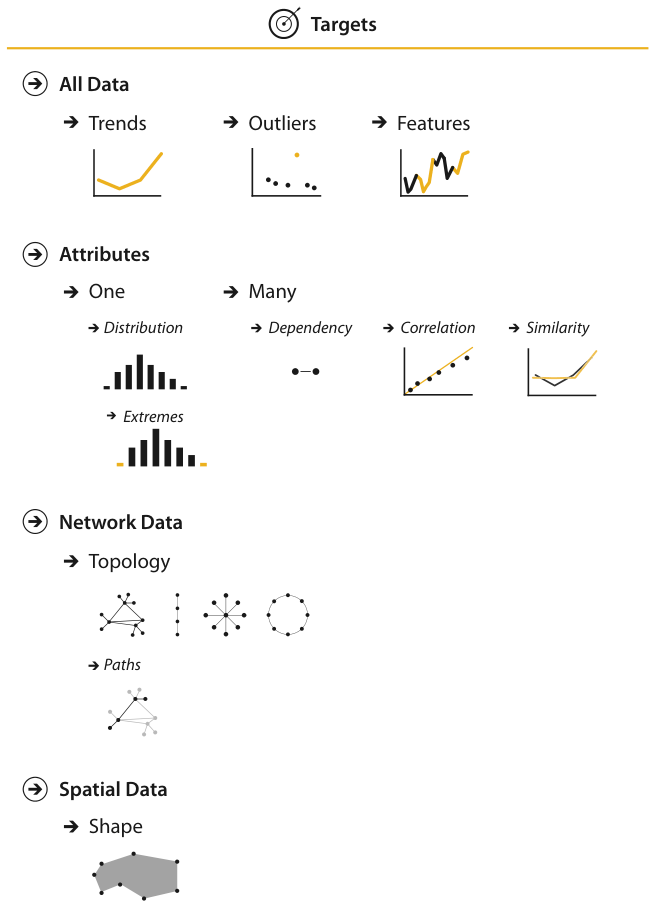

# 3.5 Targets

## What a target is

Figure 3.6 shows four kinds of abstract target [p.80].

<!-- verbatim p.80 -->
> The actions discussed above refer to a target, meaning some aspect of the data that is of interest to the user. Targets are nouns, whereas actions are verbs.
<!-- /verbatim -->

The target is explicit with search and query actions, and more implicit, but still relevant, with the use actions: for example, the thing the user presents or discovers [p.80].

## Targets by data scope

| Data scope | Targets |
| --- | --- |
| All data | trends, outliers, features [p.80] |
| One attribute | one value, extremes (minimum, maximum), distribution [p.80] [p.82] |
| Many attributes | dependency, correlation, similarity [p.82] |
| Network data | topology, paths [p.82] |
| Spatial data | shape [p.82] |

## All data: trends, outliers, features

Three high-level targets are relevant to all kinds of data [p.80].

<!-- verbatim p.80 -->
> A trend is a high-level characterization of a pattern in the data.
<!-- /verbatim -->

Simple trends include increases, decreases, peaks, troughs and plateaus; a margin note gives pattern as a synonym for trend [p.80].

<!-- verbatim p.80 -->
> Almost inevitably, some data doesn’t fit well with that backdrop; those elements are the outliers.
<!-- /verbatim -->

A margin note lists synonyms for outliers: anomalies, novelties, deviants and surprises [p.80].

<!-- verbatim p.80 -->
> The exact definition of features is task dependent, meaning any particular structures of interest.
<!-- /verbatim -->

## Attributes: one

Attributes are specific properties that are visually encoded [p.80].

<!-- verbatim p.80 -->
> The lowest-level target for an attribute is to find an individual value. Another frequent target of interest is to find the extremes: the minimum or maximum value across the range.
<!-- /verbatim -->

A very common target with high-level scope is the distribution of all values for an attribute [pp.80-82].

## Attributes: many

Some targets span multiple attributes: dependencies, correlations and similarities between attributes [p.82].

<!-- verbatim p.82 -->
> A first attribute can have a dependency on a second, where the values for the first directly depend on those of the second. There is a correlation between one attribute and another if there is a tendency for the values of second to be tied to those of the first. The similarity between two attributes can be defined as a quantitative measurement calculated on all of their values, allowing attributes to be ranked with respect to how similar, or different, they are from each other.
<!-- /verbatim -->

<!-- verbatim p.82 -->
> The abstract tasks of understanding trends, outliers, distributions, and correlations are extremely common reasons to use vis.
<!-- /verbatim -->

Each can be expressed in very diverse domain-specific terms, so watch for these abstractions [p.82].

## Dataset-specific targets: networks and spatial data

Network data specifies relationships between nodes as links [p.82].

<!-- verbatim p.82 -->
> The fundamental target with network data is to understand the structure of these interconnections; that is, the network’s topology. A more specific topological target is a path of one or more links that connects two nodes. For spatial data, understanding and comparing the geometric shape is the common target of user actions.
<!-- /verbatim -->

## Figures

-  **Figure 3.6** [p.81]. The goals of the user might be to find or understand specific aspects of the data: trends and outliers for all kinds of data; individual values, the minimum or maximum extremes of the range, or the entire distribution of a single attribute; or the dependencies, correlations, or similarities between multiple attributes; topology or paths for network data, and shape for spatial data.

## Related

- [3.4 Actions](s03-04-actions/node.md): the verbs that act on these targets [p.80]
- [2.5 Attribute Types](../ch02-what-data-abstraction/s02-05-attribute-types.md): attributes in detail [p.80]
- [2.4.2 Networks and Trees](../ch02-what-data-abstraction/s02-04-dataset-types/s02-04-02-networks-trees.md): the network dataset type whose targets are topology and paths [p.82]
- [9 Arrange Networks and Trees](../ch09-arrange-networks-trees/node.md): choices for arranging networks [p.82]
- [2.4.3.1 Spatial Fields](../ch02-what-data-abstraction/s02-04-dataset-types/s02-04-03-fields.md#s02.04.03.01): the spatial field dataset type whose target is shape [p.82]
- [2.4.4 Geometry](../ch02-what-data-abstraction/s02-04-dataset-types/s02-04-04-geometry.md): the geometry dataset type, also spatial [p.82]
- [8 Arrange Spatial Data](../ch08-arrange-spatial-data/node.md): choices for arranging spatial data [p.82]
