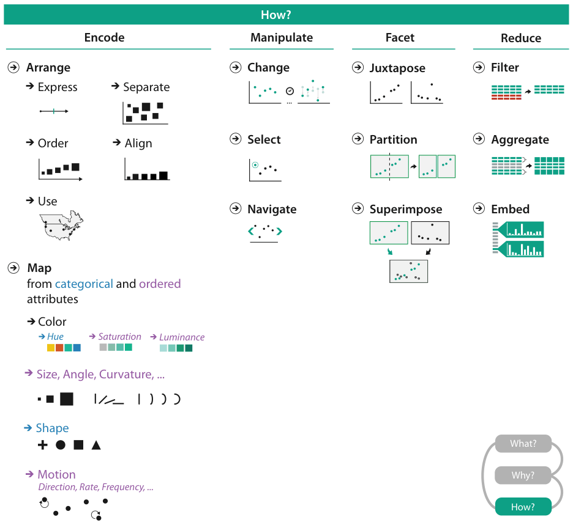

# 3.6 How: A Preview

## Four families of design choices

<!-- verbatim p.82 -->
> The third part of an analysis instance trio is how a vis idiom can be constructed out of a set of design choices.
<!-- /verbatim -->

Figure 3.7 previews these choices, broken down into four major classes: encode, manipulate, facet and reduce [pp.82-83].

| Family | Choices |
| --- | --- |
| Encode: arrange | express values; separate, order and align regions; use given spatial data [p.82] |
| Encode: map | all the nonspatial visual channels, including colour, size, angle, shape and many more [p.82] |
| Manipulate | change any aspect of the view; select elements within the view; navigate to change the viewpoint [p.82] |
| Facet | juxtapose and coordinate multiple views; partition data between views; superimpose layers [p.82] |
| Reduce | filter data away; aggregate many elements together; embed focus and context information in one view [p.83] |

- **Encode.** The family of how to encode data within a view has five choices for arranging data spatially and also covers mapping data to every nonspatial channel. Figure 3.7 shows the map channels as colour (hue, saturation, luminance), size, angle, curvature and more, shape, and motion (direction, rate, frequency and more); the figure leaves both lists open with an ellipsis [pp.82-83].
- **Manipulate.** Navigate is an aspect of change, with a rich enough set of choices to merit its own category [p.82].
- **Facet** is how to divide data between views; **reduce** is how to reduce the data shown [pp.82-83].

The rest of the book defines, describes and discusses these choices in depth [p.83].

## Figures

-  **Figure 3.7** [p.83]. How to design vis idioms: encode, manipulate, facet, and reduce.

## Related

- [7 Arrange Tables](../ch07-arrange-tables/node.md): the express, separate, order and align arrangement choices [p.82]
- [8 Arrange Spatial Data](../ch08-arrange-spatial-data/node.md): the use-given-spatial-data arrangement choice [p.82]
- [10 Map Color and Other Channels](../ch10-map-color-other-channels/node.md): mapping data to colour and other nonspatial channels [p.82]
- [11 Manipulate View](../ch11-manipulate-view/node.md): change, select and navigate [p.82]
- [12 Facet into Multiple Views](../ch12-facet-into-multiple-views/node.md): juxtapose, partition and superimpose [p.82]
- [13 Reduce Items and Attributes](../ch13-reduce-items-attributes/node.md): filter and aggregate [p.83]
- [14 Embed: Focus+Context](../ch14-embed-focus-context/node.md): embedding focus and context in a single view [p.83]
