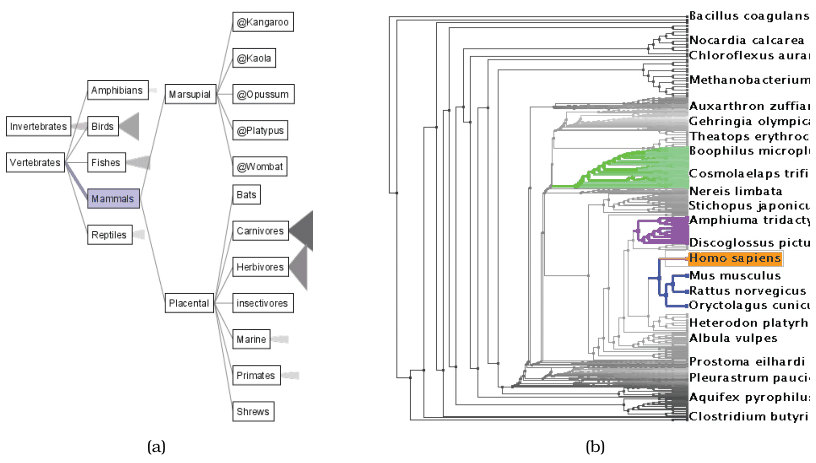
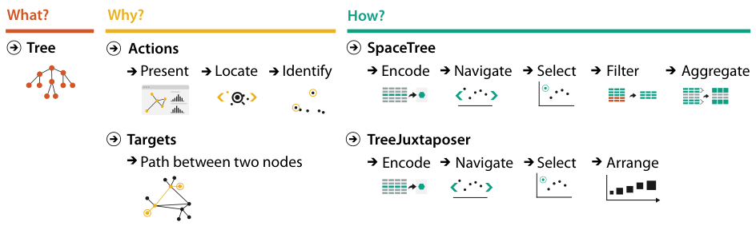

# 3.7.1 Comparing Two Idioms

## Comparative analysis

<!-- verbatim p.84 -->
> The what–why–how analysis framework is useful for comparative analysis, for example, to examine two different vis tools that have different answers for the question of how the idiom is designed when used for exactly the same context of why and what at the abstraction level.
<!-- /verbatim -->

## SpaceTree and TreeJuxtaposer

SpaceTree (Figure 3.8a) and TreeJuxtaposer (Figure 3.8b) are tree vis tools with somewhat different idioms [pp.84-85]. Figure 3.9 summarises the analysis [p.85]:

| Facet | SpaceTree | TreeJuxtaposer |
| --- | --- | --- |
| What | a large tree of nodes and links [p.85] | the same [p.85] |
| Why | present a path traced between two nodes of interest to a colleague; in more detail, locate paths between nodes and identify them [p.85] | the same [p.85] |
| How, shared | navigate; select a path, which is then encoded differently from nonselected paths by highlighting [p.85] | the same [p.85] |
| How, different | selection automatically aggregates and filters the unselected items [p.85] | the user arranges areas of the tree to keep areas of interest visible [p.85] |

The systems differ in how elements are manipulated and arranged: SpaceTree ties selection to a change of what is shown, while TreeJuxtaposer lets the user arrange the tree [p.85]. Figure 3.9 labels the target as "Path between two nodes", and lists SpaceTree's how as encode, navigate, select, filter, aggregate and TreeJuxtaposer's as encode, navigate, select, arrange [p.85].

## Figures

-  **Figure 3.8** [p.84]. Comparing two idioms. (a) SpaceTree [Plaisant et al. 02]. (b) TreeJuxtaposer. From <http://www.cs.umd>. edu/hcil/spacetree and [Munzner et al. 03, Figure 1].
-  **Figure 3.9** [p.85]. Analyzing what–why–how comparatively for the SpaceTree and TreeJuxtaposer idioms.

## Related

- [3.4.1 Analyze](../s03-04-actions/s03-04-01-analyze.md): the present goal both tools serve here [p.85]
- [3.4.3 Search](../s03-04-actions/s03-04-03-search.md): locate, the search type in this scenario [p.85]
- [3.5 Targets](../s03-05-targets.md): paths, the network target in this scenario [p.85]
- [11.4 Select Elements](../../ch11-manipulate-view/s11-04-select-elements/node.md): selection and highlighting, shared by both tools [p.85]
- [11.5 Navigate: Changing Viewpoint](../../ch11-manipulate-view/s11-05-navigate-changing-viewpoint.md): navigation, shared by both tools [p.85]
- [13 Reduce Items and Attributes](../../ch13-reduce-items-attributes/node.md): the filter and aggregate choices SpaceTree applies on selection [p.85]
