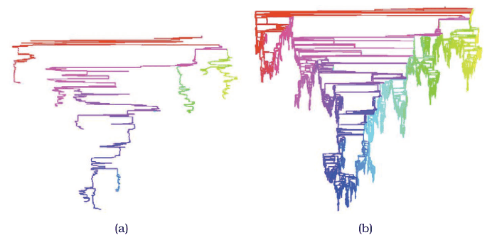
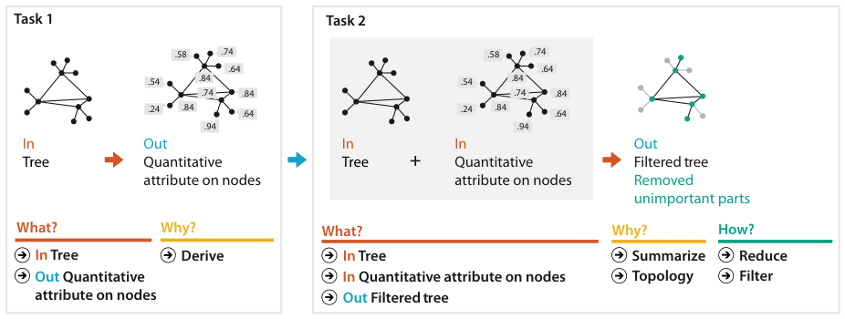

# 3.7.2 Deriving One Attribute

## Filtering by derived importance

In a vis of a complex network or tree it is useful to filter out most of the complexity and draw a simpler picture that communicates the key aspects of its topological structure. One way is to derive an attribute measuring each node's importance and filter on it. Many importance measures exist; centrality metrics take network topology into account [p.85].

## The Strahler number

The Strahler number, developed in hydrogeology to characterise the branching of rivers, has been adapted and extended for visualising trees and networks. Very central nodes have large Strahler numbers and peripheral nodes low ones [pp.85-86].

<!-- verbatim p.86 -->
> The Strahler number is an example of a derived attribute for network data that is the result of a complex and global computation, rather than simply a local calculation on a small neighborhood around a node.
<!-- /verbatim -->

## Result

Drawing only the top-ranked 5000 nodes and the links between them gives a recognisable skeleton (Figure 3.10a) of a tree of over half a million nodes (Figure 3.10b). Picking 5000 nodes at random would not give an understandable structure. Both versions are also coloured by Strahler number, to show how the centrality measure varies [p.86].

## What–why–how

Figure 3.11 analyses this as a chained sequence of two instances [pp.86-87]:

| Instance | What (in → out) | Why | How |
| --- | --- | --- | --- |
| Task 1 | tree → quantitative attribute on nodes [p.87] | derive [p.87] | |
| Task 2 | tree plus quantitative attribute on nodes → filtered tree with unimportant parts removed [p.87] | summarize topology [p.87] | reduce: filter [p.87] |

As in 3.7.1, the tree is encoded as a node–link diagram, the most common choice for arranging trees and networks [p.86].

## Figures

-  **Figure 3.10** [p.86]. The derived quantitative attribute of Strahler numbers is used to filter the tree in order to create a recognizable summary. (a) The important skeleton of a large tree is visible when only 5000 of the highest-ranked nodes are drawn. (b) The full tree has over a half million nodes. From [Auber 02, Figures 10 and 13].
-  **Figure 3.11** [p.87]. Analyzing a chained sequence of two instances where an attribute is derived in order to summarize a tree by filtering away the unimportant parts.

## Related

- [3.4.2 Produce](../s03-04-actions/s03-04-02-produce.md): the derive action, including complex global computations [p.86]
- [3.4.4 Query](../s03-04-actions/s03-04-04-query.md): summarize, the query action served here [p.86]
- [13.3 Filter](../../ch13-reduce-items-attributes/s13-03-filter/node.md): the filter choice applied to the derived attribute [p.86]
- [9.2 Connection: Link Marks](../../ch09-arrange-networks-trees/s09-02-connection-link-marks.md): node–link diagrams for trees and networks [p.86]
