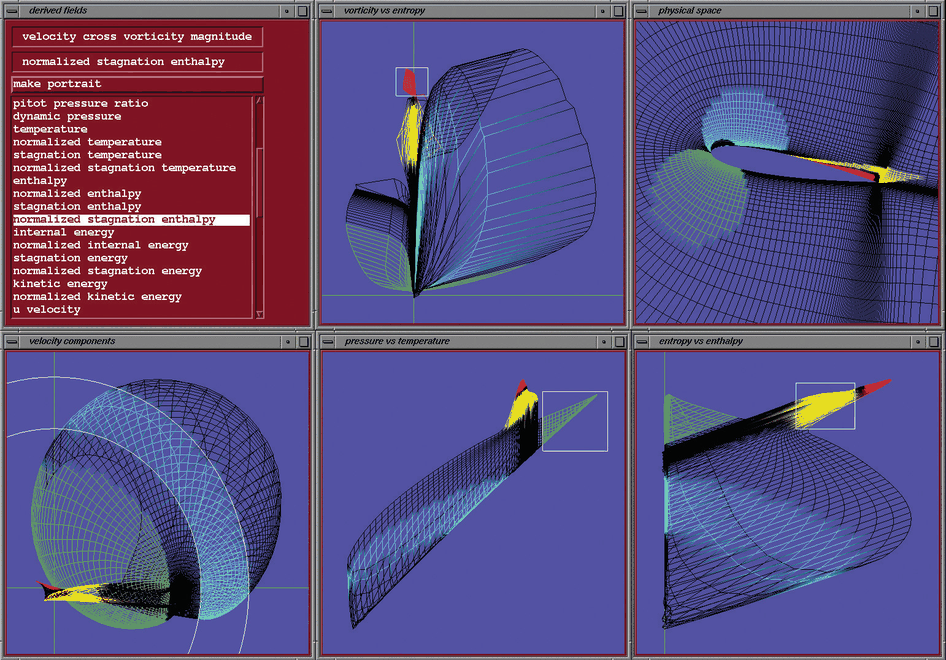
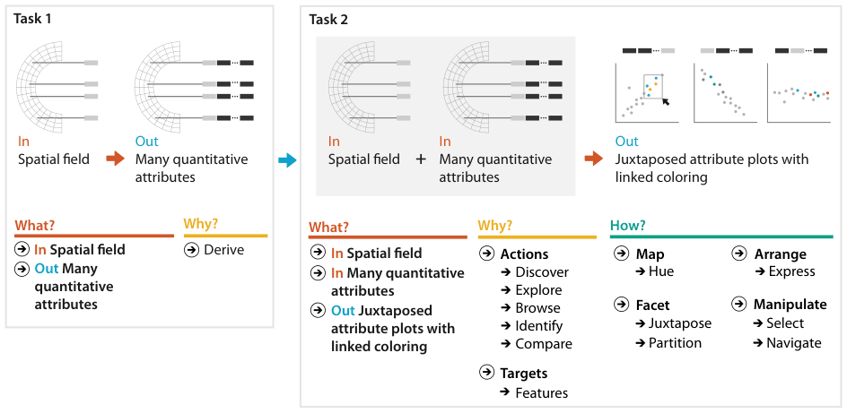

# 3.7.3 Deriving Many New Attributes

## Linked derived spaces

Data transformations help with spatial data too. In a computational fluid dynamics example, linked derived spaces are used for feature detection [p.87]. The system in Figure 3.12 lets the user quickly plot any two original or derived variables from a palette in the derived fields pane, and links the views with colour highlighting [p.87].

<!-- verbatim p.87 -->
> The power of this idiom lies in seeing where regions that are contiguous in one view fall in the other views.
<!-- /verbatim -->

## The airfoil dataset

- **Original data.** A time-varying spatial field measured along a curvilinear mesh fitted to an airfoil. The physical space pane shows it using the two spatial field variables, with undisturbed airflow entering from the left and the airfoil's back tip on the right [p.87].
- **Regions of interest.** Behind the airfoil, a red recirculation region and a yellow wake region are hard to distinguish in the physical view but easier to understand and select through the four derived views [p.87].
- **Vorticity versus enthalpy.** The recirculation zone is a coherent structure at the top, with the wake beneath it, and the zone can easily be selected there [pp.87-88].
- **Pressure versus temperature.** Both regions appear where pressure and temperature are both high, in the upper right [p.88].

<!-- verbatim p.88 -->
> Without getting into the exact technical meaning of the derived variables as used in fluid dynamics (vorticity, entropy, enthalpy, and so on), the point of this example is that many structures of interest in fluid dynamics can be seen more easily from layouts in the derived spaces.
<!-- /verbatim -->

## What–why–how

Figure 3.13 analyses a chained sequence of two instances [p.89]:

| Instance | What (in → out) | Why | How |
| --- | --- | --- | --- |
| Task 1 | spatial field → many quantitative attributes [p.89] | derive [p.89] | |
| Task 2 | spatial field plus many quantitative attributes → juxtaposed attribute plots with linked colouring [p.89] | discover; explore, browse; identify, compare; target features [p.89] | map (hue); arrange (express); facet (juxtapose, partition); manipulate (select, navigate) [p.89] |

In summary, many new quantitative attributes are derived from an original spatial field; each pair of them is encoded in a view, as is the original spatial data, and the juxtaposed views are coordinated with shared colour coding and highlighting [p.89].

## Figures

-  **Figure 3.12** [p.88]. Computational fluid dynamics vis showing the list of many derived attributes (top left), one view of the original spatial field (top right), and four other views showing pairs of selected derived attributes. The multiple juxtaposed views are coordinated with shared colored highlights. From [Henze 98, Figure 5].
-  **Figure 3.13** [p.89]. Analyzing a chained sequence, where many attributes are derived and visually encoded.

## Related

- [12 Facet into Multiple Views](../../ch12-facet-into-multiple-views/node.md): multiple views, discussed further there [p.87]
- [12.3 Juxtapose and Coordinate Views](../../ch12-facet-into-multiple-views/s12-03-juxtapose-coordinate-views/node.md): juxtaposed views coordinated by shared highlighting [p.89]
- [3.4.2 Produce](../s03-04-actions/s03-04-02-produce.md): the derive action [p.87]
- [3.5 Targets](../s03-05-targets.md): features, the target here [p.89]
- [2.4.3.1 Spatial Fields](../../ch02-what-data-abstraction/s02-04-dataset-types/s02-04-03-fields.md#s02.04.03.01): the spatial field dataset type of the original data [p.87]
