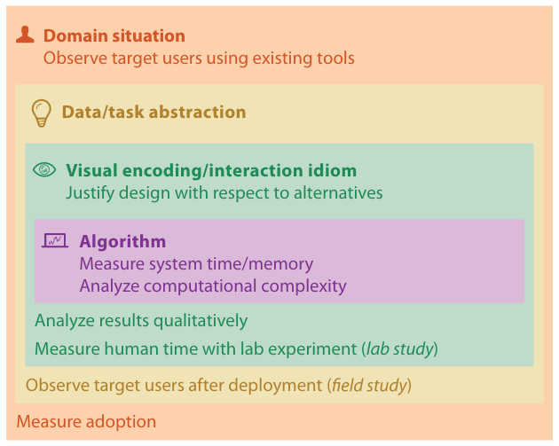

# 4.1 The Big Picture

The chapter's framework has four nested levels of design: domain situation, task and data abstraction, visual encoding and interaction idiom, and algorithm [p.92].

<!-- verbatim p.92 -->
> The task and data abstraction level addresses the why and what questions, and the idiom level addresses the question of how. Each of these levels has different threats to validity, so it's a good idea to choose your validation method with these levels in mind.
<!-- /verbatim -->

## The map in Figure 4.1

Figure 4.1 draws the levels as nested boxes and writes the validation methods inside each box [p.91]:

| Level | Validation methods in the figure | Pages |
| --- | --- | --- |
| Domain situation | Observe target users using existing tools; measure adoption | [p.91] |
| Data/task abstraction | Observe target users after deployment (field study) | [p.91] |
| Visual encoding/interaction idiom | Justify design with respect to alternatives; analyze results qualitatively; measure human time with lab experiment (lab study) | [p.91] |
| Algorithm | Measure system time/memory; analyze computational complexity | [p.91] |

In the domain, abstraction and idiom boxes, some methods are printed above the nested inner levels and others below them; the figure does not label this placement [p.91]. Section 4.6 distinguishes immediate validation from downstream validation, which needs results from the levels nested inside; its Figure 4.5 draws the same methods with the downstream ones below the inner levels [p.101].

## Figures

-  **Figure 4.1** [p.91]. The four nested levels of vis design have different threats to validity at each level, and validation approaches should be chosen accordingly.

## Related

- [4.3 Four Levels of Design](s04-03-four-levels-design/node.md): what each level decides and how the levels nest [p.92]
- [4.5 Threats to Validity](s04-05-threats-validity.md): the threat at each level that the figure's methods address [p.92]
- [4.6 Validation Approaches](s04-06-validation-approaches/node.md): each method in the figure explained [p.92]
