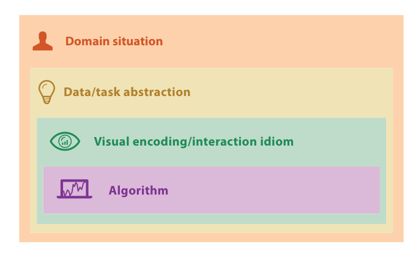

# 4.3.1 Domain Situation

## The nested model (Section 4.3 introduction)

Splitting vis design into four cascading levels gives an analysis framework that lets you address different concerns separately [p.92]. At the top is the situation level, the details of a particular application domain; next the what–why abstraction level, which maps domain-specific problems and data into domain-independent forms; then the how level of idioms for visual encoding and interaction; and last the design of algorithms that instantiate those idioms computationally [p.93].

<!-- verbatim p.93 -->
> These levels are nested; the output from an upstream level above is input to the downstream level below. A block is the outcome of the design process at that level. The challenge of this nesting is that choosing the wrong block at an upstream level inevitably cascades to all downstream levels.
<!-- /verbatim -->

A poor choice at the abstraction stage means even perfect idiom and algorithm choices will not produce a vis system that solves the intended problem [p.93]. The value of the levels is that you can analyse whether each was addressed correctly independently of the order in which decisions were made [p.93]. In practice you would not finalise one level before moving to the next: vis design is usually a highly iterative refinement in which better understanding at one level feeds back and forward into the others, an example of the principle of design as redesign [pp.93-94].

## Domain situation blocks

A domain situation block covers a group of target users, their domain of interest, their questions and their data [p.94]. "Domain" means a particular field of interest of the target users, such as microbiology, high-energy physics or e-commerce; each domain usually has its own vocabulary and an existing workflow for using its data to solve its problems. The target group can be as narrow as a handful of people at one company or as broad as anybody doing scientific research [p.94].

Examples: a computational biologist in comparative genomics using genomic sequence data to ask about the genetic source of adaptivity in a species; and, outside a work setting, members of the general public making healthcare decisions under uncertainty [p.94].

Situation blocks are identified, not designed: the outcome is the designer's understanding of the users' needs. Typical methods are interviews, observations or careful research about target users within the domain [p.94]. Working closely with a target audience to refine a design iteratively is called user-centred or human-centred design in the human–computer interaction literature [p.94].

## Why requirements are hard to get

<!-- verbatim p.94 -->
> While it might seem obvious to you that it would be a good idea to understand requirements, it's a common pitfall for designers to cut corners by making assumptions rather than actually engaging with any target users.
<!-- /verbatim -->

Users usually know they need to view their data but typically cannot articulate their analysis needs clearly, and eliciting requirements is hard even with unfettered access to fluent, immersed users [p.94]. Asking users to introspect is notoriously insufficient: what they say they do gives an incomplete picture compared with what they are observed to do [p.95].

## What a good situation block looks like

The outcome is a detailed set of questions asked about, or actions carried out by, the target users, about a possibly heterogeneous collection of data that is also understood in detail [p.95]. The comparative genomics questions "What are the differences between individual nucleotides of feature pairs?" and "What is the density of coverage and where are the gaps across a chromosome?" are specific enough; a very general question such as "What is the genetic basis of disease?" is not specific enough to feed the next level [p.95].

## Figures

-  **Figure 4.2** [p.93]. The four nested levels of vis design.

## Related

- [4.3.2 Task and Data Abstraction](s04-03-02-task-data-abstraction.md): the next level, which turns these domain questions into abstract tasks and data [p.95]
- [4.6.1 Domain Validation](../s04-06-validation-approaches/s04-06-01-domain-validation.md): how to validate a domain characterisation against the wrong-problem threat [p.94]
- [4.4 Angles of Attack](../s04-04-angles-attack.md): the pitfall of skipping the domain situation level entirely [p.94]
