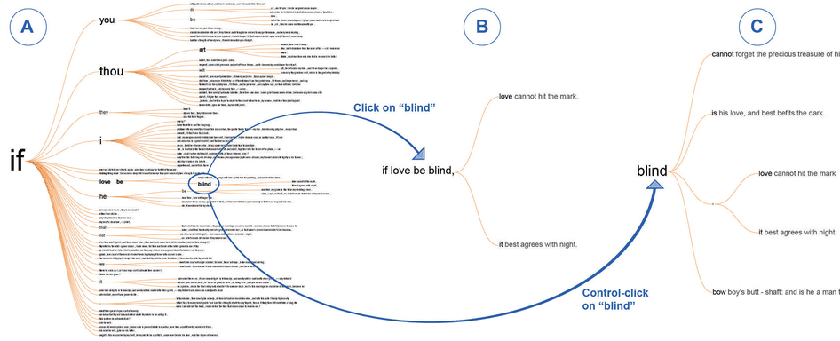

# 4.3.3 Visual Encoding and Interaction Idiom

## Two kinds of idiom

At this level you decide how to create and manipulate the visual representation of the data block chosen at the abstraction level, guided by the abstract tasks identified there. Each distinct approach is an idiom [p.96].

<!-- verbatim p.96 -->
> One set of design choices covers how to create a single picture of the data: the visual encoding idiom controls exactly what users see. Another set of questions involves how to manipulate that representation dynamically: the interaction idiom controls how users change what they see.
<!-- /verbatim -->

Word Tree (Figure 4.3) combines the encoding idiom of a horizontal hierarchical tree of keywords, which preserves the context of their use in the original text, with the interaction idiom of navigation by keyword selection [p.96]. Encoding and interaction can often be analysed as separable decisions, but sometimes they are so intertwined that the outcome is best treated as one combined idiom [p.96].

## Idiom blocks are designed

Idiom blocks are the outcome of the designer's decisions. The design space of static encoding idioms is already enormous, and adding dynamic manipulation makes it bigger [p.96]. The nested model has you identify task abstractions and decide data abstractions first exactly so you can rule out many idioms as a bad match for the users' goals [p.97].

<!-- verbatim p.97 -->
> You should make decisions about good and bad matches based on understanding human abilities, especially in terms of visual perception and memory.
<!-- /verbatim -->

Many vis tools offer several idioms to choose between, but some are deliberately narrow, supporting a few idioms or only one [p.97].

## Figures

-  **Figure 4.3** [p.97]. Word Tree combines the visual encoding idiom of a hierarchical tree of keywords laid out horizontally and the interaction idiom of navigation based on keyword selection. From [Wattenberg and Viegas 08, Figure 3].

## Related

- [5 Marks and Channels](../../ch05-marks-channels/node.md): perception principles relevant to idiom choices [p.97]
- [6 Rules of Thumb](../../ch06-rules-thumb/node.md): perception and memory principles relevant to idiom choices [p.97]
- [7 Arrange Tables](../../ch07-arrange-tables/node.md): the first of Chapters 7 to 14, which survey the idiom design space [p.96]
- [11 Manipulate View](../../ch11-manipulate-view/node.md): interaction idioms for changing what users see [p.96]
- [4.6.3 Idiom Validation](../s04-06-validation-approaches/s04-06-03-idiom-validation.md): how to test whether an idiom communicates the abstraction [p.97]
- [4.3.4 Algorithm](s04-03-04-algorithm.md): the computational level that instantiates the idiom [p.97]
