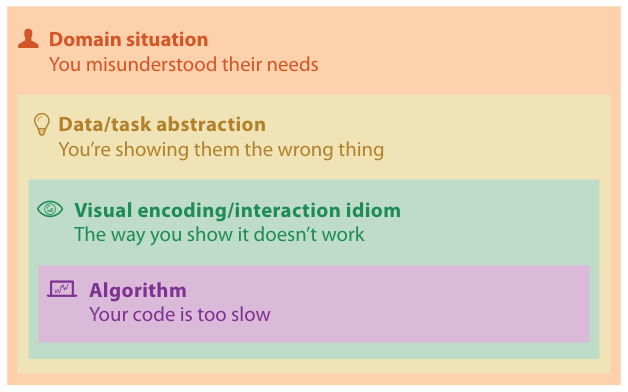

# 4.5 Threats to Validity

Validating a design's effectiveness is difficult because so many questions are on the table. Considering validity at each nested level separately helps you find your way through them, just as the levels constrain the design process itself [pp.99-100].

Each level has a different set of threats to validity, that is, different fundamental reasons why you might have made the wrong choices. In Figure 4.4's summary, "they" means the target users and "you" means the vis designer [p.100]:

<!-- verbatim p.100 -->
> • Wrong problem: You misunderstood their needs.
> • Wrong abstraction: You're showing them the wrong thing.
> • Wrong idiom: The way you show it doesn't work.
> • Wrong algorithm: Your code is too slow.
<!-- /verbatim -->

## Terms

- The phrase "threats to validity" is borrowed from computer security by way of software engineering [p.100].
- The book says validation rather than evaluation to stress that validation is required at every level and extends beyond user studies and ethnographic observation to complexity analysis and benchmark timings [p.100].
- In software engineering, validation asks whether you built the right product and verification asks whether you built the product right; the simulation community likewise separates validating a scientific model against real-world observation from verifying the implementation. The book's "validation" covers both questions [p.100].

## Figures

-  **Figure 4.4** [p.100]. The four nested levels of vis design have different threats to validity at each level.

## Related

- [1.12 Why Is Validation Difficult?](../ch01-whats-vis-why/s01-12-why-validation-difficult.md): the many validation questions this section sorts by level [p.99]
- [4.6 Validation Approaches](s04-06-validation-approaches/node.md): the methods that address each threat [p.100]
- [4.3 Four Levels of Design](s04-03-four-levels-design/node.md): what is decided at each level the threats apply to [p.100]
