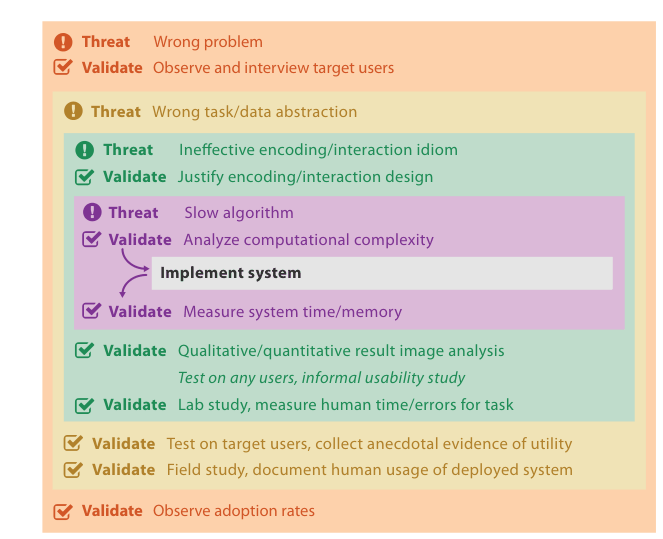

# 4.6.1 Domain Validation

## Threats and methods at every level (Section 4.6 introduction)

Different threats need very different validation approaches. The book only outlines each method and points to Further Reading for fuller discussion [pp.100-101]. Figure 4.5 summarises them [p.101]:

| Level | Threat | Immediate validation | Downstream validation | Pages |
| --- | --- | --- | --- | --- |
| Domain situation | Wrong problem | Observe and interview target users | Observe adoption rates | [p.101] |
| Data/task abstraction | Wrong task/data abstraction | None shown | Test on target users, collect anecdotal evidence of utility; field study, document human usage of deployed system | [p.101] |
| Encoding/interaction idiom | Ineffective encoding/interaction idiom | Justify encoding/interaction design | Qualitative/quantitative result image analysis; lab study, measure human time/errors for task (the figure also lists "test on any users, informal usability study", without a "Validate" label) | [p.101] |
| Algorithm | Slow algorithm | Analyze computational complexity | Measure system time/memory | [p.101] |

The timing columns are read from Figure 4.5's layout and the text of 4.6.1 to 4.6.4, where each method is called immediate or downstream. In the figure, "Implement system" sits inside the algorithm box between complexity analysis and timing measurement, and every downstream method is listed below it [pp.101-105]. The informal usability study appears in the figure without a "Validate" label; the book refuses to call it a validation method [p.101] [p.104].

<!-- verbatim p.101 -->
> An important corollary of the model having nested levels is that most kinds of validation for the outer levels are not immediate because they require results from the downstream levels nested within them.
<!-- /verbatim -->

These dependencies make validation harder: a poor test result may misdirect attention upstream when the real problem is a poor choice at the current level. A poor encoding can cast doubt on a legitimate abstraction, and a poor algorithm on an interaction technique [p.101].

<!-- verbatim pp.101-102 -->
> Despite their difficulties, the downstream validations are necessary. The immediate validations only offer partial evidence of success; none of them are sufficient to demonstrate that the threat to validity at that level has been addressed.
<!-- /verbatim -->

You need not complete full design and implementation at each level before any downstream validation. Rapid prototyping methods create low-fidelity stand-ins so downstream validation happens sooner; paper prototypes and Wizard of Oz testing can get target users' feedback on abstraction and encoding designs before any algorithm is designed or implemented [p.102].

## Domain validation

Characterising the domain situation asserts that particular problems of the target audience would benefit from vis tool support. The primary threat is that the problem is mischaracterised: the target users do not in fact have these problems [p.102].

**Immediate.** Interview and observe the target audience to verify the characterisation, rather than relying on assumptions or conjectures [p.102]. A common approach is a field study, observing people in real-world settings rather than a laboratory; for domain assessment these often gather qualitative data through semi-structured interviews [p.102]. Contextual inquiry, where the researcher observes users in their real context and interrupts to ask questions when clarification is needed, is typically better suited to vis designers than silent observation because the targeted cognitive tasks are complex [p.102].

**Downstream.** Report the rate at which the target audience has adopted the tool [p.102]. Adoption does not tell the whole story: many well-designed tools are not adopted and some poorly designed ones win in the marketplace. Its value is that it reports what target users do of their own accord, not when asked to use a tool [p.102].

<!-- verbatim pp.102-103 -->
> In particular, a tool that is actually used by its intended users has reached a different level of success than one that has only been used by its designers.
<!-- /verbatim -->

## Figures

-  **Figure 4.5** [p.101]. Threats and validation at each of the four levels. Many threats at the outer levels require downstream validation, which cannot be carried out until the inner levels within them are addressed, as shown by the red lines. Any single project would only address a subset of these levels, not all of them at once.

## Related

- [4.3.1 Domain Situation](../s04-03-four-levels-design/s04-03-01-domain-situation.md): what a domain characterisation should contain [p.102]
- [4.6.2 Abstraction Validation](s04-06-02-abstraction-validation.md): the next level's validation, including the post-deployment field study [p.102]
- [4.7.2 MatrixExplorer](../s04-07-validation-examples/s04-07-02-matrixexplorer.md): a domain level validated by interviews and participatory design [p.102]
- [4.8 Further Reading](../s04-08-further-reading.md): contextual inquiry and field study sources [p.102]
