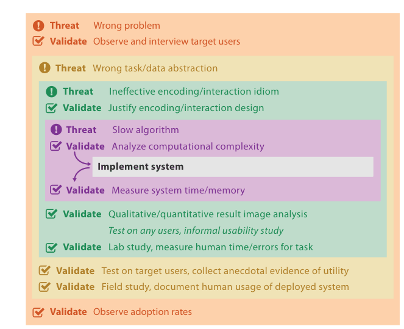

# 4.6.3 Idiom Validation

The threat at the encoding and interaction idiom level is that the chosen idioms are not effective at communicating the desired abstraction to the person using the system [p.103].

## Immediate: justify the design

Carefully justify the idiom design with respect to known perceptual and cognitive principles [p.103]. Heuristic evaluation and expert review are ways to systematically ensure that the design violates no known guidelines [p.103].

## Downstream: lab study

A lab study is a controlled experiment in a laboratory setting, appropriate for teasing out the impact of specific idiom design choices by measuring human performance on abstract tasks chosen by the study designers [p.104].

- **Measurements.** Objective time and errors are extremely common; subjective preferences are also popular. Some studies log mouse moves and clicks or track eye movements; qualitative data often comes from questionnaires asking participants to reflect on their strategies [p.104].
- **Statistics.** Expected variation in human behaviour is small enough here that experiments can include enough participants to test for statistical significance [p.104].
- **Terminology.** "User study" is used ambiguously in the literature, sometimes for lab studies only and sometimes also for field studies; the book uses it broadly for both [p.104].

## Downstream: result images and quality metrics

- **Qualitative discussion of still images or video.** Downstream because it needs an implemented system [p.104]. It is strongest with an explicit discussion of the desirable properties in the results, rather than assuming every reader will make the desired inferences unassisted. Such discussions sometimes take the form of usage scenarios arguing the tool is useful for a particular task–dataset combination [p.104].
- **Quantitative measurement of result images, often called quality metrics.** For node–link drawings, many layout metrics such as the number of edge crossings and edge bends have been proposed; some have been tested against human judgement, while others remain unproved conjectures [p.104].

## Usability studies are not validation

Informal usability studies appear in Figure 4.5, but the book specifically refrains from calling them a validation method, quoting Andrews [p.104]:

<!-- verbatim p.104 -->
> "Formative methods [including usability studies] lead to better and more usable systems, but neither offer validation of an approach nor provide evidence of the superiority of an approach for a particular context" [Andrews 08].
<!-- /verbatim -->

They are listed at this level because it is a very good idea to run them before a validating lab or field study: if the system is unusable, a user study can draw no useful conclusions about its utility [pp.104-105]. They differ from the informal testing with target users at the abstraction level, whose goal is anecdotal evidence that the system meets its design goals; such anecdotes convince far less when they come from a random person. In a usability study the user need not be in the target audience, only not the system designer [p.105].

## Figures

-  **Figure 4.5** [p.101]. Threats and validation at each of the four levels. Many threats at the outer levels require downstream validation, which cannot be carried out until the inner levels within them are addressed, as shown by the red lines. Any single project would only address a subset of these levels, not all of them at once.

## Related

- [5 Marks and Channels](../../ch05-marks-channels/node.md): perceptual principles for justifying an idiom [p.103]
- [6 Rules of Thumb](../../ch06-rules-thumb/node.md): perceptual and cognitive principles for justifying an idiom [p.103]
- [4.3.3 Visual Encoding and Interaction Idiom](../s04-03-four-levels-design/s04-03-03-visual-encoding-interaction-idiom.md): what an idiom block is [p.103]
- [4.6.2 Abstraction Validation](s04-06-02-abstraction-validation.md): informal testing with target users, contrasted with usability studies [p.105]
- [4.7.6 Sizing the Horizon](../s04-07-validation-examples/s04-07-06-sizing-horizon.md): a paper validated by lab studies at this level [p.104]
- [4.7.5 LinLog](../s04-07-validation-examples/s04-07-05-linlog.md): an idiom validated by qualitative and quantitative image analysis [p.104]
