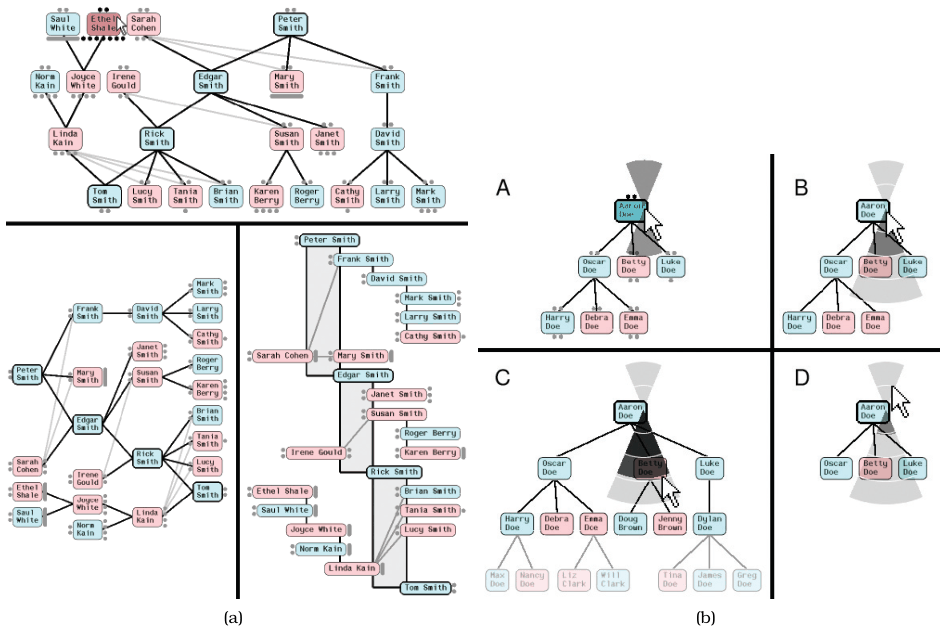
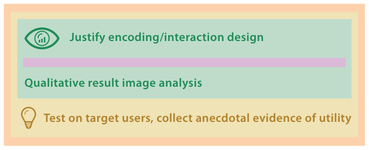

# 4.7.1 Genealogical Graphs

Section 4.7 analyses several research papers by the levels they target and the methods used to validate their benefits; they also preview approaches discussed later in the book [p.106].

## The system

McGuffin and Balakrishnan present a system for visualising genealogical graphs [p.106]. They propose several new encoding idioms, including one based on the dual-tree, a subgraph formed by the union of two trees (Figure 4.6a). The prototype has sophisticated interaction idioms: automatic camera framing, animated transitions, and a new widget for ballistically dragging out subtrees to arbitrary depths (Figure 4.6b) [p.107].

## Levels addressed

The book calls this an exemplary paper that explicitly covers all four levels [p.107].

- **Domain situation.** Handled concisely but clearly: the domain is genealogy, with a brief discussion of the needs and current tools of genealogical hobbyists [p.107].
- **Abstraction.** Where the paper particularly shines. The term "family tree" is highly misleading because the data type is a more general graph with specialised structural constraints; they discuss when it is a true tree, a multitree or a directed acyclic graph [pp.107-108]. They map the domain problem of recognising nuclear family structure to the abstract task of determining subgraph structure [p.108].
- **Idiom.** They discuss strengths and weaknesses of encodings using connection, containment, adjacency and alignment, and indentation; present two more specialised idioms in passing, fractal node–link and containment for free trees; then present their main encoding in detail. They also carefully address interaction idiom design [p.108].
- **Algorithm.** They concisely cover the algorithmic details of dual-tree layout [p.108].

## Validation methods (Figure 4.7)

Three methods are used [p.108]:

- Immediate justification of encoding and interaction design decisions in terms of established principles [p.108].
- Downstream qualitative discussion of result images and videos [p.108].
- At the abstraction level, downstream informal testing of a prototype with a target user to collect anecdotal evidence [p.108].

## Figures

-  **Figure 4.6** [p.107]. Genealogical graphs. (a) Three layouts for the dual-tree: classical node–link top-to-bottom at the top, classical left-to-right on the left, and the new indented outline algorithm on the right. (b) Widget for subtree collapsing and expanding with ballistic drags. From [McGuffin and Balakrishnan 05, Figures 13 and 14].
-  **Figure 4.7** [p.108]. Genealogical graphs [McGuffin and Balakrishnan 05] validation levels.

## Related

- [9 Arrange Networks and Trees](../../ch09-arrange-networks-trees/node.md): design choices for encoding network data [p.108]
- [9.5 Containment: Hierarchy Marks](../../ch09-arrange-networks-trees/s09-05-containment-hierarchy-marks.md): containment and indented layouts among the encodings the paper weighs [p.108]
- [4.6.2 Abstraction Validation](../s04-06-validation-approaches/s04-06-02-abstraction-validation.md): the anecdotal target-user testing this paper uses [p.108]
- [4.6.3 Idiom Validation](../s04-06-validation-approaches/s04-06-03-idiom-validation.md): justification and result-image discussion [p.108]
