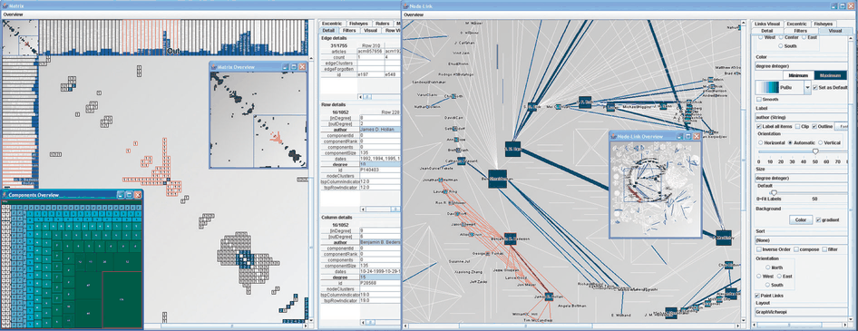
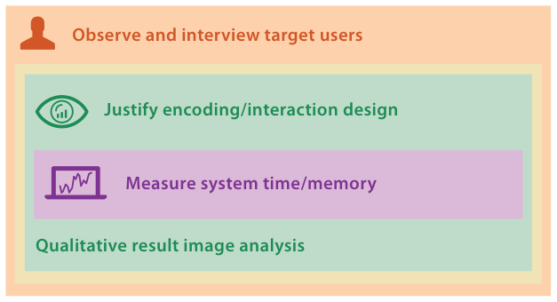

# 4.7.2 MatrixExplorer

## The system

Henry and Fekete's MatrixExplorer supports social network analysis (Figure 4.8) [p.108]. Its design comes from requirements formalised by interviews and participatory design sessions with social science researchers [pp.108-109]. It uses matrix representations to minimise clutter for large and dense graphs and the more intuitive node–link representations for smaller networks [p.109].

## Levels addressed and validation (Figure 4.9)

All four levels are addressed, with validation at three [p.109].

- **Domain situation.** Explicit characterisation of the social network analysis domain, validated qualitatively by interviews and an exploratory study using participatory design with social scientists and other researchers who use social network data [p.109].
- **Abstraction.** A detailed list of the target users' requirements in terms of abstract tasks and data [p.109].
- **Idiom.** A thorough discussion of the primary decision to show the data with both node–link and matrix views, plus many secondary encoding issues, and of basic interaction idioms and more complex interactive reordering and clustering [p.109]. Both are validated immediately by justifying the decisions, and downstream by extensive qualitative discussion of result images [p.109].
- **Algorithm.** The focus is the reordering algorithm; downstream benchmark timings are mentioned very briefly [p.109].

Figure 4.9 shows the four methods: observe and interview target users, justify encoding/interaction design, qualitative result image analysis, and measure system time/memory [p.110].

## Figures

-  **Figure 4.8** [p.109]. MatrixExplorer features both node–link and matrix representations in an interface designed for sociolo-gists and historians to explore social networks. From [Henry and Fekete 06, Figure 1].
-  **Figure 4.9** [p.110]. MatrixExplorer [Henry and Fekete 06] validation methods.

## Related

- [9.4 Costs and Benefits: Connection versus Matrix](../../ch09-arrange-networks-trees/s09-04-costs-benefits-connection-matrix.md): strengths and weaknesses of matrix and node–link views [p.109]
- [Adjacency Matrix View](../../idioms/adjacency-matrix-view.md): the matrix idiom MatrixExplorer uses for large, dense graphs [p.109]
- [7.5 Separate, Order, and Align: Categorical Regions](../../ch07-arrange-tables/s07-05-separate-order-align-categorical/node.md): reordering, which MatrixExplorer supports interactively [p.109]
- [4.6.1 Domain Validation](../s04-06-validation-approaches/s04-06-01-domain-validation.md): interviews and observation as domain validation [p.109]
