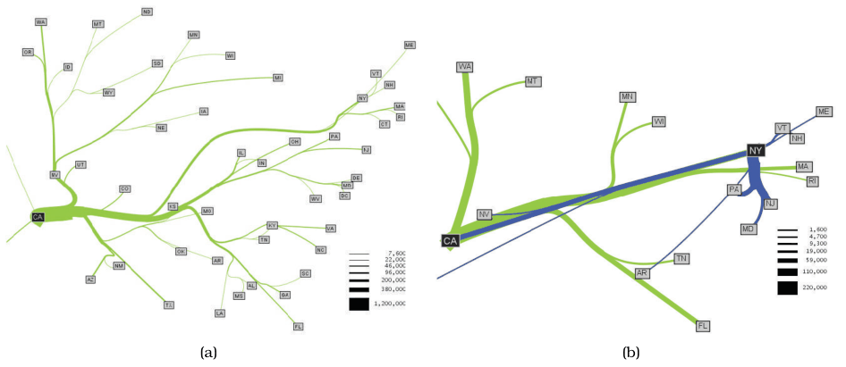
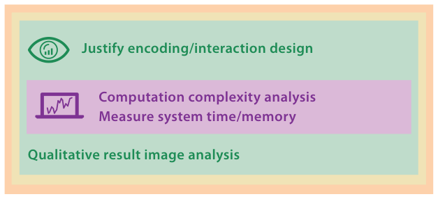

# 4.7.3 Flow Maps

## The system

Phan et al. propose a system for creating flow maps, which show the movement of objects from one location to another, demonstrated on network traffic, census data and trade data [p.110]. Flow maps reduce visual clutter by merging edges, but most earlier ones were hand drawn. The paper gives automatic techniques, inspired by graph layout algorithms, that minimise edge crossings and distort node positions while keeping relative positions (Figure 4.10) [p.110]. Figure 4.10(a) shows migration to California and 4.10(b) the top ten states sending migrants to California and New York [p.110].

## Levels addressed

- **Algorithm.** The paper's focus is the innermost algorithm level [p.110].
- **Abstraction.** Its analysis of the useful characteristics of hand-drawn flow maps falls at this level [p.110].
- **Idiom.** A brief but explicit description of the layout algorithm's goals: intelligent distortion of positions so the separation between nodes exceeds the maximum flow-line thickness, while keeping left–right and up–down ordering [p.110]. The authors justify three fundamental requirements as the outcome of analysing hand-drawn diagrams: intelligent distortion of positions, merging of edges that share destinations, and intelligent edge routing [p.112].
- **Domain situation.** Addressed implicitly rather than explicitly: there is no discussion of who uses flow maps and why, though the analysis of hand-drawn maps could be construed as an implicit claim of longstanding usage needs [p.110].

## Validation methods (Figure 4.11)

Four methods are used [p.111]:

- Immediate complexity analysis at the algorithm level [p.111].
- A brief downstream report of system timing: all images were computed in a few seconds [p.111].
- A more involved downstream qualitative discussion of result images, intended mainly to address algorithm correctness rather than the encoding idiom level [pp.111-112].
- At the idiom level, justification of the three requirements derived from hand-drawn diagrams [p.112].

## Figures

-  **Figure 4.10** [p.111]. Flow maps showing migration patterns from 1995 to 2000 US Census data. (a) Migration from California. (b) The top ten states that sent migrants to California shown in green, and to New York in blue. From [Phan et al. 05, Figures 1c and 10].
-  **Figure 4.11** [p.111]. Flow map [Phan et al. 05] validation methods.

## Related

- [8.3.1 Geographic Data](../../ch08-arrange-spatial-data/s08-03-geometry.md#s08.03.01): visual encoding of geographic data [p.110]
- [4.6.4 Algorithm Validation](../s04-06-validation-approaches/s04-06-04-algorithm-validation.md): complexity, timings and implicit correctness validation through result images [p.111]
- [4.7.5 LinLog](s04-07-05-linlog.md): another layout paper, whose contribution is at the idiom level instead [p.110]
