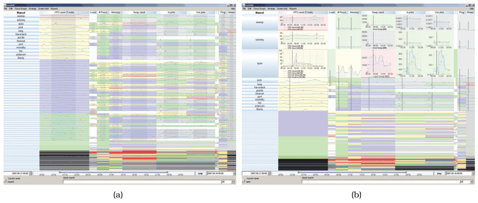
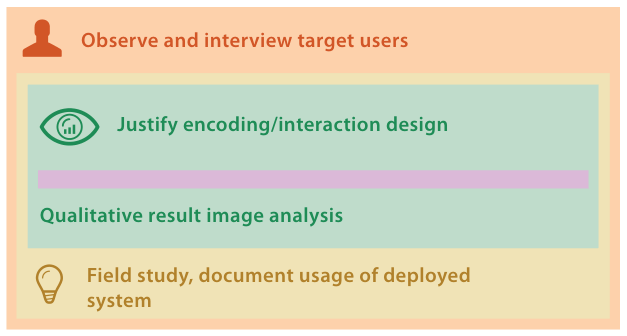

# 4.7.4 LiveRAC

## The system

McLachlan et al.'s LiveRAC explores system management time-series data [p.112]. It uses a reorderable matrix of charts with stretch and squish navigation combined with semantic zooming, so each chart's visual representation adapts to the available space [p.112]. In Figure 4.12(a), small boxes show a single attribute encoded with colour and somewhat larger boxes show concise line charts; in 4.12(b) the top three rows are enlarged enough that the representation switches to detailed charts with axes and labels [p.112]. The paper reports an informal longitudinal field study of its deployment to operators of a large corporate web hosting service [pp.112-113].

## Levels addressed and validation (Figure 4.13)

Four validation methods are used [p.113].

- **Domain situation.** The paper explains the roles, activities, existing workflow and tools of system management professionals, validated by interviews with the target audience [p.113]. Because management approval was needed for access to the true target users, the phased methodology mixed immediate and downstream timing: many interviews happened after a working prototype existed. The book calls this a good example of the iterative process of Section 4.3 [p.113].
- **Abstraction.** The choice of a collection of time-series data is discussed early, but in reverse: the authors justify the domain as a suitable one for studying this data type, rather than justifying the data type for the domain [p.113]. Explicit design requirements include abstract tasks such as search, sort and filter. Downstream validation is a longitudinal field study of the system deployed to its target users, life cycle engineers for managed hosting services in a large corporation [p.113].
- **Idiom.** An extensive discussion of design choices, validated immediately by justification in terms of design principles and downstream by qualitative discussion of results [pp.113-114].
- **Algorithm.** Not discussed [p.114].

## Figures

-  **Figure 4.12** [p.112]. LiveRAC supports exploration of system management time-series data with a reorderable matrix and semantic zooming. (a) The first several dozen rows have been stretched out to show sparklines for the devices. (b) The top three rows have been enlarged more, so the charts appear in full detail. From [McLachlan et al. 08, Figure 3].
-  **Figure 4.13** [p.113]. LiveRAC [McLachlan et al. 08] validation methods.

## Related

- [7.5.2 Matrix Alignment: Two Keys](../../ch07-arrange-tables/s07-05-separate-order-align-categorical/s07-05-02-matrix-alignment-two-keys.md): reorderable matrix alignments [p.112]
- [11.5.2 Semantic Zooming](../../ch11-manipulate-view/s11-05-navigate-changing-viewpoint.md#s11.05.02): representations that change with available space [p.112]
- [14.5 Distort](../../ch14-embed-focus-context/s14-05-distort.md): stretch and squish navigation [p.112]
- [Semantic Zooming](../../idioms/semantic-zooming.md): the idiom card for semantic zooming [p.112]
- [Stretch and Squish Navigation](../../idioms/stretch-and-squish-navigation.md): the idiom card for stretch and squish navigation [p.112]
- [4.3 Four Levels of Design](../s04-03-four-levels-design/node.md): the iterative process this project illustrates [p.113]
- [4.6.2 Abstraction Validation](../s04-06-validation-approaches/s04-06-02-abstraction-validation.md): the deployed field study as abstraction validation [p.113]
