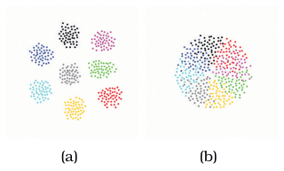
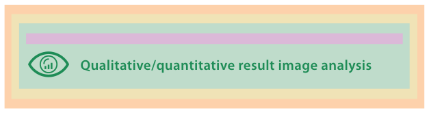

# 4.7.5 LinLog

## The contribution

Noack's LinLog paper introduces an energy model for graph drawing designed to reveal clusters, defined as sets of nodes with many internal edges and few edges to nodes outside the set [p.114]. Energy-based and force-directed methods are related, heavily used approaches to network layout. Earlier models enforced a layout metric of uniform edge lengths, but Noack points out that visually distinguishable clusters need long edges between them [p.114]. Figure 4.14(a) shows LinLog separating clusters, against the "indifferentiated blob" of the Fructerman-Reingold model in 4.14(b) [p.114].

## Which level: idiom, not algorithm

<!-- verbatim p.114 -->
> Although a quick glance might lead to an assumption that this graph drawing paper has a focus on algorithms, the primary contribution is in fact at the visual encoding idiom level.
<!-- /verbatim -->

Noack distinguishes the energy model itself from the algorithm that searches for a minimum-energy state. In the nested model's vocabulary the LinLog energy model is a visual encoding idiom: requiring longer edges between clusters than within them is an encoding using the spatial position channel [pp.114-115].

## Levels addressed

- **Algorithm.** Not addressed. Noack leaves better energy-minimisation algorithms as future work and uses previously proposed ones to show the results [p.115].
- **Domain situation.** Handled concisely but adequately by referencing previous work on application domains with graph data that need clusters to be seen [p.115].
- **Abstraction.** The paper does not use the vocabulary of task and data abstraction, but clearly states that the abstract task is finding clusters and the data abstraction is a network [p.115].

## Validation methods (Figure 4.15)

Two methods are used, qualitative and quantitative result image analysis [p.114]:

- A downstream qualitative discussion of result images, appropriate for an encoding-level contribution [p.115].
- Mathematical proof, a method not listed in the model because it is rare in vis. The proofs concern the optimality of the model's results under quantitative metrics of edge lengths and node distances, so the model classes them as quantitative image analysis, another appropriate idiom-level method [p.115].

## Figures

-  **Figure 4.14** [p.114]. The LinLog energy model reveals clusters in node–link graphs. (a) LinLog clearly shows clusters with spatial separation. (b) The popular Fructerman-Reingold model for force-directed placement does not separate the clusters. From [Noack 03, Figure 1].
-  **Figure 4.15** [p.115]. LinLog [Noack 03] validation methods.

## Related

- [9.2 Connection: Link Marks](../../ch09-arrange-networks-trees/s09-02-connection-link-marks.md): force-directed placement [p.114]
- [Force-Directed Placement](../../idioms/force-directed-placement.md): the idiom family LinLog's energy model belongs to [p.114]
- [4.4 Angles of Attack](../s04-04-angles-attack.md): telling a new algorithm from a new idiom [p.114]
- [4.6.3 Idiom Validation](../s04-06-validation-approaches/s04-06-03-idiom-validation.md): result image analysis and quality metrics [p.115]
