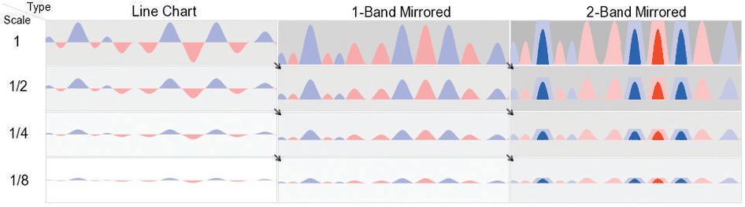
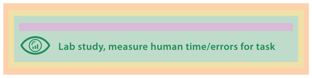

# 4.7.6 Sizing the Horizon

Heer et al. compare line charts with the more space-efficient horizon graphs (Figure 4.16) [p.115]. They identify transition points at which reducing chart height causes significantly different drops in estimation accuracy across the chart types, and find optimal positions on the speed–accuracy trade-off curve where viewers performed quickly without drops in accuracy [p.115].

The paper's lab studies are designed to validate, or invalidate, specific design choices at the visual encoding and interaction idiom level by measuring the time and error rates of people carrying out abstracted tasks (Figure 4.17) [pp.115-116].

## Figures

-  **Figure 4.16** [p.116]. Experiment 2 of Sizing the Horizon compared filled line charts, one-band horizon graphs, and two-band horizon graphs of different sizes to find transition points where reducing chart height results in major drops in estimation accuracy across chart types. From [Heer et al. 09, Figure 7].
-  **Figure 4.17** [p.116]. Lab studies as a validation method.

## Related

- [9.2 Connection: Link Marks](../../ch09-arrange-networks-trees/s09-02-connection-link-marks.md): the book's margin note says line charts are discussed in Section 9.2 [p.115]
- [Line Charts](../../idioms/line-charts.md): the line-chart idiom card, planned under Section 7.5.1 [p.115]
- [4.6.3 Idiom Validation](../s04-06-validation-approaches/s04-06-03-idiom-validation.md): lab studies as idiom-level validation [p.116]
