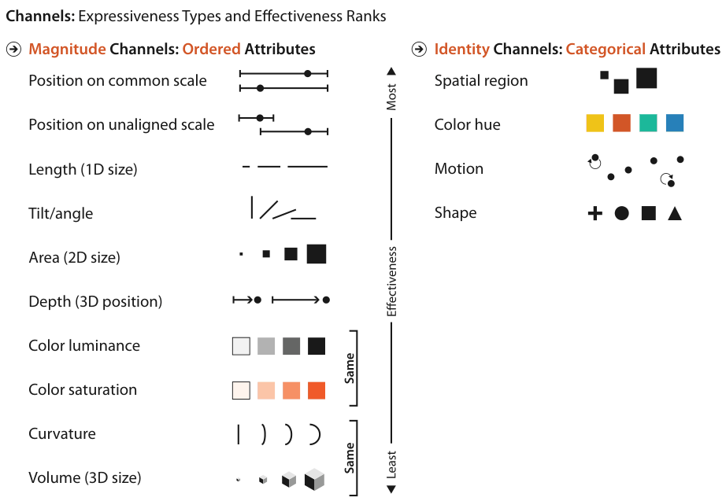

# 5.1 The Big Picture

<!-- verbatim p.120 -->
> Marks are basic geometric elements that depict items or links, and channels control their appearance. The effectiveness of a channel for encoding data depends on its type: the channels that perceptually convey magnitude information are a good match for ordered data, and those that convey identity information with categorical data.
<!-- /verbatim -->

Figure 5.1 summarises the channel rankings, which Section 5.4.2 sets out in full: magnitude channels for ordered attributes on one side, identity channels for categorical attributes on the other, each ordered from most to least effective [pp.119-120].

## Figures

-  **Figure 5.1** [p.119]. The effectiveness of channels that modify the appearance of marks depends on matching the expressiveness of channels with the attributes being encoded.

## Related

- [5.4 Using Marks and Channels](s05-04-using-marks-channels.md): the full ranked lists and the expressiveness and effectiveness principles behind this summary [p.120]
- [5.3 Defining Marks and Channels](s05-03-defining-marks-channels.md): definitions of marks, channels, and the identity and magnitude channel types [p.120]
