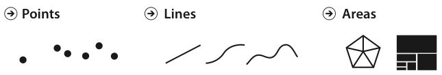
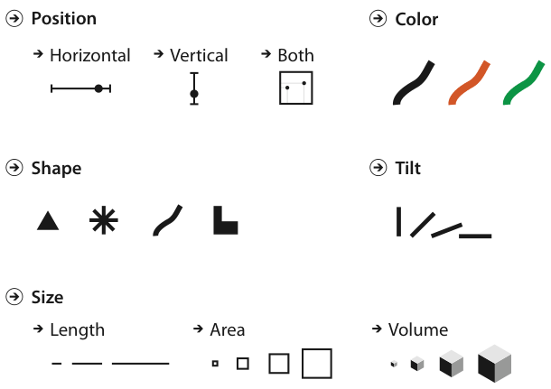
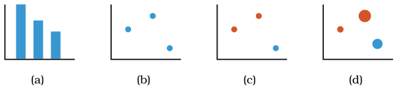
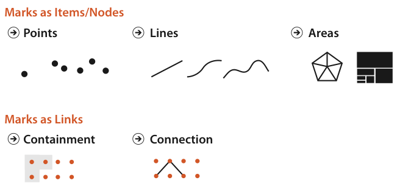

# 5.3 Defining Marks and Channels

## Marks

<!-- verbatim p.120 -->
> A mark is a basic graphical element in an image. Marks are geometric primitive objects classified according to the number of spatial dimensions they require.
<!-- /verbatim -->

- **Point** is a zero-dimensional (0D) mark, **line** a one-dimensional (1D) mark and **area** a two-dimensional (2D) mark (Figure 5.2) [pp.120-121].
- **Volume.** A 3D volume mark is possible but not frequently used [p.120].

## Channels

<!-- verbatim p.121 -->
> A visual channel is a way to control the appearance of marks, independent of the dimensionality of the geometric primitive.
<!-- /verbatim -->

The book's list of channels (Figure 5.3 shows a few) [p.121]:

- **Spatial position:** aligned planar position, unaligned planar position, depth (3D position) and spatial region [p.121].
- **Colour:** three distinct aspects, hue, saturation and luminance [p.121].
- **Size:** one per added dimension; length is 1D size, area is 2D size and volume is 3D size [p.121].
- **Motion:** motion pattern (for instance oscillating circles versus straight jumps), direction of motion and velocity [p.121].
- **Angle** (sometimes called tilt), **curvature**, and **shape**, which is a complex phenomenon but treated as a channel in this framework [p.121].

The term channel does not imply any theory of the underlying mechanisms of human perception. Synonyms abound: nearly any combination of visual, graphical, perceptual or retinal with channel, attribute, dimension, variable, feature or carrier [p.121].

## Adding attributes by adding channels

Figure 5.4 shows a progression in which each chart shows one more attribute by using one more channel [p.122]:

- **(a) Bar chart.** Line marks; vertical position encodes a quantitative attribute (bar height) and horizontal position spreads out the bars by a categorical attribute [p.122].
- **(b) Scatterplot.** A second independent quantitative attribute on horizontal position; a line no longer makes sense, so the mark becomes a point [p.122].
- **(c)** A categorical attribute added with hue. Spatial position channels run out in 2D, but many channels are nonspatial [p.122].
- **(d)** A fourth, quantitative attribute added with size [p.122].

<!-- verbatim p.122 -->
> Multiple channels can be combined to redundantly encode the same attribute. The limitation of this approach is that more channels are “used up” so that not as many attributes can be encoded in total, but the benefit is that the attributes that are shown will be very easily perceived.
<!-- /verbatim -->

## Which marks can take size and shape coding

<!-- verbatim pp.122-123 -->
> The size and shape channels cannot be used on all types of marks: the higher-dimensional mark types usually have built-in constraints that arise from the way that they are defined.
<!-- /verbatim -->

- **Area marks** have both dimensions of their size constrained by their shape, so they typically are not size coded or shape coded. A state on a map already has a size; a treemap's nested areas get size, shape and position from attributes used to build it (Figure 9.8), so resizing them by another attribute would destroy the encoding's meaning [p.123].
- **Exception: cartograms.** The cartogram idiom does size code geographic regions by an additional attribute, altering boundaries with a unified calculation that keeps borders contiguous while trying to preserve each area's shape [p.123].
- **Line marks** that encode a quantitative attribute with length can be size coded in the other direction by changing their width, but not lengthened, because length is already taken; the bars of Figure 5.4(a) cannot be size coded vertically. Line marks used in visual encoding take up nonzero area, and a whole set of bars can be made uniformly wider to be more visible [p.123].
- **Point marks** can be size and shape coded because their area is completely unconstrained, for example sized circles in Figure 5.4(d), or a cross or triangle instead of a circle for a categorical attribute [p.123].

<!-- verbatim p.123 -->
> In the context of visual encoding, point marks intrinsically convey information only about position and are exactly the vehicle for conveying additional information through area and shape.
<!-- /verbatim -->

### 5.3.1 Channel Types

<!-- verbatim p.124 -->
> The human perceptual system has two fundamentally different kinds of sensory modalities. The identity channels tell us information about what something is or where it is. In contrast, the magnitude channels tell us how much of something there is.
<!-- /verbatim -->

- **Identity channels** answer "what" or "where": shape (circle, triangle, cross), colour hue, motion pattern, and spatial region (what region a mark is within, and where it is). Magnitude questions about shape make little sense [p.124].
- **Magnitude channels** answer "how much": length, area and volume; two of the three colour channels, luminance and saturation; and tilt. Identity is not a productive question for two lines, but how much longer one is than the other is [p.124].
- In psychophysics the identity channels are called metathetic or what–where, and the magnitude channels prothetic or how much [p.124].

### 5.3.2 Mark Types

- **Items and links.** In table datasets a mark always represents an item. In network datasets a mark represents either an item (a node) or a link, a relationship between items [p.124].
- **Connection marks** show a pairwise relationship between two items using a line [p.124].
- **Containment marks** show hierarchical relationships using areas, nested within each other at multiple levels. The area may be drawn as a boundary line, but containment is fundamentally about area. Synonyms are enclosure and nesting [p.124].
- **Points cannot be links.** Links cannot be represented by points, even though items can. Figure 5.5 summarises the possibilities [pp.124-125].

The book says connection marks "can be nested within each other at multiple levels" when describing containment; from context it appears to mean the containment (area) marks are nested, but the printed wording says connection [p.124].

## Figures

-  **Figure 5.2** [p.121]. Marks are geometric primitives.
-  **Figure 5.3** [p.121]. Visual channels control the appearance of marks.
-  **Figure 5.4** [p.122]. Using marks and channels. (a) Bar charts encode two attributes using a line mark with the vertical spatial position channel for the quantitative attribute, and the horizontal spatial position channel for the categorical attribute. (b) Scatterplots encode two quantitative attributes using point marks and both vertical and horizontal spatial position. (c) A third categorical attribute is encoded by adding color to the scatterplot. (d) Adding the visual channel of size encodes a fourth quantitative attribute as well.
-  **Figure 5.5** [p.125]. Marks can represent individual items, or links between them.

## Related

- [5.4 Using Marks and Channels](s05-04-using-marks-channels.md): how identity and magnitude channels are matched to categorical and ordered attributes, and ranked [p.124]
- [Bar Charts](../idioms/bar-charts.md): the line-mark idiom of Figure 5.4(a) [p.122]
- [Scatterplots](../idioms/scatterplots.md): the point-mark idiom of Figure 5.4(b) to (d) [p.122]
- [Treemaps](../idioms/treemaps.md): nested area marks that cannot take further size coding [p.123]
- [9.2 Connection: Link Marks](../ch09-arrange-networks-trees/s09-02-connection-link-marks.md): connection marks in network layouts [p.124]
- [9.5 Containment: Hierarchy Marks](../ch09-arrange-networks-trees/s09-05-containment-hierarchy-marks.md): containment marks for trees and hierarchies [p.124]
- [10.4 Other Channels](../ch10-map-color-other-channels/s10-04-other-channels.md): fuller treatment of the size, angle, curvature, shape and motion channels listed here [p.121]
