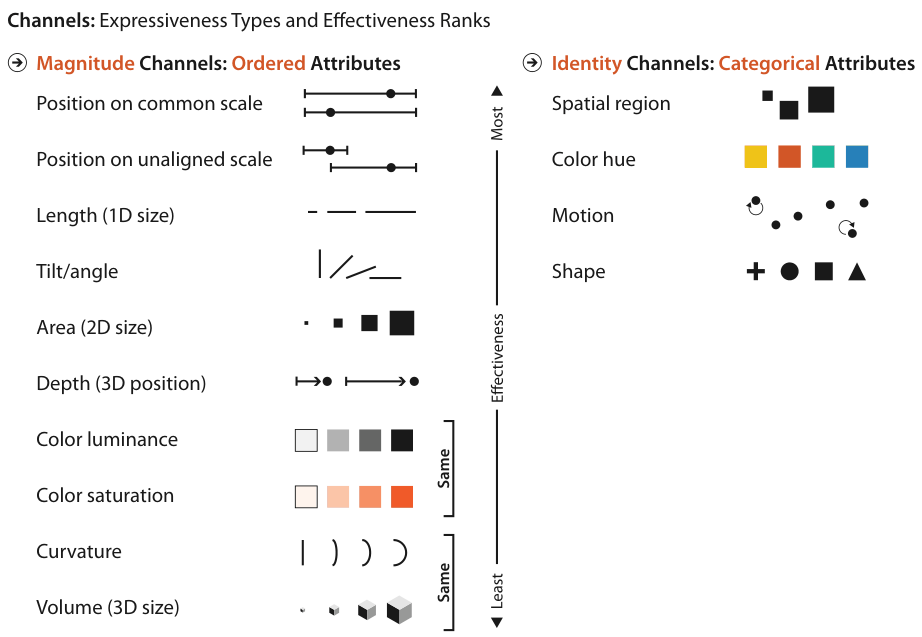

# 5.4 Using Marks and Channels

All channels are not equal: the same attribute encoded with two different channels leaves different information in the viewer's head after perceptual and cognitive processing [pp.124-125].

<!-- verbatim p.125 -->
> The use of marks and channels in vis idiom design should be guided by the principles of expressiveness and effectiveness. These ideas can be combined to create a ranking of channels according to the type of data that is being visually encoded. If you have identified the most important attributes as part of developing your task and data abstraction, you can ensure that they are encoded with the highest ranked channels.
<!-- /verbatim -->

## 5.4.1 Expressiveness and Effectiveness

### Expressiveness principle

<!-- verbatim p.125 -->
> The expressiveness principle dictates that the visual encoding should express all of, and only, the information in the dataset attributes. The most fundamental expression of this principle is that ordered data should be shown in a way that our perceptual system intrinsically senses as ordered. Conversely, unordered data should not be shown in a way that perceptually implies an ordering that does not exist. Violating this principle is a common beginner’s mistake in vis.
<!-- /verbatim -->

The classification of data attributes in Chapter 2 splits along this same line, and the split of channels into two types is built into that classification at the ground level [pp.125-126]:

<!-- verbatim p.126 -->
> The identity channels are the correct match for the categorical attributes that have no intrinsic order. The magnitude channels are the correct match for the ordered attributes, both ordinal and quantitative.
<!-- /verbatim -->

### Effectiveness principle

<!-- verbatim p.126 -->
> The effectiveness principle dictates that the importance of the attribute should match the salience of the channel; that is, its noticeability. In other words, the most important attributes should be encoded with the most effective channels in order to be most noticeable, and then decreasingly important attributes can be matched with less effective channels.
<!-- /verbatim -->

The rest of the chapter is devoted to what effectiveness means in visual encoding [p.126].

## 5.4.2 Channel Rankings

Figure 5.6 ranks the channels separately for the two expressiveness types, ordered and categorical, from most effective at the top to least effective at the bottom [p.126].

### Magnitude channels: ordered attributes

<!-- verbatim p.126 -->
> Ordered attributes should be shown with the magnitude channels. The most effective is aligned spatial position, followed by unaligned spatial position. Next is length, which is one-dimensional size, and then angle, and then area, which is two-dimensional size. Position in 3D, namely, depth, is next. The next two channels are roughly equally effective: luminance and saturation. The final two channels, curvature and volume (3D size), are also roughly equivalent in terms of accuracy.
<!-- /verbatim -->

| Rank | Channel (Figure 5.6 label) | Note |
| --- | --- | --- |
| 1 | Position on common scale | Aligned spatial position, most effective [pp.126-127] |
| 2 | Position on unaligned scale | [pp.126-127] |
| 3 | Length (1D size) | [pp.126-127] |
| 4 | Tilt/angle | [pp.126-127] |
| 5 | Area (2D size) | [pp.126-127] |
| 6 | Depth (3D position) | [pp.126-127] |
| 7 (tie) | Color luminance | Marked "Same" as saturation in the figure [pp.126-127] |
| 7 (tie) | Color saturation | [pp.126-127] |
| 9 (tie) | Curvature | Marked "Same" as volume in the figure, least effective [pp.126-127] |
| 9 (tie) | Volume (3D size) | [pp.126-127] |

### Identity channels: categorical attributes

<!-- verbatim p.126 -->
> Categorical attributes should be shown with the identity channels. The most effective channel for categorical data is spatial region, with color hue as the next best one. The motion channel is also effective, particularly for a single set of moving items against a sea of static ones. The final identity channel appropriate for categorical attributes is shape.
<!-- /verbatim -->

| Rank | Channel (Figure 5.6 label) | Note |
| --- | --- | --- |
| 1 | Spatial region | Most effective [pp.126-127] |
| 2 | Color hue | [pp.126-127] |
| 3 | Motion | Especially one moving set among static items [pp.126-127] |
| 4 | Shape | [pp.126-127] |

### Do not cross the lists

<!-- verbatim p.126 -->
> While it is possible in theory to use a magnitude channel for categorical data or a identity channel for ordered data, that choice would be a poor one because the expressiveness principle would be violated.
<!-- /verbatim -->

### The primacy of spatial position

Both lists put spatial channels at the top: aligned and unaligned position for ordered data, spatial region for categorical data. The spatial channels are the only ones on both lists; none of the others are effective for both data types [pp.126-127].

<!-- verbatim p.127 -->
> This primacy of spatial position applies only to 2D positions in the plane; 3D depth is a much lower-ranked channel.
<!-- /verbatim -->

<!-- verbatim p.127 -->
> The choice of which attributes to encode with position is the most central choice in visual encoding. The attributes encoded with position will dominate the user’s mental model—their internal mental representation used for thinking and reasoning—compared with those encoded with any other visual channel.
<!-- /verbatim -->

These observations motivate many of the book's idioms and underlie its framework of idiom design choices [p.127].

### Where the rankings come from

The rankings are the author's own synthesis of several previous frameworks, a large body of empirical studies, and the author's own analysis; Section 5.7 points to the sources and Section 5.5 discusses the reasons at length [pp.127-128]. Luminance, saturation and hue are aspects of colour treated in Chapter 10 [p.126].

## Figures

-  **Figure 5.6** [p.127]. Channels ranked by effectiveness according to data and channel type. Ordered data should be shown with the magnitude channels, and categorical data with the identity channels.

## Related

- [5.5 Channel Effectiveness](s05-05-channel-effectiveness/node.md): the accuracy, discriminability, separability, popout and grouping evidence behind these rankings [p.128]
- [5.5.1 Accuracy](s05-05-channel-effectiveness/s05-05-01-accuracy.md): the experimental orderings the magnitude list is primarily based on [p.128]
- [5.7 Further Reading](s05-07-further-reading.md): the frameworks and studies the rankings synthesise [p.128]
- [2.5 Attribute Types](../ch02-what-data-abstraction/s02-05-attribute-types.md): categorical versus ordered (ordinal and quantitative) attributes, the split the two lists follow [p.125]
- [6.3 No Unjustified 3D](../ch06-rules-thumb/s06-03-no-unjustified-3d/node.md): the limitations and benefits of 3D, and why depth ranks low [p.127]
- [10.2 Color Theory](../ch10-map-color-other-channels/s10-02-color-theory/node.md): luminance, saturation and hue, the colour channels in both lists [p.126]
- [10.3 Colormaps](../ch10-map-color-other-channels/s10-03-colormaps/node.md): putting the colour channels ranked here into practice as colormaps [p.126]
