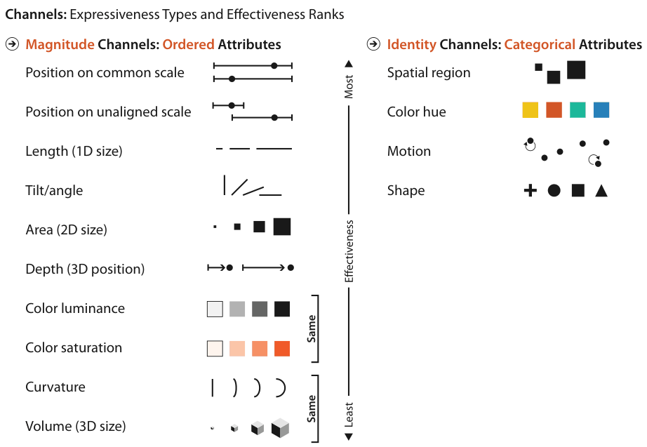
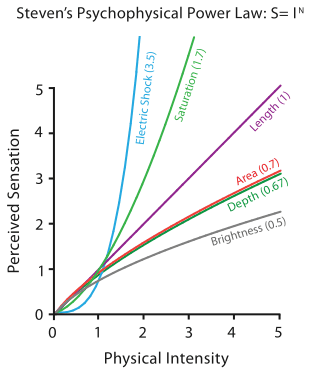
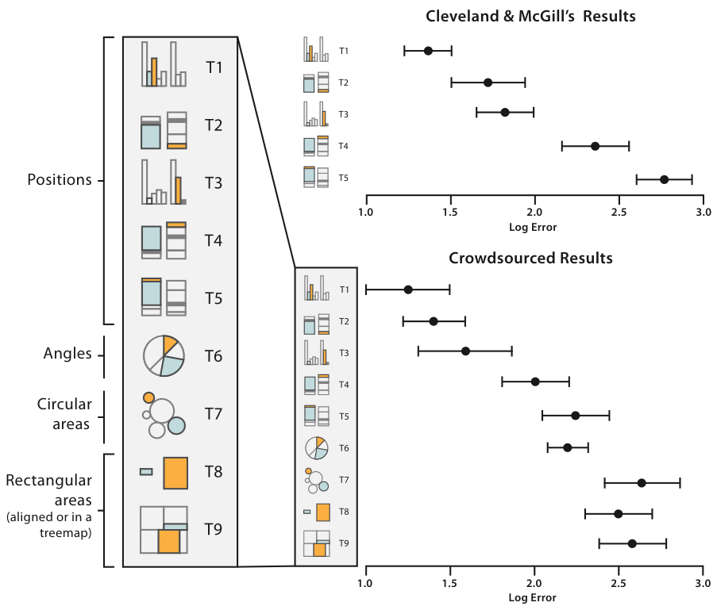

# 5.5.1 Accuracy

<!-- verbatim p.128 -->
> The obvious way to quantify effectiveness is accuracy: how close is human perceptual judgement to some objective measurement of the stimulus?
<!-- /verbatim -->

## Psychophysics: Stevens' power law

- **Channels differ.** We perceive different channels with different levels of accuracy; they are not all equally distinguishable. Responses to magnitude follow power laws whose exponent depends on the sensory modality: most stimuli are magnified or compressed, few are unchanged [p.128].
- **The law.** The apparent magnitude of all sensory channels follows S = I^n, where S is the perceived sensation and I the physical intensity (Equation 5.1) [p.128].
- **Range of exponents.** n runs from a sublinear 0.5 for brightness to a superlinear 3.5 for electric current. Doubling physical brightness is perceived as considerably less than twice as bright; doubling current on the fingertips feels much more than twice as great [pp.128-129].
- **Length is accurate.** Length has n = 1.0, so perceived length closely matches the true value; here length means a line segment on a 2D plane perpendicular to the observer [p.129].
- **Others are distorted.** Area and brightness are compressed, while red–gray saturation is magnified [p.129].

Figure 5.7 summarises the point, and its caption states the result for length, area and saturation [p.129]:

<!-- verbatim p.129 -->
> Length perception is completely accurate, whereas area is compressed and saturation is magnified.
<!-- /verbatim -->

## Controlled experiments

Experiments that map human responses directly to visually encoded abstract information give explicit accuracy rankings per channel type [p.129]. Cleveland and McGill's experiments on the magnitude channels:

<!-- verbatim p.129 -->
> showed that aligned position against a common scale is most accurately perceived, followed by unaligned position against an identical scale, followed by length, followed by angle. Area judgements are notably less accurate than all of these.
<!-- /verbatim -->

- **Untested channels.** Cleveland and McGill also propose rankings for channels they did not test directly: after area comes an equivalence class of volume, curvature and luminance, followed by hue in last place [pp.129-130].
- **Hue as magnitude versus identity.** The book stresses that last place applies to hue used as a magnitude channel [p.130]:

<!-- verbatim p.130 -->
> (This last place ranking is for hue as a magnitude channel, a very different matter than its second-place rank as a identity channel.)
<!-- /verbatim -->

- **Agreement with psychophysics.** These results dovetail with Stevens' measurements in Figure 5.7 [p.130].
- **Crowdsourced replication.** Heer and Bostock confirmed and extended the work with crowdsourcing (Figure 5.8). The only discrepancy is that the later work found length and angle judgements roughly equivalent [p.130].

## How accuracy shapes the rankings

<!-- verbatim p.131 -->
> The rankings in Figure 5.6 are primarily based on accuracy, which differs according to the type of the attribute that is being encoded, but also take into account the other four considerations.
<!-- /verbatim -->

The other four are discriminability, separability, popout and grouping [p.128].

## Figures

-  **Figure 5.6** [p.127]. Channels ranked by effectiveness according to data and channel type. Ordered data should be shown with the magnitude channels, and categorical data with the identity channels.
-  **Figure 5.7** [p.129]. Stevens showed that the apparent magnitude of all sensory channels follows a power law S = In, where some sensations are perceptually magnified compared with their objective intensity (when n > 1) and some compressed (when n < 1). Length perception is completely accurate, whereas area is compressed and saturation is magnified. Data from Stevens [Stevens 75, p. 15].
-  **Figure 5.8** [p.130]. Error rates across visual channels, with recent crowdsourced results replicating and extending seminal work from Cleveland and McGill [Cleveland and McGill 84a]. After [Heer and Bostock 10, Figure 4].

## Related

- [5.4 Using Marks and Channels](../s05-04-using-marks-channels.md): the ranked lists this evidence supports [p.131]
- [5.6 Relative versus Absolute Judgements](../s05-06-relative-absolute-judgements.md): why position against a common scale beats unaligned length, via Weber's Law [p.137]
- [5.5.2 Discriminability](s05-05-02-discriminability.md): the next criterion, how many distinguishable levels a channel has [p.131]
- [5.7 Further Reading](../s05-07-further-reading.md): Stevens, Cleveland and McGill, and Heer and Bostock as sources [p.128]
