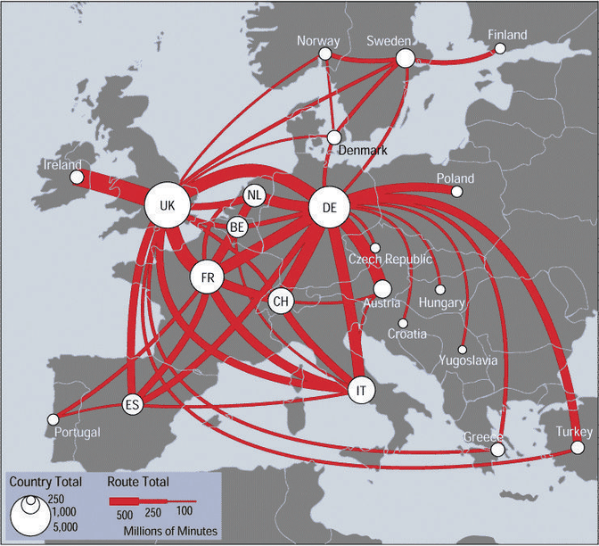

# 5.5.2 Discriminability

<!-- verbatim p.131 -->
> The question of discriminability is: if you encode data using a particular visual channel, are the differences between items perceptible to the human as intended? The characterization of visual channel thus should quantify the number of bins that are available for use within a visual channel, where each bin is a distinguishable step or level from the other.
<!-- /verbatim -->

## Line width as an example

- **Few bins.** Some channels have very few bins. Line width works only for a fairly small number of steps; widening a line past that limit makes it read as a polygon area rather than a line mark [p.131].
- **Few values are fine.** A small number of bins is no problem when the number of values is also small. Line width can work very well for three or four values of an attribute, as in Figure 5.9, but would be a poor choice for dozens or hundreds [pp.131-132].

## The guideline: match the ranges

<!-- verbatim p.131 -->
> The key factor is matching the ranges: the number of different values that need to be shown for the attribute being encoded must not be greater than the number of bins available for the visual channel used to encode it. If these do not match, then the vis designer should either explicitly aggregate the attribute into meaningful bins or use a different visual channel.
<!-- /verbatim -->

## Figures

-  **Figure 5.9** [p.132]. Linewidth has a limited number of discriminable bins.

## Related

- [5.5.1 Accuracy](s05-05-01-accuracy.md): how precisely magnitudes are judged, as opposed to how many levels can be told apart [p.131]
- [10.4 Other Channels](../../ch10-map-color-other-channels/s10-04-other-channels.md): the size channels, including line width, in more detail [p.131]
- [13.4 Aggregate](../../ch13-reduce-items-attributes/s13-04-aggregate/node.md): aggregation, one remedy when an attribute has more values than a channel has bins [p.131]
