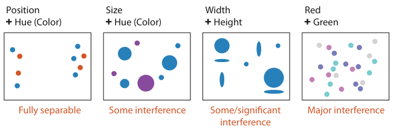

# 5.5.3 Separability

Channels are not all independent: some depend on or interact with others. Each pair lies on a continuum from orthogonal, independent **separable** channels to inextricably combined **integral** channels [p.131].

<!-- verbatim p.131 -->
> Visual encoding is straightforward with separable channels, but attempts to encode different information in integral channels will fail. People will not be able to access the desired information about each attribute; instead, an unanticipated combination will be perceived.
<!-- /verbatim -->

Some interference is obvious: having encoded two attributes with vertical and horizontal position, you cannot encode a third with planar proximity, because that channel precludes the first two. Other interference is less obvious [pp.131-132].

## Four points on the continuum (Figure 5.10)

| Channel pair | Where it falls | What is perceived |
| --- | --- | --- |
| Position and hue | Fully separable | Points split left/right by position and red/blue by hue, each attended to separately; about half fall in each category of each channel [p.132] |
| Size and hue | Some interference | Large versus small is easy, but colours are much harder to tell apart within the small half. Size interacts with many channels, including shape [p.132] |
| Width and height | Some/significant interference; the text calls it an integral pair | Perceived as area: three groups (small, medium, large) rather than wide/narrow and short/tall; medium mixes horizontally and vertically flattened shapes [p.133] |
| Red and green (RGB) | Major interference, most inseparable | A combined colour percept: four colours are visible, but recovering high and low values for each axis is very difficult even with effort, because RGB differs greatly from perceptual colour processing [p.133] |

## Guideline: match channels to the information

<!-- verbatim p.133 -->
> Integrality versus separability is not good or bad; the important idea is to match the characteristics of the channels to the information that is encoded.
<!-- /verbatim -->

- **Two attributes, each attended to selectively:** a separable pair such as position and colour hue is a good choice [p.133].
- **One attribute with three categories:** the integral pair of horizontal and vertical size is reasonable, because it yields the three groups small, flattened and large [pp.133-134].

## Open questions

Integrality and separability are endpoints of a continuum, not binary categories. The book gives no definitive categorisation of every channel pair and says many open questions remain, but advises keeping the consideration in mind when designing with channels [p.134].

## Figures

-  **Figure 5.10** [p.133]. Pairs of visual channels fall along a continuum from fully separable to intrinsically integral. Color and location are separable channels well suited to encode different data attributes for two different groupings that can be selectively attended to. However, size interacts with hue, which is harder to perceive for small objects. The horizontal size and and vertical size channels are automatically fused into an integrated perception of area, yielding three groups. Attempts to code separate information along the red and green axes of the RGB color space fail, because we simply perceive four different hues. After [Ware 13, Figure 5.23].

## Related

- [10.2 Color Theory](../../ch10-map-color-other-channels/s10-02-color-theory/node.md): colour in detail, including why the RGB channels are not perceptually separable [p.133]
- [5.5.4 Popout](s05-05-04-popout.md): another limit on combining channels, for finding a single target [p.134]
- [5.5.5 Grouping](s05-05-05-grouping.md): how identity channels make categories perceivable as groups [p.133]
- [10.3.3 Bivariate Colormaps](../../ch10-map-color-other-channels/s10-03-colormaps/s10-03-03-bivariate-colormaps.md): encoding two attributes in colour, where integral colour channels matter [p.133]
