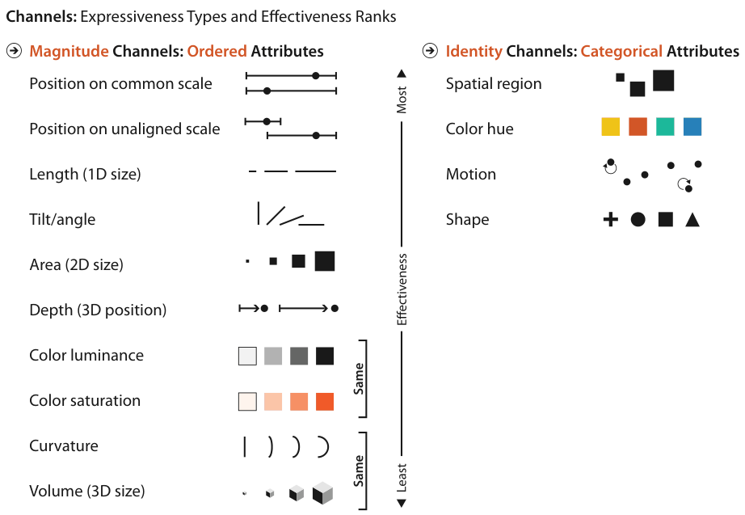
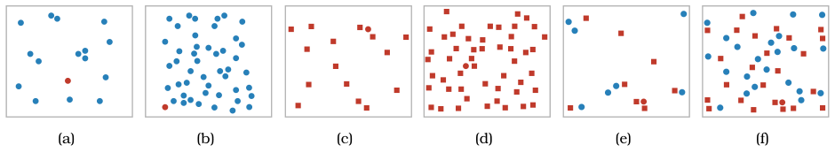
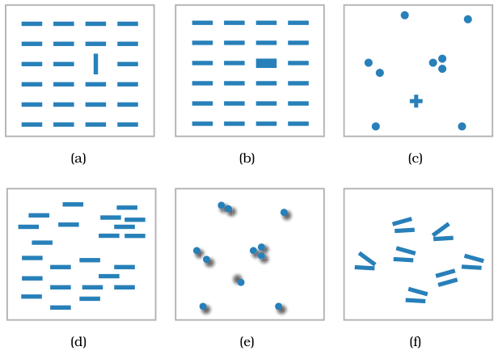

# 5.5.4 Popout

Many visual channels provide **visual popout**, where a distinct item stands out from many others immediately, such as a red object among blue ones or a circle among squares (Figure 5.11). Popout is often called preattentive processing or tunable detection [p.134].

<!-- verbatim p.134 -->
> The great value of popout is that the time it takes us to spot the different object does not depend on the number of distractor objects.
<!-- /verbatim -->

- **Why.** The low-level visual system processes these channels massively in parallel, with no need to attend to items one by one. The red circle pops out of 15 blue circles about as fast as out of 50 (Figure 5.11(a) and (b)) [p.134].
- **Degree, not all-or-nothing.** Popout depends on the channel and on how different the target is from its surroundings. A red circle pops out of 15 or 50 red squares in roughly equal time, but more slowly than in the colour versions, because the red–blue hue difference is larger than the filled circle–square shape difference [pp.134-135].

## Combining channels

- **Combinations do not pop out.** A red circle among objects that may be red or blue and circles or squares does not pop out: it is found much faster among few distractors (Figure 5.11(e)) than many (Figure 5.11(f)). It needs serial search, checking items one by one, so search time grows linearly with the number of distractors [p.135].

<!-- verbatim p.135 -->
> Most pairs of channels do not support popout, but a few pairs do: one example is space and color, and another is motion and shape. Popout is definitely not possible with three or more channels. As a general rule, vis designers should only count on using popout for a single channel at a time.
<!-- /verbatim -->

## Which channels pop out

- **Many do.** Tilt, size, shape, proximity and even shadow direction (Figure 5.12(a) to (e)), plus several kinds of motion such as flicker, motion direction and motion velocity [p.136].
- **All the major channels in Figure 5.6** support popout individually, though not in combination with each other [p.136].
- **A few do not.** Parallelism is not preattentively detected: an exactly parallel pair of lines does not pop out from slightly angled pairs and needs serial search (Figure 5.12(f)) [p.136].

## Figures

-  **Figure 5.6** [p.127]. Channels ranked by effectiveness according to data and channel type. Ordered data should be shown with the magnitude channels, and categorical data with the identity channels.
-  **Figure 5.11** [p.134]. Visual popout. (a) The red circle pops out from a small set of blue circles. (b) The red circle pops out from a large set of blue circles just as quickly. (c) The red circle also pops out from a small set of square shapes, although a bit slower than with color. (d) The red circle also pops out of a large set of red squares. (e) The red circle does not take long to find from a small set of mixed shapes and colors. (f) The red circle does not pop out from a large set of red squares and blue circles, and it can only be found by searching one by one through all the objects. After <http://www.csc.ncsu.edu/faculty/healey/PP> by Christopher G. Healey.
-  **Figure 5.12** [p.135]. Many channels support visual popout, including (a) tilt, (b) size, (c) shape, (d) proximity, and (e) shadow direction. (f) However, parallel line pairs do not pop out from a sea of slightly tilted distractor object pairs and can only be detected through serial search. After <http://www.csc.ncsu.edu/faculty/healey/PP> by Christopher G. Healey.

## Related

- [5.4 Using Marks and Channels](../s05-04-using-marks-channels.md): the ranked channels of Figure 5.6, all of which support popout on their own [p.136]
- [5.5.3 Separability](s05-05-03-separability.md): the related limit on reading two channels independently [p.135]
- [Highlighting](../../idioms/highlighting.md): making selected items stand out, where single-channel popout applies [p.135]
- [5.7 Further Reading](../s05-07-further-reading.md): Healey's popout demos and Treisman and Gormican on early visual features [p.134]
