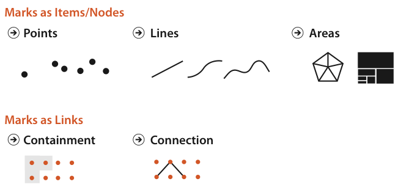
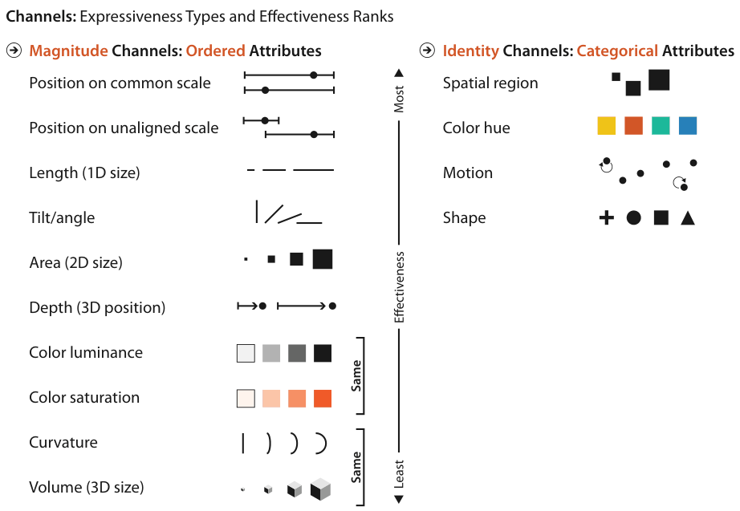

# 5.5.5 Grouping

Perceptual grouping arises either from link marks (Figure 5.5) or from identity channels encoding categorical attributes (Figure 5.6) [p.136].

## Grouping cues, strongest first

| Order | Cue | How it groups |
| --- | --- | --- |
| 1 | Containment | Areas of containment around the linked objects; the strongest cue [p.136] |
| 2 | Connection | Lines of connection between the linked objects [p.136] |
| 3 | Proximity | Placing items within the same spatial region; the reason spatial region is the top-ranked channel for categorical data [p.136] |
| 4 | Similarity | Sharing a level on the other categorical channels: hue, motion, and shape if chosen carefully [p.136] |

<!-- verbatim p.136 -->
> Containment is the strongest cue for grouping, with connection coming in second.
<!-- /verbatim -->

- **Identity channels as a lighter cue.** Items sharing a level of a categorical attribute can be perceived as a group by attending selectively to that level. The cue is weaker than connection or containment, but adds no clutter from extra link marks [p.136].
- **Proximity versus similarity.** Logically, proximity is similarity for spatial position, but perceptually the spatial channels are so much stronger than the others that the book considers them separately [p.136].
- **Example.** Animal type with levels cat, dog and wombat encoded as red, green and blue: a user attending to blue automatically sees all the wombats as one group across the whole scene [pp.136-137].

## Channels that need care

- **Shape.** Shape can encode categories without creating automatic groupings: a forward 'C' and a backward 'C' do not form globally selectable groups, whereas a circle and a star do [p.137].
- **Motion.** A set of objects moving together against static ones is a very salient cue, but several levels of motion at once may overwhelm the user's capacity for selective attention [p.137].

## Figures

-  **Figure 5.5** [p.125]. Marks can represent individual items, or links between them.
-  **Figure 5.6** [p.127]. Channels ranked by effectiveness according to data and channel type. Ordered data should be shown with the magnitude channels, and categorical data with the identity channels.

## Related

- [5.3 Defining Marks and Channels](../s05-03-defining-marks-channels.md): connection and containment link marks, defined [p.136]
- [5.4 Using Marks and Channels](../s05-04-using-marks-channels.md): the identity channel ranking that grouping helps explain [p.136]
- [9.5 Containment: Hierarchy Marks](../../ch09-arrange-networks-trees/s09-05-containment-hierarchy-marks.md): containment, the strongest grouping cue, used for trees and hierarchies [p.136]
- [9.2 Connection: Link Marks](../../ch09-arrange-networks-trees/s09-02-connection-link-marks.md): connection marks in node–link layouts [p.136]
- [10.3.1 Categorical Colormaps](../../ch10-map-color-other-channels/s10-03-colormaps/s10-03-01-categorical-colormaps.md): choosing hues for categorical levels, the similarity cue [p.136]
- [Shape Channel](../../idioms/shape-channel.md): the shape channel, which needs care to create groupings [p.137]
- [Motion Channels](../../idioms/motion-channels.md): the motion channels, which need care with several levels [p.137]
