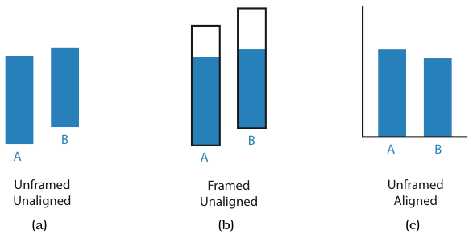
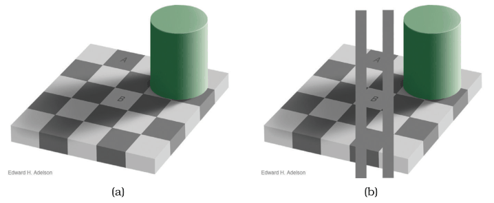
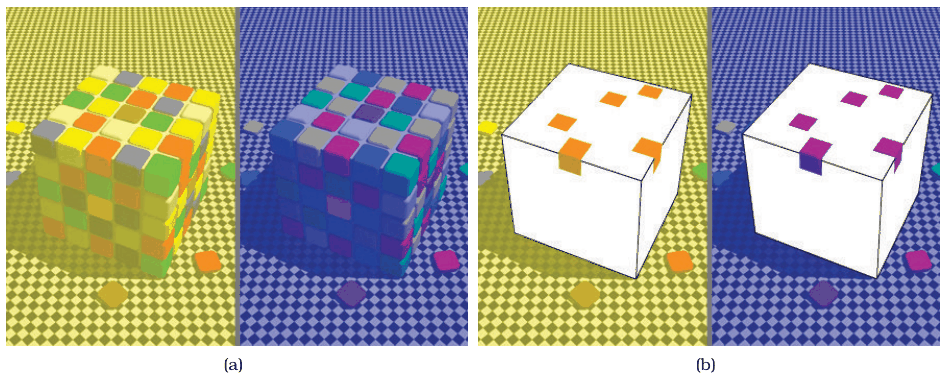

# 5.6 Relative versus Absolute Judgements

## Weber's Law

<!-- verbatim p.137 -->
> The human perceptual system is fundamentally based on relative judgements, not absolute ones; this principle is known as Weber’s Law.
<!-- /verbatim -->

- **Example.** The length difference we can detect is a percentage of the object's length [p.137].
- **Formal statement.** The detectable difference in stimulus intensity I is a fixed percentage K of the object magnitude: δI/I = K [p.137].
- **Scope.** The principle holds for all sensory modalities and has far-ranging implications. Questions of accuracy and discriminability must distinguish relative from absolute judgements: two objects directly next to each other and aligned can be judged much more precisely than unaligned objects separated by many others [p.137].

## Why position on a scale beats length (Figure 5.13)

Weber's Law explains why position along a scale can be perceived more accurately than pure length without a scale [p.137]:

- **(a) Unframed, unaligned.** The only information is the bars' own lengths, so the judgement is difficult [p.137].
- **(b) Framed.** A common frame lets you also compare the unfilled part of each frame. Bar B is only about 15% longer than Bar A, approaching the range where length differences are hard to judge, but B's unfilled part is about 50% smaller than A's, an easily discriminable difference [p.137].
- **(c) Aligned.** Aligning the bars against a common scale achieves the same effect without a frame [p.137].

## Colour and luminance are contextual

- **Luminance.** Perception of colour and luminance is completely contextual, based on contrast with surrounding colours. In Figure 5.14 two checkerboard squares look like quite different greys, but a solid grey mask touching both shows they are identical [p.138].
- **Colour.** In Figure 5.15 corresponding tiles on two cubes both look red; masks show the tile under apparent yellowish light is actually orange and under bluish light actually purple [pp.138-139].
- **Colour constancy.** The visual system evolved colour constancy so the same surface is identifiable under a broad range of lighting, even though a light meter would read very differently [p.139].

<!-- verbatim p.139 -->
> While the visual system works very well in natural environments, many of its mechanisms work against simple approaches to visually encoding information with color.
<!-- /verbatim -->

## Figures

-  **Figure 5.13** [p.138]. Weber’s Law states that we judge based on relative, not absolute differences. (a) The lengths of unframed, unaligned rectangles of slightly different sizes are hard to compare. (b) Adding a frame allows us to compare the very different sizes of the unfilled rectangles between the bar and frame tops. (c) Aligning the bars also makes the judgement easy. Redrawn and extended after [Cleveland and McGill 84a, Figure 12].
-  **Figure 5.14** [p.138]. Luminance perception is based on relative, not absolute, judgements. (a) The two squares A and B appear quite different. (b) Superimposing a gray mask on the image shows that they are in fact identical.
-  **Figure 5.15** [p.139]. Color perception is also relative to surrounding colors and depends on context. (a) Both cubes have tiles that appear to be red. (b) Masking the intervening context shows that the colors are very different: with yellow apparent lighting, they are orange; with blue apparent lighting, they are purple.

## Related

- [5.5.1 Accuracy](s05-05-channel-effectiveness/s05-05-01-accuracy.md): aligned position on a common scale ranks above unaligned position and length [p.137]
- [5.5.2 Discriminability](s05-05-channel-effectiveness/s05-05-02-discriminability.md): discriminability, which must distinguish relative from absolute judgements [p.137]
- [10.2 Color Theory](../ch10-map-color-other-channels/s10-02-color-theory/node.md): colour perception in detail, for the contextual effects shown here [p.139]
- [Bar Charts](../idioms/bar-charts.md): aligned bars, which turn length judgements into position-on-a-common-scale judgements [p.137]
