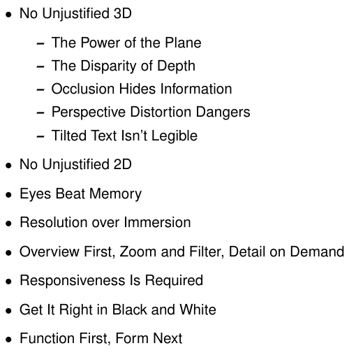

# 6.1 The Big Picture

## Scope

<!-- verbatim p.142 -->
> This chapter contains rules of thumb: advice and guidelines. Each of them has a catchy title in hopes that you'll remember it as a slogan. Figure 6.1 lists these eight rules of thumb.
<!-- /verbatim -->

## The eight rules

Figure 6.1 lists the rules in this order, with five sub-points under the first [p.141]:

- **No Unjustified 3D**, with The Power of the Plane, The Disparity of Depth, Occlusion Hides Information, Perspective Distortion Dangers and Tilted Text Isn't Legible; Section 6.3 [pp.141-142].
- **No Unjustified 2D**; Section 6.4 [p.141] [p.156].
- **Eyes Beat Memory**; Section 6.5 [p.141] [p.156].
- **Resolution over Immersion**; Section 6.6 [p.141] [p.159].
- **Overview First, Zoom and Filter, Detail on Demand**; Section 6.7 [p.141] [p.160].
- **Responsiveness Is Required**; Section 6.8 [p.141] [p.162].
- **Get It Right in Black and White**; Section 6.9 [p.141] [p.165].
- **Function First, Form Next**; Section 6.10 [p.141] [p.165].

The figure's wording differs slightly from the section headings: it says "Detail on Demand" where Section 6.7's title says "Details on Demand", and "Legible" where the 6.3.6 heading prints "Legibile" [p.141] [p.149] [p.160]. Section 6.3 has four subsections that the figure does not list: Other Depth Cues, Benefits of 3D: Shape Perception, Justification and Alternatives, and Empirical Evidence [p.141] [pp.148-154].

## Figures

-  **Figure 6.1** [p.141]. Eight rules of thumb.

## Related

- [6.2 Why and When to Follow Rules of Thumb?](s06-02-why-when-follow-rules.md): the status and evidence behind these rules [p.142]
- [6.3 No Unjustified 3D](s06-03-no-unjustified-3d/node.md): the first and longest rule, with the five sub-points the figure lists [pp.141-142]
