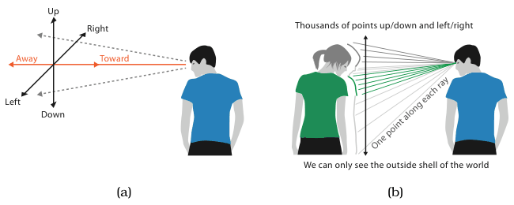

# 6.3.2 The Disparity of Depth

## Depth judgements are less accurate

The power-law exponents for accuracy in Figure 5.7 differ for depth judgements in 3D and for planar position judgements in 2D [p.143].

<!-- verbatim p.143 -->
> Our highly accurate length perception capability, with the linear n value of 1.0, only holds for planar spatial position. For depth judgements of visual distance, n was measured as 0.67 [Stevens 57]; that exponent is even worse than the value of 0.7 for area judgements.
<!-- /verbatim -->

Mathematically this is expected: a line extending into the scene is scaled nonlinearly in depth, while a line crossing the picture plane horizontally or vertically is scaled linearly, so distances and angles are distorted (Figure 6.2) [p.144].

## We see in 2.05D

Perceptually it is also expected, because the intuition that we experience the world in 3D is misleading [p.144].

<!-- verbatim p.144 -->
> We do not really live in 3D, or even 2.5D: to quote Colin Ware, we see in 2.05D [Ware 08].
<!-- /verbatim -->

Most visual information concerns a two-dimensional image plane; information about depth is only a tiny additional fraction, and the 0.05 is chosen somewhat arbitrarily to represent it [p.144].

## Line-of-sight ambiguity

- **Image plane.** Along the sideways and up–down axes we see millions of rays just by moving our eyes, each giving the nearest opaque object; this two-dimensional picture is the image plane (Figure 6.2(a)) [p.144].
- **One point per ray.** Along the toward–away depth axis we get information at only one point for each ray (Figure 6.2(b)); this is called line-of-sight ambiguity [p.144].
- **Seeing behind costs movement.** Seeing what is hidden behind the closest objects requires moving the viewpoint or the objects: at best a head movement, often a move of the whole body to a very different position [pp.144-145].

## Figures

-  **Figure 6.2** [p.144]. Seeing planar position versus depth. (a) The sideways and up–down axes are fundamentally different from the toward–away depth axis. (b) Along the depth axis we can see only one point for each ray, as opposed to millions of rays for the other two axes. After [Ware 08, page 44].

## Related

- [5.5.1 Accuracy](../../ch05-marks-channels/s05-05-channel-effectiveness/s05-05-01-accuracy.md): the psychophysical power law and Figure 5.7's exponents [p.143]
- [6.3.1 The Power of the Plane](s06-03-01-power-plane.md): planar position, the channel depth cannot match [p.143]
- [6.3.3 Occlusion Hides Information](s06-03-03-occlusion-hides-information.md): the consequence of seeing only the nearest object on each ray [p.145]
- [6.3.4 Perspective Distortion Dangers](s06-03-04-perspective-distortion-dangers.md): its margin note points back here for the disparity between depth and planar perception [p.146]
