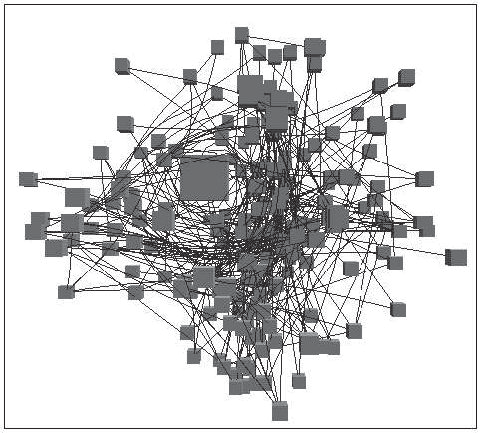

# 6.3.3 Occlusion Hides Information

## Occlusion and motion parallax

<!-- verbatim p.145 -->
> The most powerful depth cue is occlusion, where some objects cannot be seen because they are hidden behind others.
<!-- /verbatim -->

Visible objects are read as closer than occluded ones. As we move, occlusion relationships change, and this motion parallax lets us build up relative distances [p.145]. In realistic scenes of familiar objects, motion parallax typically imposes no cognitive load or conscious attention; in synthetic scenes, interactive navigation of the 3D viewpoint invokes the same mechanisms [p.145].

## The time cost

When one fixed viewpoint does not show enough of a complex scene, interactive navigation becomes critical for understanding 3D structure, and its cost is time: navigating takes longer than inspecting a single image [p.145].

<!-- verbatim p.145 -->
> The overarching problem with occlusion in the context of visual encoding is that presumably important information is hidden, and discovering it via navigation has a time cost.
<!-- /verbatim -->

Realistic environments rarely require inspecting every hidden surface, but in vis the occluded detail might be critical, especially when spatial position encodes abstract, nonspatial data [p.145].

## The memory cost

- **Unfamiliar shapes.** When objects have unpredictable, unfamiliar shapes, people must use internal memory to remember the shape from earlier viewpoints and synthesise the structure themselves, so there can be appreciable cognitive load [p.145].
- **Common in vis.** This case is common when spatial position channels encode data; a node–link graph laid out in 3D (Figure 6.3) is the example of the unfamiliar structure an abstract dataset produces [p.145].
- **Interaction helps but does not remove the cost.** Sophisticated interaction idioms have been proposed to speed up this synthesis compared with simple realistic navigation, lowering the time cost, but designers should always consider whether the benefits of 3D are worth the costs [pp.145-146].

## Figures

-  **Figure 6.3** [p.146]. Resolving the 3D structure of the occluded parts of the scene is possible with interactive navigation, but that takes time and imposes cognitive load, even when sophisticated interaction idioms are used, as in this example of a node–link graph laid out in 3D space. From [Carpendale et al. 96, Figure 21].

## Related

- [6.3.2 The Disparity of Depth](s06-03-02-disparity-depth.md): line-of-sight ambiguity, the reason occlusion arises [p.145]
- [6.5 Eyes Beat Memory](../s06-05-eyes-beat-memory.md): why relying on memory of earlier viewpoints is costly [p.145]
- [11.5 Navigate: Changing Viewpoint](../../ch11-manipulate-view/s11-05-navigate-changing-viewpoint.md): the navigation idioms that recover occluded structure [p.145]
- [9.2 Connection: Link Marks](../../ch09-arrange-networks-trees/s09-02-connection-link-marks.md): node–link layouts, here shown in 3D [p.145]
