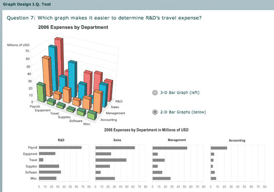
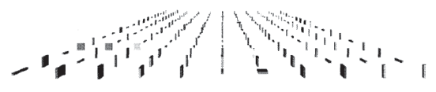

# 6.3.4 Perspective Distortion Dangers

## What perspective distortion is

<!-- verbatim p.146 -->
> The phenomenon of perspective distortion is that distant objects appear smaller and change their planar position on the image plane.
<!-- /verbatim -->

Railway tracks in a photograph appear to converge, and a ruler on the photograph would show the near track much wider than the distant one, though they are the same width [p.146]. Perspective distortion is also known as foreshortening [p.146].

## Why it is dangerous for abstract data

The Renaissance mastery of perspective makes many people think of it as a good thing, but not when encoding abstract data [pp.146-147].

<!-- verbatim p.147 -->
> However, in the context of visually encoding abstract data, perspective is a very bad thing! Perspective distortion is one of the main dangers of depth because the power of the plane is lost; it completely interferes with visual encodings that use the planar spatial position channels and the size channel.
<!-- /verbatim -->

## Examples

- **3D bar charts.** Bar heights are harder to judge in a 3D bar chart than in several horizontally aligned 2D bar charts; foreshortening makes direct comparison of heights difficult (Figure 6.4, whose caption adds occlusion as a second cause) [p.147].
- **Size coding on a ground plane.** When bars sized in multiple dimensions recede into the distance on a 3D ground plane, their sizes cannot be compared as a simple perceptual operation (Figure 6.5) [p.147].

## Figures

-  **Figure 6.4** [p.147]. 3D bar charts are more difficult than 2D bar charts because of both perspective distortion and occlusion. From [Few 07, Question 7].
-  **Figure 6.5** [p.147]. With perspective distortion, the power of the planar spatial position channel is lost, as is the size channel. From [Mukherjea et al. 96, Figure 1].

## Related

- [6.3.2 The Disparity of Depth](s06-03-02-disparity-depth.md): the disparity between depth and planar perception, as the book's margin note points out [p.146]
- [6.3.1 The Power of the Plane](s06-03-01-power-plane.md): the planar position power that perspective destroys [p.147]
- [Bar Charts](../../idioms/bar-charts.md): the 2D idiom the 3D bar chart degrades [p.147]
- [6.3.5 Other Depth Cues](s06-03-05-other-depth-cues.md): stereo cannot solve any of the problems of perspective distortion [p.148]
