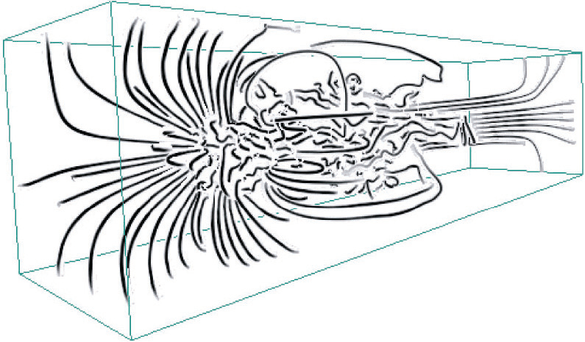

# 6.3.7 Benefits of 3D: Shape Perception

## When 3D pays

<!-- verbatim p.149 -->
> The great benefit of using 3D comes when the viewer's task fundamentally requires understanding the three-dimensional geometric structure of objects or scenes. In almost all of these cases, a 3D view with interactive navigation controls to set the 3D viewpoint will allow users to construct a useful mental model of dataset structure more quickly than simply using several 2D axis-aligned views. For these tasks, all of the costs of using 3D discussed above are outweighed by the benefit of helping the viewer build a mental model of the 3D geometry.
<!-- /verbatim -->

## Blueprints: the 2D counterpoint

- **2D views cost memory for shape.** People can be trained to read blueprints with a top view and two side views, but synthesising them into what a complex object looks like from an arbitrary viewpoint is difficult and incurs significant cognitive and memory load [p.149].
- **2D views win for sizes.** The 2D blueprint views are better for accurately discriminating the sizes of building elements, which is why construction still uses them heavily [p.149].
- **Evidence.** There is considerable experimental evidence that 3D outperforms 2D for shape understanding tasks [p.149].

## Typical cases

Most tasks with inherently 3D spatial data after abstraction fall into this category: fluid flow over an aeroplane wing, a medical tomography dataset of the human body, molecular interaction within a living cell [p.150]. In Figure 6.6's 3D streamlines of fluid flow, geometric navigation based on 3D rotation is a good strategy to help users understand the complex shapes quickly [p.150].

## Figures

-  **Figure 6.6** [p.150]. The use of 3D is well justified when the central task is shape understanding, as in this example of 3D streamline showing the patterns of fluid flow through a volume. From [Li and Shen 07, Figure 9].

## Related

- [8.5 Vector Fields: Multiple Values](../../ch08-arrange-spatial-data/s08-05-vector-fields-multiple-values/node.md): streamlines, discussed further there [p.150]
- [11.5 Navigate: Changing Viewpoint](../../ch11-manipulate-view/s11-05-navigate-changing-viewpoint.md): geometric navigation, discussed further there [p.150]
- [6.3.9 Empirical Evidence](s06-03-09-empirical-evidence.md): the studies on 3D for shape versus 2D for relative position [p.149]
- [8 Arrange Spatial Data](../../ch08-arrange-spatial-data/node.md): idioms for the inherently spatial data where 3D is justified [p.150]
